# The Broken March — WP09: Session 2

**Status:** Canonical campaign session document
**Consumes:** Campaign design doc (§4, §6, §29, §31.0, §33–§33.9); Canon Amendments — Session 1 Play; WP01–WP08; Session 1 Prep — Items (WP13 slice), Handouts (WP14 slice); post-session state BM-STATE-S01-POST-v6
**Feeds:** WP10 (Session 3), WP13, WP14, WP15, WP16
**Scope:** Session 2, from Day 2 Evening at the Sundered Cart to the end of Day 3 (with Day 4 spill-over), for a level 4 party of four.

This book runs Session 2 as it will actually be played: in the order the party said they would go. It is **not a script.** Every scene is a self-contained block. The deadlines fire whether the party is there or not, and every scene says what the world does without them. It deliberately leaves to WP10 the branch decision of the Red-Tusk, the moot vote on the quarry, and the Sentinel's first full appearance as a set-piece (WP09 only stages its Level 4 warning and the rules if contact happens anyway).

**How to read it.** One part per stage of prep:

1. **DM catch-up**: read on the bus.
2. **What the DM knows**: the hidden truths.
3. **What the players know**: so you don't leak.
4. **The session, scene by scene**: run from here at the table.
5. **Characters**: full sheets, linked from every scene.
6. **Loot**, 7. **End-of-session checklist**, 8. **Materials to make**.
9. **Appendix**: design decisions, changes to canon, worked examples, edge cases, final rules, handoffs, self-check.

Markers used throughout:

> 📜 **Read aloud.** Boxed text you read to the players.

> 👤 **Presentation box.** Who someone is in two lines, and how they feel about the party *now*.

> 🎲 **DM.** What is really going on.

> ⚠️ **Watch out.** A trap for the DM, not the players.

> ⏰ **Deadline.** Fires whatever the party does.

> 📘 **Definition.** A short card for a creature, item or place, so links never leave this page.

Tags: **[LORE]** published Forgotten Realms · **[ADAPTED]** Realms material, changed · **[CAMPAIGN]** invented for The Broken March.

---

# 1. DM Catch-up

## 1.1 Previously on *The Broken March*

> 📜 **Read aloud (the "previously on").** You came down from Waterdeep, heading for Daggerford, and stopped in a quarry village called Greybank because it has the only bridge for a day. You played for your beds. An old man on a bench became your biggest fan. The big one stole a hauler's beer. A trader called Serina started paying you for gossip. The foreman told the bard he had been inside a hole in his own quarry. Then the quarry wall came down on a man called Dov. You got him out. He lost the leg, but he lived. And then you went into the hole. Elvish names on the walls. A basin of dark water with six rings of light. Workshops full of stone tablets. A key that fit a socket, and a fourth ring that lit up when it went in. A blind thing in black water that you tricked. A huge stone door that you opened, and a long, long corridor behind it with a groove worn into the floor by something's feet. You looked. You backed away. You sold thirty tablets to Serina for three hundred gold. Now it is evening, the taproom is loud, and you have not slept since the night before last.

**[CAMPAIGN]** Everything above is canon from Session 1 play (`dm-session-record.md`).

## 1.2 Where everyone is right now (Day 2, Evening)

| Who | Where | Doing |
|---|---|---|
| **The party** (level 4) | **Sundered Cart (G3)**, north bank | Eating. ~75 gp each richer. The bard has 88 gp, has spent Cure Wounds and two Knocks. **Nobody has rested since Day 1 Night** |
| **Serina Malk** | Sundered Cart | Packing ~30 tablets into straw. Smiling |
| **Kael Durrow** | Moot Hall (G11), then the Pale | Has told the Reeve about the collapse and "the hole". Wants his cut |
| **Ondra Vell** | Moot Hall | Writing everything down. Wants the people who went inside |
| **Dov Marrek** | Maud's cottage (G22) | One leg. Alive. Fevered |
| **Bessa Ruddock** | The fold (G18), with two dogs and a lantern | Waiting for the next one |
| **Nissa Crake** | At her window by the Green | Listening |
| **Ib Sallow** | Charcoal camp (G20), far bank | Alone with a clamp. Has seen an elf |
| **Vaerelin** | Far bank, view of the quarry road | Waiting for the party to go back in |
| **Three Red-Tusk scouts** | Moving south off Stonecrop Rise | Coming to the fold tonight |
| **Threll's clerk** | On the Daggerford road, a day out | Coming with a strongbox and three contracts |
| **The Sentinel** | The Long Gallery (S10) | Walking. Same count. Every time |

## 1.3 What this session is about

**Three people are coming to Greybank to ask the party for something, and one thing is coming that cannot be asked anything.**

- **The elves** come to say *stop* (Vaerelin, once).
- **The goblins** come to say *we are hungry* (the envoy, once).
- **Daggerford** comes to say *sign here* (Threll's clerk, with three contracts).
- **The Sentinel** doesn't come at all. But **the door between it and the quarry is standing open**, and the party left it that way.

The party wants to look at **the tower**, see **the Reeve**, check **the charcoal man**, follow **goblin footprints**, and **go back into the ruins**. Every one of those paths walks into one of the four.

> **The session's lesson is "consequences branch".** The fold raid tonight, the envoy tomorrow and Vaerelin's warning are three choices the party makes with no right answer signalled. The world records what they chose. (Design doc §4, WP09 brief: *consequences branch; ignored threats advance.*)

## 1.4 The deadline strip (pin this)

| # | When | What fires | Where | Scene |
|---:|---|---|---|---|
| **1** | **Day 2 · Night** | **Fold raid**: three Red-Tusk scouts take a hen, rope and a wattle fence panel, and count who comes | G18 | [Scene 1](#scene-1-night-at-the-cart-and-the-fold-raid) |
| **2** | **Day 3 · Dawn** | **Bessa reports one last time**, or stops reporting | The Green (G10) | [Scene 2](#scene-2-dawn-with-bessa) |
| **3** | **Day 3 · Morning** | **Threll's clerk crosses Marrow Bridge** with a strongbox | G1 → G3 | [Scene 7](#scene-7-thrells-clerk-and-serinas-price-list) |
| **4** | **Day 3 · Morning** (off-screen) | **Red-Tusk food fails.** Clock → 2 | Kettlerock | [Part 2](#22-the-goblins-red-tusk) |
| **5** | **Day 3 · Afternoon** | **The goblin envoy walks up the Daggerford road to the bridge**, unarmed | G1 | [Scene 8](#scene-8-the-envoy-at-the-bridge) |
| **6** | **First time a PC heads to the Pale on Day 3** (else Day 3 Evening, on the bridge) | **Vaerelin's one warning** | G14 / G1 | [Scene 6](#scene-6-vaerelins-warning) |
| **7** | **Every watch, at the half-watch mark** | **The Sentinel turns on the S9 floor.** The leaf is open | S9 | [Scene 10](#scene-10-back-to-the-ruins) |
| **8** | **Day 3 · Night** | **Goblins take livestock** (stage 2) | G18 | [Scene 11](#scene-11-day-3-night-and-day-4-spill-over) |
| **9** | **Day 5 · Afternoon** | Envoy ignored for two days → **War +1** | — | [Scene 8](#scene-8-the-envoy-at-the-bridge) |

**Watches** (WP01): Dawn · Morning · Afternoon · Evening · Night · Deep Night. A **long rest is 2 watches**, a **short rest about ¼ watch**.

## 1.5 The dashboard you start from (state v6)

| Track | Value | Note |
|---|---:|---|
| Food | 4 | |
| Trade | 3 | Drops to **2** if the quarry is still stopped at the end of Day 3 (WP08 §3.4) |
| Defense | 2 | Prompt turnout **10** (Dov is off the roll) |
| Unity | 4 | |
| Greybank Rep | +2 | |
| Laughing Hollow Rep | +1 | |
| Red-Tusk Rep | −1 | |
| Daggerford Rep | 0 | |
| Greybank Reaction | 2 | Concern |
| **Laughing Hollow Intervention** | **3** | **Warning due.** Next sale or ignored warning → 4 |
| Red-Tusk Strategic | 1 | → 2 on Day 3 Morning, regardless |
| **Daggerford Commercial** | **3** | Opportunity: offers arrive |
| Illefarn Instability | 1 | Does not drop from the Anchor (ruling A2) |

**Infrastructure:** Quarry **Damaged** (lowest bench collapsed, aperture open, work stopped). Watchtower **Intact, unmanned at night**. Everything else Intact.
**Critical stock:** Healer's kits **2**. Everything else unchanged (Potion of Healing at the store 1, shrine 1; blasting powder 6).
**The site:** S1–S3, S6, S8, S10 Discovered · S4, S5 Accessible (Knock) · **S9 Accessible and OPEN (key B in the lock)** · S7 Unknown · System 1 **Active** (key A) · System 2 **Identified**, 4 of 6 rings lit · no breaches.

---

# 2. What the DM Knows

> ⚠️ **DM-only.** Nothing in this part is said out loud unless an NPC or an object in a scene says it.

## 2.1 The elves (Laughing Hollow)

**Clock 3 — Warning. Rep +1.** **[CAMPAIGN]**

- **They know** about the aperture, the anchor (they *felt* W3 light up), and the tablets leaving in Serina's straw. Nethra watched the party walk out of the Pale with full packs.
- **They want** the site closed and nothing carried out. Vaerelin will say so **once**, in person (Scene 6).
- **What he will say**, exactly (WP04 §5.5, stage 3): *"Do not open it further. Do not carry anything out. What you put into the stone, leave in the stone."*
- **What he will not say:** why. Ever, below stage 6.
- **The skipped beat:** the stage-2 mark was never seen. **It is still there**, cut into an alder at the charcoal camp (WP08 handoff; Scene 9). It is now trace evidence: *the elves tried to say this quietly first.*
- **What moves the clock:**

| Party does | Hollow clock | Hollow Rep |
|---|---|---|
| Sells or promises **any** Illefarn object to Serina or Threll (incl. key, cup, tools) | **→ 4** | — |
| Ignores the warning once: opens a new sector, touches a system, or carries an object out of the site | **→ 4** | — |
| Visibly complies: closes the S9 leaf **and leaves key B inside the site**, or returns an object | **→ 2** | +1 if they *tell* him |
| Pulls key A out of S3 (W3 goes dark) | **→ 4** (removal), and the elves read it as vandalism | −1 |
| Attacks a warden | **+1**, and something the party relies on is gone within two days (WP07 §4.5) | −1 |
| Kills Vaerelin | **→ 5 at once**; Nethra's position dies (WP04 §13.1) | → −3 |

- **Nethra** is not in a scene this session unless earned: **the first time the party keeps a promise to anyone where she can see it** (paying Durrow, letting the envoy go home, sitting with Ib), she moves +1 and **she watches harder**. She only *speaks* at Hollow Rep +2. See her sheet.
- **At stage 4** (if reached this session): wardens take back **one** Illefarn object per night from wherever it is. First target: **whatever the party carries.** Second: **Serina's crate** (if still in Greybank). They do **not** pull key A. **[CAMPAIGN decision, see Appendix A, D8]** They know the lit span is containment working.

## 2.2 The goblins (Red-Tusk)

**Clock 1 → 2 on Day 3 Morning. Rep −1.** **[CAMPAIGN]**

- **61 goblins at Kettlerock (Z16), 22 who can fight, 39 who can't.** **3 watches** away (12 miles, rough).
- **Tonight (Day 2 Night):** three scouts probe the fold. **Food and a count.** Their names are in the encounter (Scene 1); write down who survives.
- **Day 3 Morning:** the band's food fails. **Ghesh** wants to raid. **Orbal** sends an envoy over his objection (WP04 §8.2).
- **Day 3 Afternoon:** the envoy, **Nakka**, walks to Marrow Bridge. Unarmed, alone, daylight. She carries **one knotted cord** from Orbal's bundle as proof of who sent her. **[CAMPAIGN]**
- **Day 3 Night:** stage 2 means **livestock at the fold**: Ghesh's raiders take two sheep unless the fold is guarded.
- **What they know:** what drove them out. Ghesh's testimony: *"Something came at night. It did not hurry."* (Sentinel telegraph **Level 1**, WP07 §11.4.) Nakka can repeat it.
- **What they want:** food, and a place, before winter.
- **The branch count starts now** (WP04 §8.3). Track every point this session on the table in [Part 7](#7-end-of-session-checklist).

## 2.3 Daggerford

**Clock 3 — Opportunity. Rep 0.** **[CAMPAIGN]**

- **Threll's clerk, Osric Fenn**, arrives Day 3 Morning with two caravan guards and **three offers** (WP04 §7.3): supplies on credit against future stone, bridge repair money against a claim on the crossing, and road protection. Every one has a string. See Scene 7.
- **Threll wants** a supply contract and a commercial post. He would *love* a controllable ford (WP06 §6.4) and must never hear about the Transit Ring.
- **Serina Malk** puts her **price list on paper** this session (ruling A6). She is still in Greybank until Day 4 Dawn, then rides for Daggerford with the crate.
- **The tablets:** Serina's ~30 tablets reach Daggerford around **Day 5**. Her translator needs "a few days" more. **Nothing happens from this in Session 2.** WP10 owns what the city learns.
- **Every sale** to either buyer from now: **Daggerford clock +1 and Hollow clock +1** (WP04 §7.3, A6).
- **Accepting any Threll offer: Daggerford → 4 (Investment).** Trade +1 when the goods arrive (2 days later), plus the claim.

## 2.4 The village (Greybank)

- **Ondra** has Durrow's account, which is half wrong ("a large room"). She wants a written list from the party: who went in, what came out, where it went.
- **The quarry politics** (WP08 §6.2, session-2 row): Durrow wants **expansion** to pay the crew through winter. Enna and Ondra want **shoring** first. **Ondra calls a moot for Day 4 Evening.** The vote is WP10's.
- **Durrow** heard about the 300 gp. He wants **a tenth: 30 gp.** He will not ask twice in public. He will ask once in private.
- **Vadd** still hasn't fetched the charcoal and is still sore at Biggy.
- **Old Tarn** is telling everyone about the generous cat (inaccurately: the gold coin is now "a fistful").
- **The tower is manned Dawn to Evening and empty at night.** Manning it at night is **free at Unity 4** with the Reeve's agreement (WP02 §15.3).

## 2.5 The dungeon right now

**[CAMPAIGN, on ADAPTED Illefarn foundations]**

### The open path

**Key A in S3** holds the Anchor on and **the S5 leaf open**. **Key B in S9** holds **the S9 leaf open**. So **nothing is shut between the quarry ramp (S1) and the Long Gallery (S10).** Not a breach: pull either key and its leaf drops shut again.

> 📘 **resonance key** · *item, WP06 §5.2*
> Palm-sized, jointless stone, always blood-warm. **Each key is tuned to one span of the ward line, not to a door.** Three in the site (key A, key B, the S11 key), one held by the elves. Serina pays 60 gp.

> 📘 **the warden's kit** · *item, S2*
> A warden's kit left under a bench in the Muster Floor. **In this campaign it was found empty**: its key had been carried down to S8 by the dead warden, and is now key B (ruling B12).

### The Sentinel and the open leaf (ruling for this session)

WP06's patrol rules, applied:

1. **Its circuit does not change.** The goblins call it the Counter: same path, same steps. **It comes down S10 and turns on the S9 floor**, the grooved turning floor at the gallery mouth. **Once per watch, at the half-watch mark.** Deterministic: never roll for it.
2. **An open leaf holds nothing** (WP06 §11.2). It walks the circuit; it does not wander through. **But** its presence-sense is 120 ft. **The S6 records room is the chamber with the S9 door in it, and it is inside that range from the turning floor.** Anyone in the S6 records room (or in S9 itself) when it turns is **an incursion in its sector**: posture 1, warning (WP07 §11.2).
3. **Then nothing stops it.** It can follow **through S6 → S5 (open, key A) → S2 → up S1**. It stops at the aperture mouth and turns back, because at Instability 1 it never leaves the tunnels (Canon Amendments §1).
4. **It does not enter S7 or S8**: the race and the flooded stair are not on its circuit, and it never pursues into water (WP06 §11.1 the Listener's ground). **[CAMPAIGN]**
5. **The S6 stone-shop and metal-shop are out of range.** Only the records room and S9 are hot.

**What this means at the table:** reading the tablets for a full watch in the records room **means one pass, guaranteed.** The party can read safely by **closing the S9 leaf first** (pull key B), or by **reading in two half-watch shifts** timed to the sound, or by **carrying tablets into the stone-shop** to read (which is "carrying out" of nothing: they're still in the site).

### The Level 4 warning (staged before any contact)

Level 3 is already delivered: Allino saw the groove an inch deep (E0041). **Level 4 is the sound.** The Long Gallery is dead straight and stone, so sound carries:

- **10 minutes before the turn**, anyone in S6 hears a **slow, even grind**: stone on stone, one beat every two seconds, never faster, never slower, **getting louder**.
- **2 minutes before**, it is loud enough to feel through boots in the records room. Dust drifts off the racks.
- **At the turn**, from S6 they see the S9 floor **rotate** a quarter turn under something tall in the gallery mouth. Then the grind fades the other way.

If anyone is in the records room or S9 **at the turn**: it stops. It faces them. **One round of grace at 30 ft.** (WP07 §11.2, posture 1). See Scene 10.

### The tablets — what's actually left in S6 (correcting "depleted")

Session 1 evidence: the records room is **"racks like books in a library"**; the bard carried **10** tablets out; the party sold **~30** in total. **The archive is not empty. It is about a fifth gone.** **[CAMPAIGN ruling, Appendix A, D1]**

| Record set | Still in S6? |
|---|---|
| What the Marrowward is for · the line's design | **Yes**, complete |
| The old roster | Yes |
| **The Sentinel maintenance register** (Level 2 telegraph) | **Yes** |
| **The forms of authorisation** (WP06 §5.3 route 2) | **Yes** |
| **The Deterrent Chain sequence** | **Gap.** The middle third is in Serina's crate |

A party that reads for a watch learns everything except the full Chain sequence. Running the Chain with a gap is "run badly" (**Instability +1**, WP06 §6.6) unless they get those tablets back from Serina (buy back at her price, 20 gp each, or steal).

### S7, the Sluice Hall (opens off S8)

Not seen yet. Ruling B11: **S7 opens off S8**, keeps its overflow shaft to the quarry's lowest bench and its water control. Reaching it: from S8's top landing, along the dry upper step and through an arch **above** the waterline: **the Listener can feel that step.** Full scene in Scene 10.

### The second sealed door off S5: the Lock-keeper's Cell

**Defined here. Part of S5, not a new sector.** **[CAMPAIGN]**

A narrow door in the S5 wall, on the **Stage I side** of the leaf. **Barred from inside** and sealed with the same cut-name magic as the other doors. Key A's span opened the leaf, not this door: the lock-keeper barred it by hand.

- **Ways in:** **Knock** (bard; counts as Accessible, Canon Amendments §3) · **force it**: DC 18 Strength, and the bar shears off: **that breaks the cell's lock-bar for good** (see below) · **any resonance key** pressed to the seal *and* someone lifting the bar from inside: impossible, so in practice Knock or force.
- **Inside:** a cell eight feet square. A stone stool. **A skeleton in warden's gear, sitting with its back to the door**, facing a lever in the wall. A tablet on its knees. A lamp-stone, dead.
- **The lever is the S5 lock-bar.** Pull it down and **a stone bar drops across the S5 leaf, wedging it shut, even with key A still in S3.** Lift it and the key holds the leaf open again. **This is a second way to seal the Sentinel out of Stage I without darkening W3.** It works from the cell side only (Stage I side).
- **The tablet on his knees** is a lock-keeper's log. Its last line, in cut names (the bard's Sylvan won't read it, Elvish might with DC 15 Intelligence, or a watch with the S6 roster): *"It is walking the Stage I side now. Leaf barred. I stay."* **Level 2 telegraph, and a gut-punch.**
- **Status:** opening it by Knock: S5 stays **Accessible**. Forcing it: S5 stays Accessible but **the lock-bar is broken: the seal option is gone forever.**

### The Listener

In S8. **Unharmed. Has met the party once.** It has **not** changed its habits (they tricked it, they didn't hurt it, WP07 §4.5). Serina knows it is blind and hunts by stone. Nobody else outside the party does.

---

## 2.6 The ward line: the six posts

**[CAMPAIGN, on ADAPTED Illefarn foundations]** Canon Amendments §1–§2. The chain runs Kettlerock Gate (Z17) → W4 → W3 → W1 → W2 → W5 → W6. A span works only if its post is alive **and** the Ward Heart feeds it. **Walking over the line does nothing.**

| Post | Where | State now | By touch, and in the Watch-Glass (D15) | Who can wreck it |
|---|---|---|---|---|
| **W1** | The tower's lower 22 ft (G13) | **Alive, failing** | Pulses: warm, cool, warm. Its ring flickers | Blasting powder only (WP02 §14.8) |
| **W2** | The shrine's foundation course (G9) | **Alive, failing** | Pulses. Its ring flickers | Hard: it's under a building people pray in |
| **W3** | The burial ground's north wall (G19) | **Dead post, lit by key A in S3** (counts, ruling A2) | **Steady warm since Day 2** | Pull key A and it goes dark |
| **W4** | A standing stone on Stonecrop Rise (Z7) | **Dead** | Cold | Anyone with a hammer; no state change now, but its span can never come back |
| **W5** | Under the turf at Wend's Barrow (Z14) | **Dead** | Cold | Digging it out |
| **W6** | In the Hollowmarch (Z15) | **Alive, tended by the elves** | Warm | Only by going through the elves |

**4 of 6 count** toward the Ward Heart (needs ≥3): W1, W2, W3 (keyed), W6. **Two destroyed posts and the good ending is gone** (WP06 §13).

> 📘 **The Ward Heart** · *sector S15, Stage IV*
> The "fuse box" deep under the line that powers every span. **The good ending needs:** at least 3 living spans, the Anchor done right (done), the elves' W6 kept alive, the Sentinel's map corrected, and a full uninterrupted watch here. Forcing its door: Instability → 5.

> 📘 **The Sentinel's Walk** · *sector S14, Stage IV*
> The Sentinel's second patrol ground, deep in Stage IV, and where its **authorisation register** (System 6) can be claimed or corrected. **Correcting it is the real answer to the Sentinel.**

> 📘 **The Broken Quarter** · *sector S16, Stage IV*
> Where three spans failed: collapsed stone, rubble, daylight at the top and cold air coming down. **The hole in the fence, open onto Hagsfoot Moor.** The Moorgaunt's ground. Killing the Moorgaunt does not close it.

---

# 3. What the Players Know

> ⚠️ **Player-safe.** Use this to check yourself before you answer a question. If it isn't here or in a scene they played, they don't know it.

## 3.1 Shared knowledge (all four PCs)

- Greybank is a poor quarry village with one bridge. The Reeve runs it. The quarry is shut after the collapse.
- Something takes sheep at the fold. They found **goblin tracks** *and* **signs of something big**. They don't know which is which.
- **Under the quarry** there are ancient rooms with elvish names. A **basin with six rings**: three were dark, now **four are lit** since they put a key in a socket. Pulling the key **re-locks a door and darkens a ring** (Allino tested it).
- There's a **blind thing in the water** on a stair. It reacts to steps on stone.
- They opened a big door with a second key and **left that key in the lock**. Behind it is a **long, dead-straight gallery** with a **groove an inch deep** worn by feet.
- The **workshops** have racks of stone tablets. They took some and sold ~30 to Serina for ~300 gp. **Translations in "a few days."**
- **Serina's deal:** 5 gp per lead, a "fat cut" for magic artefacts, a letter of recommendation if the information is good.
- They **promised Durrow a share** of anything found. They haven't paid.
- They **told Old Tarn** to pass on news.
- **They think** the tower is just an old watchtower. The bard noticed it's the **same stone** as the socket room.
- **They do not know:** the word *waystone*, the ward line, that the tower, shrine and burial wall are posts of a fence, that the Sentinel exists as a *thing*, that elves are watching, or that goblins are refugees.

## 3.2 Private knowledge, one line per PC

| PC | Knows privately |
|---|---|
| **Howling Matza** (the cat-folk bard) | Durrow's private story: he went in "last night", "a large room", felt the air move. **Her own notes show the bootprints turned back at ten feet.** The contradiction is on her page. Wrote verses: *"Darkness and shadows in elven stone hall…"* |
| **Bar.D.Sync** | He's **Serina's main contact** (sold her the ruins lead for 5 gp). Vadd gave him **directions to the charcoal camp**. He called Nissa "brother". Took odd tools from S6. Tried to turn a ring in the basin: it didn't move |
| **Allino** | **Personally found** the moved-and-replaced stones and the clear goblin tracks at the fold: best placed to follow the trail. **Saw clearly the stair-thing is blind.** Noticed the gallery wear turning into two tracks, then the groove |
| **Biggy Smalls** | Lifted the slab off Dov: **the quarry crew saw it.** Hauled the warden body past the creature. **Swept a workshop table into his pack**: unidentified odds and ends. Vadd hates **him** specifically. Wants to build bed frames and **sleep in the tower** |

---

# 4. The Session, Scene by Scene

**The likely order**, from what the players said:

1. Night at the Cart and the fold raid (everyone sleeps)
2. Dawn with Bessa
3. **The Tower** (everyone)
4. The Reeve (the bard first; maybe all)
5. The Street: smithy, wright, herbwife (Biggy's tools, Ordga's line, Dov)
6. *(floating)* Vaerelin's warning: the moment anyone heads for the Pale
7. Threll's clerk and Serina's price list (the Cart, any time from Day 3 Morning)
8. The envoy at the bridge (Day 3 Afternoon)
9. The far bank and the goblin trail (Bar.D.Sync, Biggy, Allino)
10. Back to the ruins (Allino, Biggy)
11. Day 3 Night and Day 4 spill-over

> 🎲 **DM.** If the party splits (they will), run scenes in **watch order** and cut between groups at each watch. Nobody is in two places in the same watch. Scenes 6, 7 and 8 come to the party wherever it is; the rest wait for the party.

---

## Scene 1: Night at the Cart and the fold raid

> ⚠️ **As played:** the party fought the raid. They killed two scouts and incapacitated the third, carried him up to the Cart, and he fled wounded to Kettlerock. See [As played](#as-played).

**When / where:** Day 2 · Evening → Night → Deep Night. **Sundered Cart (G3)**; the **fold (G18)**, 260 yards west, outside the ring.
**Fires here:** ⏰ Deadline 1.

> ⏰ **Deadline 1 — The fold raid (Day 2 · Night).** Three Red-Tusk scouts come over the fold wall where the stones are loose. They take a hen, a coil of rope and a wattle fence panel, and **they count how many people come running.** This happens wherever the party is. (WP08 §8.1)

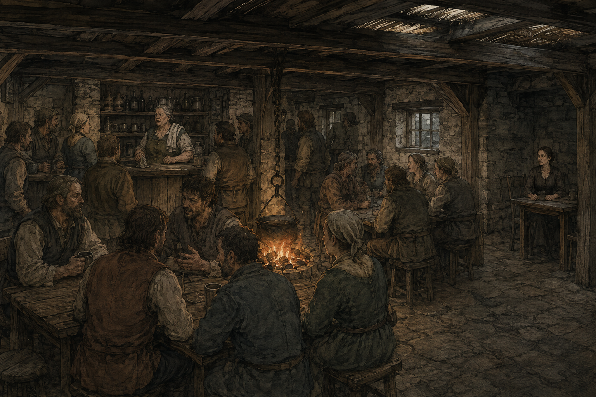

> 📜 **Read aloud (Evening, the Cart).** The common room is hot and loud and smells of wet wool. The quarry men are drinking again tonight: not like heroes, like men who still have jobs for one more day. Somebody has started a song about a man under a rock, and it is not kind to the rock. Rosal is everywhere at once with a cloth on her shoulder. In the corner, Serina is packing stone tablets into a crate of straw, one at a time, the way you'd pack eggs. Upstairs there are four pallets, and they are yours tonight.

**Who's here**

> 👤 **[Rosal Tunn](#rosal-tunn)** · *Taproom keeper (G3)*
> Sixties, broad, a cloth on one shoulder that never comes off. Talks *at* you while she works and never stops.
> **Now:** Friendly. Paid the party's gig in free beds, dinner and 5 cp. Her room was full last night because of them, and that's all she wants in life.

> 👤 **[Serina Malk](#serina-malk)** · *Collector's agent*
> Thirties, travels alone, hands always still and visible. Names one price and lets the silence work.
> **Now:** Neutral, and she never moves. Bought ~30 tablets for ~300 gp. Knows the water-thing is blind. Bar.D.Sync is her main contact.

> 👤 **[Vadd Brune](#vadd-brune)** · *Dwarf hauler, Ordga's cousin*
> Young, strong, bored. Agrees with you, then does what he was going to do anyway.
> **Now:** **Wary toward Biggy** (the stolen beer); Neutral to everyone else. Still hasn't fetched the charcoal.

> 👤 **[Old Tarn](#old-tarn)** · *Old man, watches the Green all day*
> Sees everything. Reports it wrong. Hates Maud on principle and visits her anyway.
> **Now:** **Friendly, a fan.** Got 1 gp from the bard and now tells everyone it was "a fistful of gold".

> 👤 **[Nissa Crake](#nissa-crake)** · *Halfling bell-warden. She/her.*
> Thirties, always cold, sleeps in her clothes. Asks "did you hear that?" about things nobody heard.
> **Now:** **Friendly for good.** The party believed her about the fold. Bar.D.Sync called her "brother"; she'll correct him, once, and then let it stand.

**What's going on (DM)**

- **The party is exhausted.** Nobody has slept since Day 1. Rule: **a long rest is 2 watches.** Sleeping Night + Deep Night means they wake at **Day 3 Dawn**, rested, at level 4, spells back (incl. Knock).
- **If they sleep, they miss the raid.** That's fine and expected (WP08 §8.1). Nissa hears it and nobody cares.
- **If anyone keeps watch**, they had their own goblin warning, so it's plausible. A PC on watch at the Cart **hears Bessa's dogs** at Night, far off. A PC who goes to the fold gets the encounter below.
- **Biggy wants to sleep in the tower.** The tower is **empty at night** (WP02 §14.8). From the tower top, with darkvision (60 ft), you **can't see** the fold (260+ yards away, dark), but you **hear the dogs** and a short scuffle. The tower is the best listening post in the village. Nobody stops him going up; Alys Penn (militia) finds him there at Dawn and is not pleased.
- **Serina** offers one more deal before bed (Scene 7 covers her price list). She leaves Day 4 Dawn.

**Checks and DCs**

| Check | DC | Result |
|---|---:|---|
| Hear the dogs from the Cart (on watch) | Perception 13 | Barking, then a yelp, then silence, from the west |
| Hear it from the tower top | Perception 10 | Barking, stones rattling, something running |
| Reach the fold before they leave | — | **From the Cart: 4 rounds after the barking starts they're gone.** From the tower: same. **Only someone already at the fold meets them** |
| Spot scouts at the fold in the dark | Perception vs their Stealth +7 | They're in the byre doorway; one is on the wall |

**Clues left behind (found at Dawn, no check):** stones moved and **put back badly** (same hand as Day 1); **the hen, a coil of rope and a wattle fence panel gone**; small bare footprints going **north**, uphill toward Stonecrop Rise; **nothing dragged**. A dog has a cut ear from a thrown stone.

**Encounter: The fold probe** (WP07 §6.5, placement WP08 §8)

> 🎲 **DM.** Only runs if a PC is **at the fold** on the Night watch. Three scouts. **Their names are Tikk, Brusk and Ozz.** Tikk speaks about six words of Common, and one of them is *"hungry."* **[CAMPAIGN]** Write down who escapes.

| # | Field | |
|---:|---|---|
| **1** | Conventional difficulty | **Type A, fair.** Three scouts (AC 14, 10 hp, shortsword/shortbow +5, 1d6+3) vs four level 4 PCs: easy. **That is not why it's here** |
| **2** | Why brute force is costly | Killing any: **Red-Tusk Rep −2, War +1** per incident in the branch count (WP04 §8.3), and the survivor reports to Ghesh. **The party never learns they made a choice** |
| **3** | Telegraphing | L1: dogs unsettled two nights (Day 1). L2: goblin tracks the party found themselves. L3: none needed (not lethal). L4: three small shapes in the byre doorway, freezing when they're seen |
| **4** | Weakness, how found | **They want food, not a fight.** *Watch them*: they take a hen and look at the cott, not the people. *Ask Bessa*: "they never take more than they can carry" |
| **5** | Alternatives | **Let them take the hen and go** · **Talk** (Tikk: "Hungry. Many hungry. Go.") · **Give them more food** · **Capture one** · Chase them off without blood |
| **6** | Failure | If they're spotted and **nobody comes**, they report "the fold is slow." Next raid (Day 3 Night) is bolder |
| **7** | Reward | A live goblin is **the fastest route to Orbal** (WP07 §4.6). Talking gets the first word of the Red-Tusk story |
| **8** | World-state impact | See the outcome table below |

**Stat block:** Red-Tusk Scout ×3 (WP07 §6.2; the guide's reference page has it). **Sent to Look, Not to Fight:** each withdraws below half hp, no morale roll. Nimble Escape every turn.

> 📘 **Red-Tusk Scout** · *creature, WP07 §6.2*
> Small goblin, sent to look, not to fight. **AC 14 · HP 10 · Speed 30 ft.** Stealth +7, darkvision 60 ft., passive Perception 13.
> **Shortsword / shortbow** +5, 1d6+3. **Nimble Escape:** Disengage or Hide as a bonus action.
> **Leaves at once below half HP**, no morale roll. Getting away is its whole job.

| Outcome | State change (WP08 §8.3) |
|---|---|
| **Let them take the hen and go** | **Red-Tusk Rep −1 → 0.** They report "the fold is watched now." Ghesh notes it |
| **Drive them off, no blood** | Nothing now. **They'll be back** and Day 3 Night hits the farms (H32–34) instead of the fold |
| **Talk to them** | **Red-Tusk Rep +1** (→ 0). Orbal hears of it. **Compact +1** in the count if food is offered. **Allino speaks Goblin**: with him there it's a real conversation, not six words. They'll tell him the band is starving and the rock in the north is "full of the little ones" |
| **Kill one or more** | **Red-Tusk Rep −2** (→ −3). **War +1.** The survivor reports. **Ghesh counts** |
| **Capture one** | **Compact +1.** The prisoner goes to the Moot Hall store room. **Unity −1 if held past three days** (WP07 §4.6) |
| **Nobody comes (party asleep)** | The hen, rope and fence panel are gone. **No state change.** Nissa tells the party at Dawn and nobody else listened |

**Loot here:** nothing. If a scout is killed: a shortsword, a shortbow, 8 arrows, a hide shield, and **a twist of dried mushrooms**: the last food they had. *(Let that land.)*

**Consequences:** see the table. Plus **Nissa**: if the party believes her again at Dawn, nothing changes (she's already Friendly forever), but she **brings them the next thing she hears first.**

**If they skip this (sleep):** the expected path. **Deadline 2** happens at Dawn with the news.

**Alternatives**

- **Split the party:** one PC at the fold, three asleep. The lone PC meets three scouts in the dark. Still fair. Still nobody dies (WP04 §6.2: probes are survivable for both sides).
- **Violence in the Cart** (Biggy and Vadd again): Rosal goes **Wary** and tells the Reeve. Vadd will not throw a punch first; he'll tell Ordga.
- **Sell to Serina tonight:** see Scene 7. **Any sale now pushes the Hollow to 4 before Vaerelin has even spoken**, and he skips straight to stage 4 behaviour (he still delivers his one sentence, *after* the first theft, as an explanation, not a warning).

---

## Scene 2: Dawn with Bessa

> ⚠️ **As played:** the party left on Day 3 Morning and did not meet Bessa's report. See [As played](#as-played).

**When / where:** Day 3 · Dawn. **The Green (G10)** by the bell post; then the **fold (G18)**.
**Fires here:** ⏰ Deadline 2.

> ⏰ **Deadline 2 — Bessa reports, one last time (Day 3 · Dawn).** Bessa comes to the Green with her slate. She tells whoever is there. **If nobody comes to the fold with her by the end of Morning, she stops reporting for good** and guards it alone, at night, from now on. (WP08 §8.4)

> 📜 **Read aloud.** The mist is still on the river. A woman with a sun-cracked face is standing by the bell post with two black-and-white dogs sitting at her feet like statues. She's holding a slate with chalk marks on it: four strokes, then a fifth, fresh. She isn't shouting. She's just standing there, saying the same thing to every person who walks past, and every person walks past. One of the dogs has a torn ear.

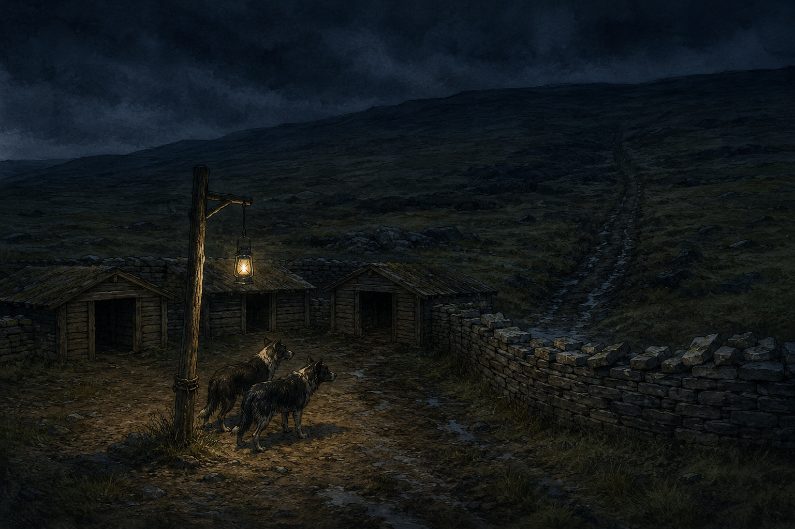

**Who's here**

> 👤 **[Bessa Ruddock](#bessa-ruddock)** · *Head shepherd (G18)*
> Fifties, two dogs smarter than the militia. Talks to people like she talks to dogs: short, clear, not unkind.
> **Now:** **Not met yet.** Neutral. Has reported four times and been ignored four times.

> 👤 **[Nissa Crake](#nissa-crake)** · *Bell-warden*
> **Now:** Friendly. Heard the whole raid from her window and **comes straight to the party**, not to anyone else.

> 👤 **[Old Tarn](#old-tarn)** · *On his bench already*
> **Now:** Friendly. Saw "six goblins, big ones, with torches." (There were three, no torches.)

**What's going on (DM)**

- Bessa says: *"Hen. Rope. A fence panel. Three of them, small, quick. They go through the wall, not over it. Something else goes over it. That one comes every third night. It's due tomorrow night."* **The fifth stroke on the slate is the hen.**
- **The Moorgaunt has stopped coming, but nobody can tell yet.** Its last kill was Day 1 Night (the dragged ewe). Its rhythm is one kill, then three quiet nights, so it isn't due until Day 4 Night. **With the Anchor on (Z4 Sign, WP06 §6.2) it won't come.** Bessa notices on Day 5 Dawn. Only a party that connects it to the key will know why.
- **What she wants:** someone to walk to the fold with her and *look*. That's it.

**Checks and DCs:** none needed. At the fold, in daylight, everything in Scene 1's clue list is visible with **no check**. **Allino** (Survival or just his experience from Day 1): the goblin trail is **clear and fresh, heading north to Stonecrop Rise** (Scene 9B).

> 📘 **The Moorgaunt** · *creature, WP07 §9*
> The big thing that drags sheep. A starving moor predator. **AC 14 · HP 76 · Speed 40 ft.**
> Bite +7 (2d10+4, grabs and drags) and claws +7 (2d6+4).
> **Rhythm:** kills, drags the body to a cache, eats for three nights, then hunts again. **Won't enter the Long Gallery.**
> **Now:** the Anchor keeps it off Greybank's land (Z4 at Sign), but nobody knows that yet.

> 📘 **Bessa's slate** · *handout*
> A shepherd's slate with chalk tally strokes, old counts half wiped. Four strokes, then a fifth: the hen. **The rhythm on it is the clue:** goblins most nights, the big thing every third night.

**Clues:** the slate (rhythm: the big thing comes every third night, last on Day 1 Night; goblins came three of the last five nights). **The top course of the wall is broken in one place and old**; the moved stones are fresh.

**Loot here:** none. **Bessa's slate** is a handout (WP14 slice, existing).

**Consequences**

| Party does | Effect |
|---|---|
| Walks to the fold with her | **Bessa → Friendly.** She keeps reporting. She tells them "they never take more than they can carry" |
| Helps move the flock inside the ring for a tenday | **Bessa Friendly.** Day 3 Night's raid finds nothing at the fold and **goes to the outlying farms (H32–34) instead.** No Food loss from the fold this session |
| Listens, then leaves | Bessa stays Neutral. **She reports once more, on Day 4, and then stops** |
| Nobody talks to her by end of Morning | **She stops reporting.** Guards the fold alone at night. **Her death becomes possible from Day 3 Night** (Scene 11) |

**If they skip this:** she stops reporting. WP03's death row goes live: **Food −1** and the fold's early warning gone if she dies.

**Alternatives:** **Biggy or Allino stays at the fold on Day 3 Night** (Scene 11): the stage-2 raid meets them. **Tell the Reeve**: Ondra writes it down and does nothing today (she has the quarry to deal with).

---

## Scene 3: The Tower

**When / where:** Day 3 · Morning. **The Tower (G13)**, on the knoll north of the village, above **the burial ground (G19)**. ¼ watch's walk from the Green.
**Fires here:** **WP08 §9.7 obligation 1**: *"this stone is ancient, leave it alone"* **must land here, before anyone holds a hammer.**

> 📜 **Read aloud.** The tower stands on a knoll above the graveyard, thirty feet of it. The bottom two-thirds is pale stone, so smooth you can't see where one block ends and the next begins. The top is crooked village work: rough grey courses, a shingle roof, a ladder poking out of a hatch. A young woman with a spear is leaning in the doorway, bored. Below, behind a low wall of the *same* seamless stone, an old man in plain clothes is pulling weeds off a grave, very slowly.

> 📜 **Read aloud (inside).** It's cooler in here than it should be. The inside wall is the same pale stone, and it curves without a single joint, like the inside of a shell. At chest height there's a shallow dip worn into the stone, the size of a palm. It is not quite warm. A ladder goes up through the villagers' floor to the roof.

**Who's here**

> 👤 **[Yorrin Fell](#yorrin-fell)** · *Lay-keeper of the shrine. Casts nothing, ever.*
> Sixties, thin, grain-stained hands. Speaks slowly and leaves silences you rush to fill.
> **Now:** **Not met yet.** Neutral. Weeding graves in G19, twenty yards below the tower.

> 👤 **[Alys Penn](#alys-penn)** · *Militia, on tower duty*
> First to every muster; nobody has ever thanked her. **If Biggy slept up here, she found him at Dawn.**
> **Now:** Not met. Neutral.

> 👤 **[Ordga Brune](#ordga-brune)** · *Dwarf smith* (only if someone fetches her, or brings a tool to the stone)
> Burn scar up one arm, tests welds with her thumb. Never says "probably."
> **Now:** **Not met yet.** Wary.

**What's going on (DM)**

**[ADAPTED: Illefarn masonry]** The tower's lower 22 ft is **waystone W1**: a living post of the ward line, **failing but alive.** The palm-dip inside is its **anchor recess**, like the one in the Anchor Room (S3), but smaller. **It is not a lock and no key fits it.** **[CAMPAIGN ruling, Appendix A, D9]** It's warm because W1 is alive.

**How anyone can tell W1 is failing** **[CAMPAIGN ruling, Appendix A, D15]**. Nobody tells them. They can **feel** it:

- **The palm-dip's warmth comes and goes.** Keep a hand on it for a minute: warm for a few breaths, then cool, then warm again, like a weak pulse.
- **Compare it with the burial-ground wall below (W3).** That wall has been **steadily warm since yesterday afternoon**, when key A went into S3. Yorrin noticed: *"Wall's been warm since yesterday. Never was before. Thought it was the sun."*
- **Compare it with W4 on Stonecrop Rise** (Scene 9B): **stone cold.** Dead.
- So the party can line up three posts: **cold (dead), pulsing (failing), steady (powered by the key).** That's the whole lesson of the ward line, learned by touch, with no lore dump.
- **The Watch-Glass agrees, if they look closely.** Nothing about it has changed since Session 1. But anyone who sits and watches the basin for a few minutes sees **two of the four lit rings flicker faintly** (W1 and W2). It was always like that; nobody stayed long enough to see it.

**The warning, guaranteed.** The moment anyone **touches the stone, compares it to the ruins, or asks Alys about it**, Yorrin straightens up and calls out (WP08 §5.3):

> *"That's older than the village. Older than the wood we put on it. It holds the corner up and it has never asked anything of anybody, so we leave it be."*

He's **untroubled**. That's the point. A calm man saying "ancient and load-bearing" lands harder than a shout. If they ask what "corner": *"Of the village. The shrine has the same stone underneath. So does that wall."* He points at the burial-ground wall he's leaning on. **That's three of the six posts named in one breath, and he doesn't know it.**

**The other two voices** (they disagree, and that's good):

| Who | Where | Says |
|---|---|---|
| **Halvard Vell** | Moot Hall fire (Scene 4) | *"Those stones were here before the village. My grandfather's rule: build on them, never cut them. Ninety years, and nobody has."* |
| **Ordga Brune** | The smithy, or here if fetched | *"No chisel makes that cut. I've said it twice. Look at it. Look!"* She wants it studied. **Best free lead into the ruins in the village** |

**Checks and DCs**

| Check | DC | Result |
|---|---:|---|
| Spot that the tower stone = ruins stone | **none** | Automatic for the bard (she already noticed) and anyone who was in S3 |
| Find the palm-dip | Investigation 10, or just going inside | It's at chest height. Not hidden |
| Feel that it's warm | none | Faintly, like a stone in the sun, but it's in shade |
| Notice the warmth comes and goes | Hand on it for a minute, no check; or Perception 12 in passing | **Failing.** A slow, uneven pulse |
| Notice the burial wall is warmer, and steady | Touch it, no check | Steady warmth. Yorrin: "Since yesterday." (That's when key A went in) |
| Arcana on the stone | 15 | "Old abjuration. Very old, very big. You can't feel the edges of it." **That is all.** No school detail beyond abjuration |
| History | 15 | Elven work of the Illefarn era is said to be jointless. **[LORE]** Illefarn was an ancient elven realm around this coast |
| Compare to the Watch-Glass memory | Intelligence 12 | "Four lights lit. One for each place like this?" *(Player theory, not confirmed)* |

**Allino is extremely superstitious** (his sheet's flaw). A stone that's warm in the shade and pulses like a heartbeat is exactly the kind of thing he won't touch twice. Play it up.

**Clues:** the same stone in **three places in the village** (tower, shrine foundation, burial wall). The palm-dip is **worn**, like hands touched it for centuries. From the tower top: you can see the **Pale**, the **fold**, the **Daggerford road**, the river, and, on clear days, **a thread of smoke far north** (Kettlerock: the goblins). Pointing at the smoke, Alys says: *"Charcoal burners, probably."* (Wrong.)

> 📘 **The Watch-Glass** · *item, in S4*
> A stone basin of dark liquid showing **six rings of light**, one per waystone. **Four lit now** (W1, W2, W3, W6). **Watch it for a few minutes and the W1 and W2 rings flicker faintly** (failing; D15). It only shows; it does nothing else.
> Serina offers 200 gp. **Selling it leaves the party blind to the ward line for good.**

**Encounter:** none. **The only way to "fight" here is a hammer, and that is the most expensive act in the campaign.**

**Loot here:** none. The waystones are never lootable (WP13 brief).

**Consequences**

| Party does | State change |
|---|---|
| Listens to Yorrin, asks about the shrine | **Yorrin → Friendly** if they're polite about the dead. Opens the shrine-potion conversation later |
| Proposes manning the tower at night (WP02 §15.3) to the Reeve | **Free at Unity 4**, needs Ondra's yes and 4 volunteers. Tower → **manned continuously.** The village now **sees things at night** (the Day 3 Night raid is spotted; bell rings before contact) |
| Biggy builds a bed up there | Alys complains to Berrick. **Harmless.** Biggy has a perfect night watch post if they man the tower |
| Chips, digs or hammers the ancient courses | **Breach: waystone damaged.** See the hammer box below |

> ⚠️ **The hammer.** The ancient 22 ft **can't realistically be destroyed** without blasting powder (WP02 §14.8). A chisel or a Rune Knight's punch **marks it and does nothing else**: no state change, but Yorrin sees, and goes **Wary**, and **Greybank Rep −1** if it's done in public. **Blasting powder on W1** = waystone destroyed: **W1's span dies forever**, 3 of 6 left (W2, W3 while keyed, W6), **one more and the good ending is gone** (WP06 §13). **Hollow clock → 4 at once, and it can never drop below 3 again** (WP01 §6.2: some destructive acts block the way back; **[CAMPAIGN ruling, Appendix A, D16]**).

> 🎲 **DM.** **Before the fuse is lit, remind the player in one sentence:** *"Yorrin told you this stone holds the village's corner up. You're about to blow up the base of the tower."* It's not a threat. It makes sure the player remembers what their character heard. **If they still light it, it's theirs.**

> 📘 **blasting powder** · *critical stock, the quarry*
> **Six charges** in the quarry's powder store, kept by Durrow. The only thing in Greybank that can drop a pier, a quarry face, or the ancient base of the tower. Taking it is a serious crime.

**If they skip this:** the warning is **still owed.** Deliver it through **Ordga** (anyone visiting the smithy, Biggy wants tools) or **Halvard** (Scene 4). **The obligation is: before anyone holds a hammer near any post.**

**Alternatives**

- **Split party:** the tower scene runs for whoever goes. Yorrin's line is said once; whoever heard it, heard it.
- **Biggy wants to sleep / build here:** he needs **Enna Fisk** (wright, carpentry; she whistles: **Bar.D.Sync will want to hear that**) and Ordga's tools. Enna answers "can we build X" with a number: *"Bed frame? Two days and a plank I haven't got."*
- **"Let's bring the Watch-Glass up here":** carrying it out of the site is **"carrying anything out"**: Hollow → 4 if Vaerelin has warned them, and +1 regardless after the warning. Before the warning: still noticed (stage 3 is already reached). The glass would show the same four rings.

---

## Scene 4: The Reeve

> ⚠️ **As played:** the party has not met the Reeve yet. Cart NPCs will have told her about the goblin they carried in, so she starts knowing it. See [As played](#as-played).

**When / where:** Day 3 · Morning (or whenever the bard goes). **Moot Hall (G11)**, on the Green. Ondra's rooms at the north end; **Halvard** by the hall fire.
**Fires here:** Durrow's report (WP08 §7.5, "now"); the quarry argument begins; **Durrow wants his tenth.**

> 📜 **Read aloud.** The Moot Hall is the biggest building on the Green: long, stone below and timber above, with a slate roof. Inside, a fire, a long table, and a very old man in a chair by the fire who looks up at you like he's been expecting you for thirty years. Through a door at the end, a tall woman in a coat two sizes too big is writing in a ledger. She doesn't stop writing. "You're the ones who went in," she says. It isn't a question. A girl of about twelve is sitting on the stairs, pretending not to listen, very badly.

**Who's here**

> 👤 **[Ondra Vell](#ondra-vell)** · *The Reeve*
> Late forties, ink on her fingers, wears her father Halvard's old coat, too big for her. Answers a question with a question.
> **Now:** **Not met yet.** Neutral. Has Durrow's account of the collapse and "the hole", and wants the party's.

> 👤 **[Halvard Vell](#halvard-vell)** · *Former Reeve, her father*
> Seventy-eight. Sharp two days in three, lost on the third. Roll a d6 when they meet him: on 1–2 it is a lost day.
> **Now:** **Not met yet.** Neutral. Loves being asked anything worth answering.

> 👤 **[Pell](#pell)** · *Fostered girl, twelve*
> Fast, everywhere, reports things in the wrong order and gets the important part right by accident.
> **Now:** Not met. Friendly. **Has seen "the lady in the trees" twice** (Nethra) and never told anyone because nobody asked.

> 👤 **[Kael Durrow](#kael-durrow)** · *Quarry foreman* (arrives partway through)
> Grey with stone dust, two fingertips missing. Speaks in instructions.
> **Now:** **Neutral.** Told the bard his secret on Day 1, gave permission, was **promised a share and hasn't been paid.** Has reported to the Reeve. **Heard about the 300 gp.**

**What's going on (DM)**

- **Ondra wants a list.** Who went in, what came out, where it is now. She writes it all down. **She is not hostile; she's the Reeve who doesn't want to lose the village on her watch.**
- **She asks about Malk.** *"The woman at the Cart is paying you. For what?"* If told "tablets": *"From under my quarry."* Long pause. *"Does that belong to Greybank?"* (She doesn't know the answer either. It's a real question.)
- **The quarry argument.** Durrow (arriving) wants **expansion**: *"Fourteen men. No stone, no pay. No pay, they walk to Daggerford."* Ondra and Enna want **shoring first.** Ondra calls **a moot for Day 4 Evening.** The party may be asked to speak at it.
- **Durrow's tenth.** In private, at the door, once: *"You said a share. I heard three hundred. Thirty."* He doesn't repeat it.
- **Halvard on the tower** (sharp day). **The second voice of the warning, and it's a rule, not a story:** *"The tower? Was here before the village. Before the ring, before the bridge. My grandfather's rule, and his grandfather's: build on the old stone, never cut it. We put our wood on top and we leave the bottom be. Ninety years. Nobody's ever broken that rule, and I'd not like to see who does."*
- **Pell**, if anyone is kind to her or asks her anything: *"There's a lady in the trees by the graves. Not from here. She watches the tower. She looked at me once and put her finger on her lips."* **This is Nethra.** Pell won't say more unless asked twice.

**Checks and DCs**

| Check | DC | Result |
|---|---:|---|
| Convince Ondra the party is on Greybank's side | Persuasion 13, **or** an honest account | Ondra → **Friendly** if they give her the full list *and* mention Dov. She moves on **results** |
| Lie to Ondra about what came out | Deception vs her Insight +4 | If caught: **Wary.** She writes that down too |
| Notice Durrow's story doesn't match the bootprints | **The bard already has it in her notes** | Confronting him in front of Ondra: he goes **Wary**, admits "ten feet", and says "I wanted the expansion stopped. Or approved. I don't know" |
| Get Ondra to agree to man the tower at night | Persuasion 10 with a reason | Free at Unity 4. **4 volunteers by Evening** |
| Ask Ondra about the shrine potion for Dov | — | *"Is Dov an emergency? Harvest is six weeks out."* Same argument as WP08 §14.6. Not settled today |

**Clues:** Halvard's line. Pell's lady. Ondra's **crossing book / deeds** if asked: Greybank was founded ~90 years ago "by the old stone." Durrow's contradiction.

> 📘 **Potion of Healing** · *critical stock*
> Greybank has **two**: one for sale at the store (62 gp) and one in the shrine's strongbox. **The shrine's is not for sale**: it needs the Reeve's consent, or theft. Neither is ever restocked locally.

**Loot here:** none. **Paying Durrow** is a *cost*, not loot.

**Consequences**

| Party does | State change |
|---|---|
| Gives Ondra the honest list | **Ondra → Friendly.** Opens the labour levy. Greybank Reaction stays 2 |
| Pays Durrow 30 gp | **Durrow → Friendly.** He offers **the overflow shaft route** (he knows the lowest bench) and, later, the powder conversation. **A kept promise: Nethra +1** (she watches the village; she'll know by evening) |
| Pays Durrow less, or "later" | Durrow stays Neutral. Says nothing. Remembers |
| Refuses Durrow | **Durrow → Wary.** Tells the crew. **Greybank Rep −1** among the quarry bloc (apply as Rep −1 if the refusal is public) |
| Lies and is caught | **Ondra Wary.** Starts writing an investigation (WP01 §8): **Evidence Weak** for now |
| Backs **expansion** at the moot (Day 4) | WP10: if approved, **Trade +1, Instability +1** and the cut runs toward the aperture (WP08 §6.2) |
| Backs **shoring** | WP10: Enna's project; Trade stays 2 until it's done |
| Is kind to Pell | Pell → shows them **route 5** (the riverside path) and the lady-in-the-trees spot by G19 |

**If they skip this:** Ondra comes to *them* at the Cart, Day 3 Evening, ledger under her arm. Same questions, in front of everyone. **Greybank Reaction +1 (→ 3)** if by Day 3 Evening nobody has told her what came out of her quarry: she treats it as "outsiders taking things," and the Organized Response stage begins (WP04 §4.5).

**Alternatives**

- **Threaten Ondra:** she doesn't fold. **Wary**, and she'd rather be removed than bullied.
- **Offer the tablet money to the moot chest:** **Unity +1** if done publicly, Ondra **Friendly**, and her secret (the chest is 9 gp short) quietly becomes fixable. She'll never mention it.
- **Tell her about the elves / the fence:** they don't know enough to. If they guess, she writes it down and asks Halvard. Halvard: *"Elves? Fifty years since anyone saw one. That's not the same as fifty years since one saw us."*

---

## Scene 5: The Street: smithy, wright and herbwife

**When / where:** Day 3 · Morning or Afternoon. **The Smithy (G5)**, **Enna's house (H4)**, **Maud's cottage (G22)**. All within a few minutes' walk.
**Fires here:** nothing on a timer. **Backup delivery of the waystone warning** (Ordga) if the tower scene was skipped.

> 📜 **Read aloud (the smithy).** You hear the smithy before you see it: one hammer, very steady, then a pause, then the same blow again. A stone forge with a cold side and a hot side. The hot side is barely hot: the coal bin is nearly empty. A dwarf woman with a burn scar up her right arm is redoing a hinge that looks fine already. A younger dwarf is leaning on the doorframe, very carefully not looking at the big grey one among you.

**Who's here**

> 👤 **[Ordga Brune](#ordga-brune)** · *Smith (G5)*
> Shield dwarf. Two speeds: one-word grunts at the forge, long precise speeches about metal.
> **Now:** **Not met yet.** Wary of armed strangers. Furious with Vadd about the charcoal.

> 👤 **[Vadd Brune](#vadd-brune)** · *Hauler, her cousin*
> **Now:** **Wary toward Biggy.** Neutral to the rest. Hasn't fetched the charcoal. Ordga is about to say so, loudly.

> 👤 **[Enna Fisk](#enna-fisk)** · *Wright (H4)*
> Thirties, sawdust in everything, a carpenter's rule in her belt. **The only person in Greybank who whistles.** Answers "can we build X" with a number.
> **Now:** **Not met yet.** Friendly: adventurers mean projects.

> 👤 **[Maud Elleth](#maud-elleth)** · *Herbwife (G22)*
> Half-elf who looks fifty and isn't. Green fingernails. Says "mm" instead of yes.
> **Now:** **Neutral, warmer.** Thanked the party for Dov. Has 2 healer's kits.

> 👤 **[Dov Marrek](#dov-marrek)** · *Quarryman, Maud's patient*
> **Now:** **Alive because of the bard's spell, minus a leg.** Off the militia roll. Fevered and furious at the quarry, not at the party. *(Attitude not recorded in play: Friendly is the natural read; your call.)*

**What's going on (DM)**

- **Ordga's line, guaranteed if anyone mentions the old stone, the tower, the ruins, or shows her an S6 tool:** *"No chisel makes that cut. I've said it twice. The tower, the shrine, the wall at the graves. Same stone, same no-cut. Somebody should look at it properly."* **She is arguing for exactly what Yorrin is arguing against.** If someone has already heard Yorrin, let them notice the disagreement.
- **Show Ordga Biggy's or Bar.D.Sync's S6 tools** and she **goes Friendly on the spot** (interesting metal, WP03 §5.3). She identifies them (see Loot).
- **The charcoal.** Ordga, to Vadd, in front of everyone: *"Four days. Four. The forge is at half."* Vadd: *"I'll go today."* (He won't, unless someone goes with him: Scene 9A.) **WP08 §6.3 session-1 row fires now:** Vadd's attitude to the village drops; **he's now the party's easiest recruit for something dubious.**
- **Biggy wants bed frames:** Enna, *"Two days and planks I don't have. Ib's got timber on the far bank."* **Biggy and Allino both have carpenter's tools**, and Biggy's **Fire Rune doubles his proficiency on tool checks**: with Ib's timber they build it themselves in a watch, and **Enna goes Friendly on the spot** (she loves a builder). Biggy has his own **smith's tools** too; working at Ordga's forge still needs her yes.
- **Maud and Dov:** she'll sell a healer's kit (6 gp) or, at Greybank Rep +2, **give one free** (WP13 slice). There are 2. She'll say: *"Mm. Don't need it again so soon."*

**Checks and DCs**

| Check | DC | Result |
|---|---:|---|
| Get Ordga talking | Show her metal, or ask about stone | No check. She can't help herself |
| Make Vadd go for the charcoal today | Persuasion 12, or go with him | He goes. Charcoal arrives Day 3 Evening; forge back to full output |
| Biggy makes peace with Vadd | Buy him a beer (2 cp) + Persuasion 10 | **Vadd → Neutral to Biggy.** Cheapest fix in the session |
| Identify the S6 tools (without Ordga) | Smith's tools or Arcana 14 | See Loot |

**Clues:** Ordga's "same stone, same no-cut" names the three village posts. Enna's whistling (Bar.D.Sync collects whistles: she has **a bone whistle her grandmother carved**, not for sale, see Loot).

> 📘 **healer's kit** · *critical stock*
> **Two left** in Greybank. Maud makes one every 3 days. 6 gp, or free at Greybank Rep +2.

**Encounter:** none.

**Loot here (identify the S6 haul)**

| Item | Who has it | What Ordga says | Value |
|---|---|---|---|
| **A cutting guide of jointless stone**, palm-length, with a notched edge | Bar.D.Sync | *"That's a gauge. For cutting at an angle no saw makes."* | **proposed** 15 gp to Malk; to Ordga, priceless; **Hollow: an Illefarn object** |
| **A metal clamp that doesn't rust**, unknown alloy | Biggy | *"I can't make that. Nobody here can."* | **proposed** 25 gp to Malk |
| **A stone peg, warm**, thumb-sized | Biggy | *"Same as the stone. Feel it. It's warm."* Not a key. **[CAMPAIGN]** A scrap of resonant stone. | **[LOOT PLACEHOLDER: WP13 to define; proposed 10 gp, no function]** |
| **[LOOT PLACEHOLDER: the rest of Biggy's table sweep]** | Biggy | Player to list what's in the pack; DM rules | WP13 |
| **Enna's bone whistle** | Enna | Not for sale. **Bar.D.Sync** can earn it at Enna Friendly by playing it a song she doesn't know | **proposed** keepsake, no gp value |

**Consequences**

| Party does | State change |
|---|---|
| Brings Ordga real metal | **Ordga → Friendly.** Sells at normal price (not +25%). Lends tools |
| Gets Vadd to fetch charcoal | Forge to full output. **Vadd back to Neutral** with the village |
| Gives Ordga an S6 tool | Ordga Friendly. **That object stays in Greybank: it has left the site** (Hollow: carried out; not a sale) |
| Sells an S6 tool to Malk instead | **Hollow +1, Daggerford +1** (A6). Ordga, if she hears: **Wary** |

**If they skip this:** charcoal stays late until **Day 4**, then Vadd goes (shouted at). Forge at half until then. Ordga's line is unheard: **only matters if nobody heard Yorrin or Halvard.**

**Alternatives:** **Recruit Vadd for something dubious** (e.g. help carry things out of the Pale at night, or steal the blasting powder): he says yes. Ordga **never forgives** whoever asked. **Hollow**: anything carried out after the warning counts.

---

## Scene 6: Vaerelin's warning

> ⚠️ **As played:** the party was away on Day 3. Vaerelin's warning was not given. The S12 breach has put the Hollow at stage 4 anyway. See [As played](#as-played).

**When / where (floating):** **The first time any PC heads up the haul road to the Pale on Day 3**: he's waiting at the lip of the lowest bench, beside the aperture. **If no PC goes to the Pale by Day 3 Evening**, he's standing **in the middle of Marrow Bridge at dusk** when the party crosses or looks out. **If the party is split, he picks the group heading for the ruins.**
**Fires here:** ⏰ **Hollow stage 3: the single explicit warning** (WP04 §5.3; ruling A9).

> ⏰ **Hollow clock 3 — Vaerelin, once.** He says what must not be done and what happens if it is. **He does not say why.** After this, the fairness contract is done (design doc §6 Level 3).

> 📜 **Read aloud (at the Pale).** The haul road ends in a white bowl of broken stone. The fallen bench is still a mess of slabs. The boards over the hole are gone; the hole is a black mouth in the rock. And there is someone standing beside it who was not there a moment ago. A tall elf, grey-green cloak, a bow on his back he doesn't reach for. He doesn't move while you look at him. He doesn't shift his weight. He just waits, like he can wait longer than you.

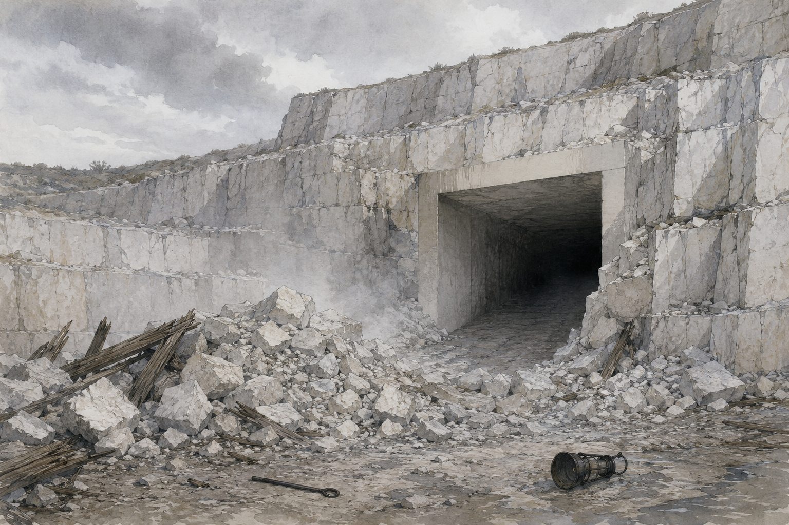

**Who's here**

> 👤 **[Vaerelin Ossuine](#vaerelin-ossuine)** · *Warden-speaker of the Laughing Hollow*
> A moon elf who has done this a long time. **Total stillness.** Answers the question asked and stops.
> **Now:** **Not met.** Neutral. Has watched the party go in, come out with full packs, and sell what they carried.

**What's going on (DM)**

He says this, **once**, and does not repeat it (**[CAMPAIGN]**, WP04 §5.5):

> *"You have been inside. You have carried things out, and sold them. Do not open it further. Do not carry anything out. What you put into the stone, leave in the stone. If you do these things, we will take back what you have taken, from wherever it is. I will not say this again."*

Then: questions. **He answers only what's asked, in as few words as possible, and never explains why.**

| They ask | He says |
|---|---|
| "Who are you?" | *"Vaerelin. Of the Hollow."* |
| "Why?" | Silence. Then: *"Because I have seen it done before."* Never more |
| "What's down there?" | *"What was put there."* |
| "What does 'further' mean?" | *"No door you have not opened. Nothing you have not touched."* |
| "The door we left open?" | *"Close it. Leave the key in the stone."* (Pull key B → the S9 leaf drops shut. Leave key B inside the site, e.g. set it on the S6 bench. **That's compliance.**) |
| "The key in the socket?" | *"Leave it."* (He wants W3 lit. He won't say so.) |
| "We already sold some" | *"I know."* |
| "Can we buy them back?" | A pause. *"That would be noticed."* (Returning objects reverses the clock: WP04 §5.3) |
| "Are you threatening us?" | *"No. I am telling you what will happen."* |
| Anything about goblins | *"They were here first, and they left. Ask them why."* |
| Draws a weapon | He doesn't move. *"That would be a mistake you could only make once."* Then he steps back into nowhere. See Alternatives |

**Checks and DCs:** none to hear him. **Insight 10:** he means every word. **Insight 18:** he's not angry: **he's afraid of being right.** **Perception 20**: two more elves on the quarry rim, bows unstrung. (Allino's passive Perception is 18, so even he has to actively look.) **Stealth to follow him:** no. He's gone into the scrub above the Pale (Stealth +10); following leads nowhere this session.

**Clues:** *"before"*. *"take back."* *"leave it"* (about the key). His eyes go to the **tower** when he says "the stone." (He knows W1 is there.)

**Encounter:** **only if the party attacks.** Vaerelin + 2 wardens (WP07 §7.2). **Not a pitched battle: after two rounds every warden breaks off and vanishes.** See WP07 for blocks.

> 📘 **Laughing Hollow Warden** · *creature, WP07 §7.2*
> One of nine elf wardens. **AC 15 · HP 36 · Speed 35 ft.** Perception +6, Stealth +8.
> **Two longbow shots** +7, 1d8+4. Never leaves cover; hides as a bonus action.
> **After two rounds of any fight, every warden vanishes.** Never pitched, never nine.

| # | Field | |
|---:|---|---|
| **1** | Conventional difficulty | Vaerelin AC 16, 60 hp, two longbow shots +8 (1d8+5). Two wardens AC 15, 36 hp. **They leave after 2 rounds.** A lucky level 4 party *could* drop him |
| **2** | Why brute force is costly | **Killing Vaerelin: Hollow → 5 at once, Nethra's position dies, the cooperative ending dies.** Even attacking: **Hollow +1, Rep −1**, and something the party relies on vanishes in two days |
| **3** | Telegraphing | L1: Ib says he's watched (Scene 9A). L2: the mark on the alder (Scene 9A). L3: **this speech**. L4: two bows on the rim, unstrung but in hand |
| **4** | Weakness, how found | **He is a person with a position.** *Ask Pell*: there's another elf, a "lady" who watches the village kindly. *Watch*: he looks at the tower, not at the party |
| **5** | Alternatives | Listen and comply · Listen and argue (he doesn't move) · Ask about the goblins · Walk away · Promise something and **keep it** (Nethra sees) |
| **6** | Failure | Ignore it once → **stage 4**: one Illefarn object vanishes per night from wherever it is |
| **7** | Reward | The **one rule of the elves**, stated plainly. Knowing who is watching |
| **8** | World-state impact | See below |

**Loot here:** none.

**Consequences**

| Party does | State change |
|---|---|
| Listens, says nothing | Clock stays **3.** The test is now what they do next |
| Promises to comply | Clock 3. **If they keep it through Day 4: Nethra +1** (a kept promise, WP04 §13.2) |
| Complies visibly (closes S9 leaf, leaves key B inside) | **Hollow → 2.** Rep stays +1. (WP04 §5.3: reverses on visible compliance) |
| Returns an object (e.g. Biggy's S6 odds and ends, Bar.D.Sync's tools) by leaving it at the aperture | **Hollow → 2** and **Rep +1 (→ +2)**: a real gift back. **This is the cheapest +1 in the session** |
| Opens a new sector, touches a system, carries anything out, or sells anything, after this | **Hollow → 4.** Wardens start taking things back (one per night) |
| Attacks | **Hollow → 4, Rep −1 (→ 0).** Two rounds, then gone. Within two days something the party relies on is gone (a rope, a boat, the stone cup) |
| Kills him | **Hollow → 5, Rep → −3, Nethra lost.** The fastest route to armed confrontation (WP04 §13.1) |

**If they skip this (nobody goes to the Pale, nobody crosses the bridge at dusk):** he finds them anyway: **Day 3 Evening, he's standing at the back of the Sundered Cart's common room** when they come down, and the room goes quiet. Same speech. **He always delivers it this session.**

**Alternatives**

- **Split party:** he speaks to whoever reaches the Pale first. **The others hear it secondhand**; that's still the warning (the contract is with the party).
- **Already sold something on Day 2 Night:** the clock is already 4. He still comes, but the speech changes: *"You were told by the mark on the tree. You did not read it. Now we will take back what you have taken."* It's an explanation, not a warning.
- **Ignore him and go straight down:** stage 4 starts. **The first thing taken is whatever the party carried out of the site most recently.**
- **Bring the bard's songbook out:** he doesn't care. **Nethra would.** (Her sheet.)

---

## Scene 7: Threll's clerk and Serina's price list

> ⚠️ **As played:** not played. The party was away on Day 3 Morning. See [As played](#as-played).

**When / where:** clerk crosses **Marrow Bridge (G1)** at Day 3 · Morning, sets up in the **Sundered Cart (G3)** from Afternoon. **Serina** is in the Cart until **Day 4 · Dawn**.
**Fires here:** ⏰ **Daggerford clock 3, Opportunity**: both offers arrive (WP04 §7.3; ruling A6).

> ⏰ **Deadline 3 — Threll's clerk arrives (Day 3 · Morning).** A two-wheeled cart, a mule, two hired guards and a man in good boots with ink on his cuffs. He pays the toll without arguing and asks Denk which house is the Reeve's.

> 📜 **Read aloud.** By afternoon the Cart has a new smell: lamp oil and fresh paper. A neat man of about thirty has taken the best table by the window and covered it with documents held down by a strongbox the size of a bread oven. Two big women in leather with cudgels sit by the door, eating Rosal's stew like it owes them money. The man sees you and stands up so fast the bench scrapes. "You'll be the ones who went under the quarry," he says, smiling with every tooth. "Mister Threll would very much like to be your friend."

**Who's here**

> 👤 **[Osric Fenn](#osric-fenn)** · *Clerk to Corben Threll, Daggerford trading house* **[CAMPAIGN]**
> Thirty, eager, ink-stained, a strongbox key on a chain round his neck. Restates your position more kindly than you put it, then names a number.
> **Now:** New. Neutral. Strictly business. **Has never been more than two days from Daggerford and hates it.**

> 👤 **[Serina Malk](#serina-malk)** · *Collector's agent*
> **Now:** Neutral, never moves. Has her crate packed. **Today she writes her price list on paper** and slides it across the table.

> 📘 **Caravan Guard** · *creature, WP07 §8.1*
> Hired muscle from Daggerford. **AC 16 · HP 22.** Spear +4 (1d6+2), light crossbow +3 (1d8+1).
> **Guards the cargo only:** never goes more than 60 ft. from it, never chases, stops the moment the cargo is safe.

**What's going on (DM)**

**Threll's three offers** (WP04 §7.3, WP02 §10.5). Each is a **handout: Threll's contract** (Materials, Part 8). Fenn offers them **to the party and to the Reeve**, in that order. He wants the party to carry them to Ondra and speak for them.

| Offer | What Greybank gets | The string (the claim clause) |
|---|---|---|
| **1. Supplies on credit** | One cartload in 2 days: grain, lamp oil, **a second Potion of Healing for the store**, bar iron for Ordga. **Trade +1** when it arrives | Repaid in **stone at Threll's price** (a third below market) for a year. "Let's be practical: you've no stone moving right now anyway" |
| **2. Bridge money** | 40 gp toward the bridge parapet and pier work | **Threll holds a claim on the crossing toll for 5 years** |
| **3. Road protection** | Two guards ride with every stone cart to Daggerford | **Paid in stone**, and the guards answer to Threll |

- **The party can't accept for the village.** Only the Reeve can, at moot (Day 4 Evening). **The party can accept for themselves**: Fenn will **pay the party 20 gp** to "speak warmly of the supply offer at your moot." That's a bribe and he doesn't call it one.
- **Fenn asks about the quarry.** He's heard "something odd" from Gedd Plank. If told about the ruins: he writes it down and says *"Mister Threll would rather that stayed a rumour. Delays, you understand."* If told about **the Sluice Works or a controllable ford**: his eyes light up: **Threll would pay a fortune** (WP06 §6.4). **Never tell him about the Transit Ring** (WP06 §6.5). If they do, **Daggerford clock +1 immediately.**

**Serina's price list** (handout; **all prices proposed**, WP13 to confirm): **[CAMPAIGN]**

| Item | Serina pays | Note |
|---|---:|---|
| Cut tablet (any) | 10 gp | What she paid on Day 2 |
| **The middle-third Chain tablets back** | sells at **20 gp each** (6 tablets) | **proposed.** Only if asked. *"You sold them to me. Now they are worth more. That is how it works."* |
| A resonance key | **60 gp** | WP13 slice. Same as Session 1 |
| **The Watch-Glass** | **200 gp** | WP13 slice. "Bring it to me and I'll double the tablets" |
| Worked tools from the workshops | 15–25 gp each | **proposed** |
| A whole warden's kit | 40 gp | **proposed** |
| The stone cup | **0**. She refused it on Day 2 | "It's a cup." *(She's wrong.)* |
| An account of a new room (a lead) | 5 gp | The standing deal |
| **Unbroken waystone fragment** | *She doesn't know to ask* | **Never on the list.** If offered: 100 gp, no questions, and that's the most expensive sale in the campaign |

**Checks and DCs**

| Check | DC | Result |
|---|---:|---|
| Get Fenn to drop the claim clause | Persuasion 18 | **He can't.** He can shorten the toll claim to 3 years |
| Spot the stone-price trap in offer 1 | Insight 12 or any guild/merchant background | "A third below market, for a year. That's how he gets the quarry" |
| Haggle with Serina | — | **She never haggles.** One price, then silence |
| Steal the Chain tablets from her crate | Sleight of Hand / Stealth 15, at night | Works. **Crime** (WP01 §7). Rosal's room, witnesses: Nissa awake, Rosal late. **Evidence Moderate** if seen |

**Loot here:** coin, if they sell. The **Chain tablets** (buy back or steal). **[LOOT PLACEHOLDER: Fenn's sample case: a bolt of Daggerford wool, a lamp, a good knife: "gifts" worth ~5 gp each, proposed]**

**Consequences**

| Party does | State change |
|---|---|
| Sells anything to Serina | Rule (A6): **every sale advances Daggerford +1 and Hollow +1.** Daggerford → 4 Investment; Hollow → 4 |
| Takes Fenn's 20 gp bribe | **Daggerford Rep +1.** If Ondra learns of it: **Ondra Wary**, Greybank Rep −1 |
| Speaks for an offer at moot (Day 4) and it passes | **Daggerford → 4.** Trade +1 on delivery (Day 6). The claim stands (WP10) |
| Speaks against all three | Daggerford stays 3. Fenn leaves Day 5 for Daggerford, **reports the party as "unhelpful"**: Daggerford Rep −1 |
| Buys back the Chain tablets | 120 gp. **Daggerford Rep +1** (good customers). **Hollow: returning to the site = compliance** (→ 2) if they put them back in S6 |
| Steals them | Crime. Serina finds out by Day 4 Dawn. **She does not complain. She raises every price by half**, permanently, and Daggerford Rep −1 |
| Tells Fenn about the Sluice / ford | **Daggerford +1.** Threll comes himself in session 3 (WP10) |

**If they skip this:** Fenn takes his offers straight to Ondra. **At the Day 4 moot, the supply offer passes 3 blocs to 2** (the quarry bloc wants anything that moves stone). **Daggerford → 4** at the end of Day 4 without the party. Serina leaves Day 4 Dawn with the crate.

**Alternatives**

- **Rob Fenn's strongbox:** ~60 gp, the contract originals, and a letter of credit. Two caravan guards (WP07 §8.1). **Serious crime, Daggerford Rep −2**, and **Threll sends a written claim in two days** (WP07 §4.5). The village **hates** a robbery in Rosal's room.
- **Bar.D.Sync forges something** (he has a forgery kit and is a Charlatan): a changed clause in Threll's contract, or a fake letter from the Reeve. Forgery kit check vs Fenn's Insight (+3). **If Fenn catches it: Daggerford Rep −1 and he warns Threll.** If it works, it's a crime (WP01 §7) that surfaces the day Threll's lawyers read it (WP10).
- **Play Fenn and Serina against each other:** works for a better *Threll* deal (Fenn matches 10 gp more), never for Serina (she doesn't move).
- **Sell to Serina before Vaerelin speaks:** see Scene 6 alternatives. The Hollow goes to 4 and the warning becomes an explanation.

---

## Scene 8: The envoy at the bridge

> ⚠️ **As played:** not played by the party. They made peace at Kettlerock first. Whether Nakka still came is an open question. See [As played](#as-played).

**When / where:** Day 3 · Afternoon. **Marrow Bridge (G1)**, from the far end, walking up the Daggerford road. Open ground, broad daylight.
**Fires here:** ⏰ **Red-Tusk stage 2: the envoy** (WP04 §6.3, §8.2; WP07 E09). **The single most consequential event in the first half of the campaign.**

> ⏰ **Deadline 5 — The envoy (Day 3 · Afternoon).** One goblin. **Unarmed. Alone. In daylight. Hands open.** Orbal sent her over Ghesh's objection. Whatever happens here moves the branch count. Wherever the party is, **somebody runs to tell them** (Pell, almost certainly, breathless and in the wrong order).

> 📜 **Read aloud.** Denk the toll-keeper is standing in his doorway with a boathook, not using it, just holding it like a man who doesn't know what else to do. Out on the road beyond the bridge, a goblin is walking toward the village. Slowly. In the middle of the road. Her hands are held out from her sides, open, empty. She's thin, the kind of thin where you can see the joints. Around one wrist is a single cord with knots tied along it. When she's halfway across the bridge, she stops, and waits, and doesn't look away.

**Who's here**

> 👤 **[Nakka](#nakka)** · *Red-Tusk envoy, sent by Orbal* **[CAMPAIGN]**
> Young, thin, missing two teeth, carries **one knotted cord** from Orbal's bundle as her proof. Speaks careful, slow Common learned from Orbal.
> **Now:** New. **Wary** (Orbal's attitude, sent with her). Very, very frightened, and standing still anyway.

> 👤 **[Denk Ottersby](#denk-ottersby)** · *Ferryman and toll-keeper*
> Keeps the crossing book. Has a gap in it he doesn't talk about.
> **Now:** Not met. Neutral. Holding a boathook and praying someone else decides.

> 📘 **the crossing book** · *the toll-shed's ledger*
> Greybank's only written record of who crossed the bridge and when. **It has a three-month gap** that Denk won't talk about.

> 👤 **Militia** (WP02 §12.2): if the bell is rung, **3–4 villagers** reach the Green in about 2 minutes, and **10 militia** are armed there in **about 20 minutes** (Defense 2). Nobody is posted at the bridge.

**What's going on (DM)**

**What Nakka says** (in order, if allowed to finish):

1. *"I am Nakka. Orbal sends me. This is her cord."* (Holds it up.)
2. *"We are the Red-Tusk. We live at the rock in the north. Sixty-one. Twenty-two who fight. The rest, no."*
3. *"We have no food. The sheep, yes, that is us. Three nights. A hen. We are sorry for the hen."* (She means it.)
4. *"We did not live here. We lived near the old stone road in the north. Something came at night. It did not hurry."* ← **Sentinel telegraph Level 1** (Ghesh's words, WP07 §11.4).
5. *"Orbal says: there was a promise here once, with the stone-folk. Orbal remembers the words. Ghesh says: there is no promise. Ghesh says take."*
6. *"I am to ask: food, and a place. Before winter. What do you ask, for this?"*

**She will answer questions honestly.** She doesn't know what the "something" was. She knows Ghesh counted the village's fighters twice. She'll say *"twelve, maybe. With sticks."* (She's close.)

**Who decides?** **The party can't make a deal for Greybank alone.** They can **receive** her, **escort her to the Reeve**, **offer something themselves** (their own coin, their own food), or **send her home with a message**. Ondra will receive her if asked and will put it to the moot (Day 4).

**Telegraph check (fairness):** L1 tracks (Day 1–2) · L2 Bessa reporting losses (Scene 2) · L3 Bessa to the party's faces, if they met her · **L4 this: unarmed, open hands, daylight.** **Do not let an ambiguous goblin get shot.** If someone fires without looking, ask the player: *"She's unarmed, her hands are open, she's alone, it's broad daylight. You're sure?"* (WP04 §8.2.)

**Encounter: E09, The Envoy at the Bridge** (WP07 §12.9)

| # | Field | |
|---:|---|---|
| **1** | Conventional difficulty | **Not a fight.** One unarmed goblin, 7 hp. Killing her is trivially easy, and that is the design |
| **2** | Why brute force is costly | **Killing her: War +3, the War branch locks** forever. Removes the Compact ending, Orbal, and **the Approach of Names route through Orbal's cords** (WP06 §5.3). **Red-Tusk Rep → −3** |
| **3** | Telegraphing | See above: four levels, all delivered |
| **4** | Weakness, how found | **It's a parley and it looks like one.** Found by *looking* |
| **5** | Alternatives | Receive her · Offer something concrete · Turn her away unharmed · Take her to the Reeve · Escort her home (Rep +2) · Ignore her |
| **6** | Failure | Nothing stops: the branch resolves within a day of stage 3, with or without the party |
| **7** | Reward | The Compact branch. Orbal. **The name** for the Approach of Names. **Defense +1** at C5 (the only free Defense in the campaign) |
| **8** | World-state impact | Table below |

**Checks and DCs:** none required. **Insight 10:** she's telling the truth, all of it. **Goblin language: Allino speaks it.** If he talks to her in Goblin, she relaxes visibly; **+1 to how the party's offer is reported back** (treat as "spoke to Orbal's envoy in her tongue": Orbal counts it as having spoken with Greybank, **Compact +1**).

**Clues:** "the old stone road in the north" = the Long Gallery's far end (S12, the Kettlerock Gate). "Did not hurry" = the Sentinel. **"A promise with the stone-folk"** = the authorisation name on Orbal's cords (WP06 §5.3). The party has every piece now and doesn't know it.

> 📘 **The Kettlerock Gate** · *sector S12*
> The far, northern end of the Long Gallery, coming out near the goblins' camp at Kettlerock. **Blocked by a rubble pile** from outside; it opens outward from inside without tools. **The goblins lived beside it until the Sentinel drove them out.**

> 📘 **The Approach of Names** · *sector S13, Stage IV*
> Not a lock: a challenge that **accepts a name.** Three ways to know one: **Orbal recites it** (Red-Tusk Rep ≥ +1), **a watch reading the S6 records**, or **Nethra** (Hollow Rep ≥ +2). None of them is a fight.

**Loot here:** none. **Orbal's cord** if Nakka gives it as a token of a deal: **[LOOT PLACEHOLDER: a single knotted cord: one strand of the name. WP14 handout, WP13 value: priceless to the Red-Tusk, nothing to anyone else]**

**Consequences** (WP04 §8.2, WP07 E09). **Red-Tusk clock → 3** in every row; the branch resolves **within a day** (Day 4) off-table, by the count.

| What the party / village does | Branch count | Other |
|---|---|---|
| Receives her, hears her out, both walk away | **Compact +2** | Red-Tusk Rep +1 |
| Receives her and **offers something concrete** (food, a place, coin) | **Compact +3** | **"Food or territory concretely offered": +2 more** (WP04 §8.3) |
| Takes her to the Reeve | Compact +2, and the moot argues it (Day 4) | **Orbal "has spoken with Greybank"**: Compact +1 |
| **Escorts her home to Kettlerock** (3 watches) | Compact +2 | **Red-Tusk Rep +2.** Orbal remembers. The party sees Kettlerock (61 goblins, 39 who can't fight) |
| Turns her away, unharmed | **Compact +1** ("they came, and they lived") | |
| Ignores her two days (until Day 5 Afternoon) | **War +1** | Orbal's argument loses its evidence |
| Drives her off with threats | **War +2** | |
| **Kills her** | **War +3, branch LOCKS** | **Red-Tusk Rep → −3.** Greybank Unity −1 (the Green watched it). **Nethra −1 at once** |

> 🎲 **DM.** After this scene, **score the count** (Part 7's table) and **decide the branch on Day 4, off-table**, by WP04 §8.3. Tell no one. The players learn it from what happens next (WP10).

**If they skip this:** Pell finds them anyway. If they refuse to come: **Ondra receives her** (she does the decent thing, coldly). **Compact +1** (turned away unharmed: Ondra can't promise food without the moot). Nakka walks home.

**Alternatives**

- **Split party:** whoever is nearest gets Pell. The others hear about it at Evening.
- **Kill her "to be safe":** see the table. Say the price **once** before the arrow is loosed. Then let them.
- **Capture her:** she doesn't resist. **That's not a parley any more: War +2** (driving off with threats) **and** Unity −1 after three days in the store room.
- **Ask her to guide them to Kettlerock and the "old stone road":** she'll take them home. **Ghesh will see them coming.** That's WP10.
- **The party's own food:** a pack of rations for her to carry home counts as **concrete** (Compact +3). Cheap. Huge.

---

## Scene 9: The far bank and the goblin trail

> ⚠️ **As played:** the party followed the wounded scout to Kettlerock (about 3 hours) instead of the cache on the Rise. See [As played](#as-played).

Two places, two directions. Bar.D.Sync wants both; Biggy and Allino want the trail.

### 9A. The charcoal camp: Ib Sallow and the marked tree

**When / where:** Day 3 · any day watch. **Charcoal Camp (G20)**, far bank, half a mile south-west of the bridge in the coppice (Z5). ¼ watch from the bridge.
**Fires here:** the **skipped Hollow stage-2 mark** is here as trace evidence (WP08 handoff).

> 📜 **Read aloud.** Across the bridge and off the road, the coppice closes in: hazel and alder, cut and regrown so many times the stumps are wider than the trees. You smell the camp before you see it. Two earth mounds smoke gently in a clearing; a turf hut; stacks of split wood. A man black to the elbows is poking one mound with a pole. He sees you and his whole face lights up. "People!" he says. "Real ones! Sit, sit. Do you want tea? It tastes of smoke. Everything does."

**Who's here**

> 👤 **[Ib Sallow](#ib-sallow)** · *Charcoal burner, far bank*
> Forties, black to the elbows, smells of smoke from ten feet. Talks nonstop after days alone.
> **Now:** **Not met yet.** Neutral. Lonely. **Has seen an elf**, twice this tenday, and nobody believes him.

**What's going on (DM)**

- **Why the charcoal is late:** Vadd. Ib has two sacks bagged and waiting. *"He's family to the smith, so he's allowed to be useless."*
- **Ib says he's watched** (Hollow telegraph **L1**, WP07 E03): *"Something walks through here at night. Not a deer. Deer don't stop to look at you. I've said it for years."*
- **The mark** (Hollow telegraph **L2**): on a big alder at the clearing's edge, **a symbol cut through the bark, a hand high**: a circle with a line through it, and below it, **six short cuts, three of them crossed out.** It was **cut on Day 2, after the aperture was opened**, and looks a day or two old. **[CAMPAIGN]** Ib noticed it Day 2 evening and thinks it's "a hunter's mark."
- **Meaning (DM only):** *"Closed. Six; three dead."* It was the quiet warning. The party has already passed it. **Reading it now** is how they learn the elves tried to say it softly first.
- **Nethra may be watching** from the coppice edge (she is, if it's Evening or later). **If the party sits with Ib for a full watch and doesn't hunt or chase anything**, that's exactly what she's scoring: **Nethra +1** (WP07 E03).

**Checks and DCs**

| Check | DC | Result |
|---|---:|---|
| Find the mark | Perception 12, or Ib shows them | On the alder by the stack yard |
| Read it as "closed" | Intelligence 13 (or anyone who saw the elvish names in S2 and the six rings) | "Six marks. Three crossed. Like the basin." |
| Find elf tracks | Survival 18 (Allino advantage) | **One** clear print, light, long-footed, pointing west into the coppice: the Hollowway (Z9) |
| Follow them | Survival 18, a full watch | Leads west to **Z9**. Session 3 content (WP05 discovery 3). **Nobody to meet today** |

**Loot here:** two sacks of charcoal (for the forge or the Cart: Rosal needs two a day). **[LOOT PLACEHOLDER: Ib's sharpening stone, a hand-carved pipe, "a lucky acorn": trinkets, proposed no value]**. **The mark is a handout** (Materials).

**Consequences**

| Party does | State change |
|---|---|
| Carries the charcoal back | **Forge to full output.** Rosal +, Ordga +: **Ordga → Neutral** (from Wary), Vadd shamed |
| Sits with Ib a watch | **Ib → Friendly.** If Evening or later: **Nethra +1** |
| Reads the mark, then stops going underground | **Hollow → 2** (compliance with the mark, WP07 E03), **then the clock drops further only if activity stops for several days** |
| Cuts, defaces or follows the mark aggressively at night | **Hollow +1** if they chase a warden. Nobody is caught |

**If they skip this:** the charcoal comes Day 4. The mark stays. Ib keeps talking to nobody. **At Hollow 4, the camp is interfered with and Ib is hurt** (WP07 E03, session 3).

**Alternatives:** **Split party**: Bar.D.Sync alone at the camp is perfectly safe in daylight. **Violence**: there's nobody to fight here unless they go looking at night. **Ib as a guide**: he knows the far bank; he'll walk them to the Hollowway's edge for company, not money.

### 9B. The goblin trail: north to Stonecrop Rise

**When / where:** Day 3 · Morning onward. From the **fold (G18)** north across the **Home Fields (Z3)** and up **Stonecrop Rise (Z7)**. **About 1 watch** to the scouts' cache. Kettlerock (Z16) is **3 watches** (12 miles, rough) from Greybank.
**Fires here:** nothing on a timer. **A dead waystone (W4)** is on the route: the warning must already have been given.

> 📜 **Read aloud.** The goblin tracks are small and bare and they don't try to hide: three of them, single file, going straight uphill through wet grass and then through gorse. The land climbs into a long bald ridge of grey stone and heather. Near the top, the wind gets in your teeth, and you can see everything: Greybank, the white bite of the quarry, the river, the road. Off to the north, past more ridges, a thin smoke goes straight up. And on the crest beside you, half sunk in heather, there's a standing stone. Pale. Smooth. No joints.

**Who's here:** nobody, by day. **[The scouts]** if any escaped last night are back at Kettlerock.

**What's going on (DM)**

- **The scouts' cache** (**[CAMPAIGN]**): a dry scrape under an overhang 50 yards below the crest. In it: **the hen's feathers and bones**, the **coil of rope**, the **fence panel** (used as a roof), a cracked bucket from Day 1, **and the tracks of three goblins who slept here**. Also **dozens of old, smaller fires**: they've used this for weeks. **The trail continues north** toward Kettlerock: rough ground, clearly a regular path.
- **The standing stone is waystone W4: dead.** Cold to the touch (compare the tower: warm). **[ADAPTED: Illefarn masonry]** No palm-dip on the outside; the recess faces into the ridge. Anyone who's heard Yorrin or Ordga recognises the stone.
- **The view:** from here the **Moorgaunt's** drag furrows are visible, heading west to Hagsfoot Moor (Z11). The newest is **two nights old** (Day 1 Night); the rest are weeks old.
- **The smoke** is Kettlerock. 3 more watches. **If they go on, they arrive at Day 3 Evening at the earliest: that's Ghesh's camp, at the moment the band's food has failed.** Ghesh's sentries see them a mile off. See Alternatives.

**Checks and DCs**

| Check | DC | Result |
|---|---:|---|
| Follow the trail | Survival 10 (Allino: automatic) | To the cache, 1 watch |
| Read the cache | Survival 12 | "Three of them. Here for weeks. Small fires: they're careful with wood. They ate the whole hen. Bones cracked for marrow." **They're starving** |
| Notice W4 is the same stone | none, if they've heard the warning | Same as the tower. **Cold**, not warm |
| Read the moor drag-marks | Survival 14 | "One every three nights, regular as a bell. The last was two nights ago" |
| Spot Kettlerock from here | Perception 12 | Smoke, a dark cleft in a hill, maybe a hundred tiny movements |

**Loot here:** the **stolen rope and fence panel** (Bessa's; return them: **Bessa +1 step**). **[LOOT PLACEHOLDER: a goblin-carved bone toggle on a thong, dropped. Proposed: worthless; a gift for Nakka/Orbal would read as "a possession returned" (WP04 §8.4 tie-break)]**.

**Consequences**

| Party does | State change |
|---|---|
| Finds the cache, leaves it | Knowledge only. **The party now knows the goblins are hungry, careful and few** |
| **Leaves food in the cache** | Scouts find it Day 3 Night. **Red-Tusk Rep +1. Compact +1** ("food concretely offered" counts only if offered openly; a cache gift is +1 Compact, not +2) |
| Wrecks the cache / waits in ambush | If they ambush Day 3 Night (scouts come back to it): Scene 1's outcome table applies |
| Touches / chips W4 | **It's dead already.** Damage changes nothing *now*, but **destroying W4's post means its span can never be re-anchored** (WP06 §13): **no state change this session, but W4 off the table forever.** Hollow clock **+1** if it's seen |
| Goes on to Kettlerock | Arrive Day 3 Evening at the earliest. **Ghesh meets them with 8 fighters, at a distance.** He talks first (he's not stupid). **Not a WP09 encounter: treat as Nakka's scene in reverse**: the party is the envoy. Killing anyone there: **War +1 per incident**, and the party is three watches from home with 22 spears behind them |

**If they skip this:** the trail cools. The cache stays. Nothing decays this session.

**Alternatives:** **Split**: one ranger alone on the Rise is safe by day, **not** at night (scouts return; Day 3 Night stage-2 raiders pass this way). **Violence**: there's no one to fight by day. **Bring Bessa's dogs**: they track fine and refuse to go past the cache.

---

## Scene 10: Back to the ruins

> ⚠️ **As played:** the party entered from the north, through the Old Delving, and cleared the rubble. **S12 is permanently Breached.** The Sentinel walks only S9–S12, and S13–S16 were explored. See [As played](#as-played).

**When / where:** Day 3, any watch, usually Afternoon. **The Pale (G14) → S1 → S2 → S5 → S6**, then **S8 → S7**, the **Lock-keeper's Cell** (off S5), and **S9 / S10**. See `Maps/marrowward-map-dm.png`.
**Fires here:** ⏰ **The Sentinel's turn at S9, every watch at the half-watch mark.** Vaerelin (Scene 6) almost certainly fires on the way in.

> ⏰ **Deadline 7 — The Counter (every watch).** The Sentinel comes down the Long Gallery and turns on the S9 floor **once per watch, at the half-watch mark.** The S9 leaf is open (key B). Anyone in the **S6 records room** or **S9** at that moment is in its sector. **Never roll for this. Keep the time.**

> ⚠️ **Before they go in, the Level 4 warning must be stageable.** It is: the grind (below). Make sure the players hear it **the first time they're in S6 near a turn.** If they arrive just after a turn, they get ~2 hours of quiet first: say the silence is *total*.

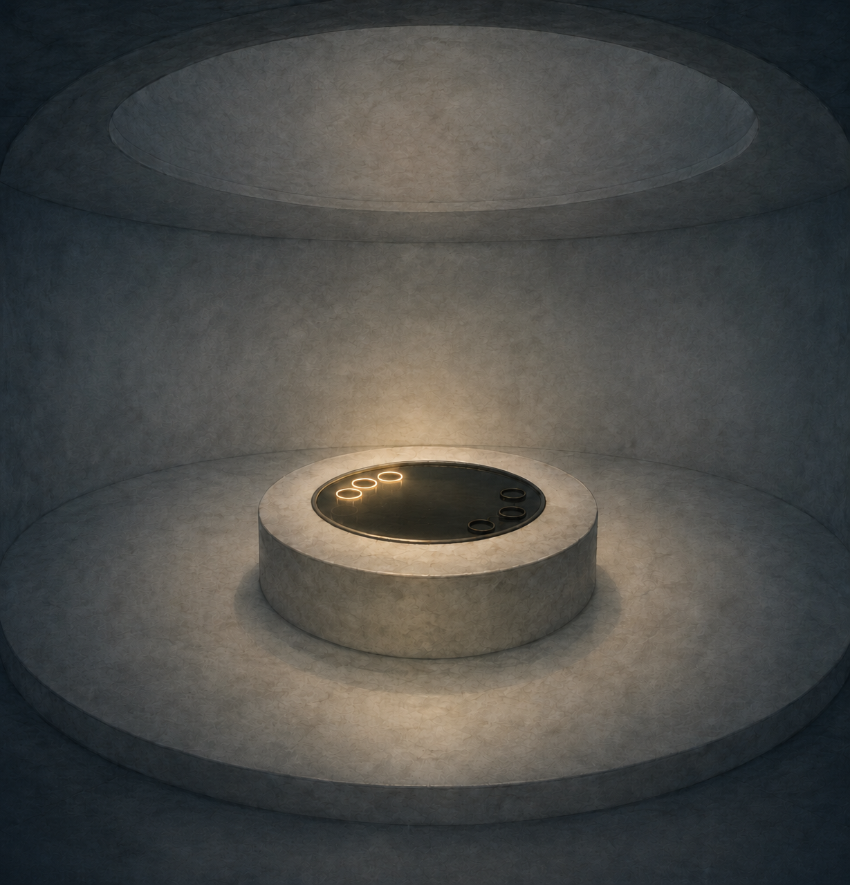

**Who's here**

> 👤 **[The Listener](#the-listener)** · *Blind thing in the water, S8*
> Huge, eyeless, lashing arms. Reads every footstep on dry stone. **Can't feel you if you stand still in running water.**
> **Now:** **Met once, unharmed. Tricked.** Hasn't changed its habits.

> 👤 **[The Sentinel](#the-sentinel)** · *The Counter. The guard of the line.*
> Tall, stone and something else. Walks at exactly 30 ft. Never hurries, never stops, never talks.
> **Now:** **Not met.** Only its groove was seen. **The door between it and the quarry is open.**

### 10.1 The way in (S1 → S5)

> 📜 **Read aloud (the ramp).** The hole in the quarry face breathes cold air at you, same as before. The ramp goes down in the lantern light. On the floor of the hall below, the dust still holds your own footprints from yesterday, and the foreman's, which stop ten feet in. Past the muster hall, the great stone leaf in the long corridor still stands open, hanging on its counterweight like a held breath.

- **S5 is open** (key A). Nothing has changed since Day 2.
- **The Lock-keeper's Cell door** is on the **left wall, Stage I side of the leaf**, 20 ft before it: a narrow door with cut names around the frame. **It didn't open when the leaf did.** Bar.D.Sync or the bard will notice it now that they're not in a hurry (no check; it's a door).

### 10.2 The Lock-keeper's Cell (S5, the second sealed door)

> 📜 **Read aloud (once open).** It's a stone cupboard, eight feet square. There's a stool. On the stool sits a skeleton in the rags of a grey uniform, with its back to the door you just opened, facing the wall. In the wall in front of it is a long stone lever, pulled up. On the skeleton's knees there's a small tablet, and its finger bones are still resting on it, like it was in the middle of reading.

- **Open by:** **Knock** (Howling Matza; S5 stays Accessible) · **Force**: DC 18 Strength: **the inner bar shears off, and with it the lever's catch: the lock-bar can never be used** · nothing else.
- ⚠️ **Biggy will probably succeed at forcing it** (Athletics +5, and Giant's Might gives advantage on Strength checks). **Say it before he tries:** *"The door is barred from the inside. If you force it, whatever is barring it breaks."* **Mending can't fix the broken catch afterwards**: it's a two-foot stone pawl, bigger than the spell's 1-foot limit.
- **The lever:** pulling it **down** drops a stone bar across the S5 leaf: **the leaf is wedged shut even with key A still in S3.** **W3 stays lit.** Pushing it up again releases it. **One action. Works only from inside the cell (the Stage I side).**
- **The tablet** (lock-keeper's log): cut names. Reading: **Elvish speaker DC 15 Intelligence**, or a watch with the S6 roster, or a long careful look by anyone who reads Elvish. (Nobody in the party knows Elvish or Comprehend Languages: Howling Matza's languages are Common, Draconic and Sylvan.) Last lines: *"Ninth day. It walks the Stage I side now. I have barred the leaf. The others are below. I stay."* **(Sentinel Level 2 telegraph, and it says: the bar holds it.)**
- **The skeleton:** a warden of the site, long dead. Gear rotted away except **a lamp-stone** (dead) and **a ring of jointless stone on one finger**.

**Loot here:** **[LOOT PLACEHOLDER: the lock-keeper's lamp-stone, dead. WP13: does it relight near a living span? proposed: glows faintly within 30 ft of a lit anchor; no gp value]** · **[LOOT PLACEHOLDER: the warden's stone ring. WP13 to define. Proposed: no magic; an Illefarn object (Hollow counts it), Serina pays 30 gp proposed]** · **the log tablet** (handout, Part 8).

**Consequences:** opening it is **"opening something further"** under Vaerelin's warning **if he has spoken: Hollow → 4.** Pulling the lever down is **not** touching a system (it's a door bar) **[CAMPAIGN ruling, Appendix A, D3]**: no clock. **Taking the ring or lamp out of the site: Hollow → 4.**

### 10.3 The workshops and the records room (S6): the grind

> 📜 **Read aloud (S6).** The workshops are as you left them: the stone-shop with its clamps, the metal shop, the store, and at the end the records room, with racks of tablets standing upright like books in a library. There are gaps in the racks now, like missing teeth, where you took them. But most of the racks are still full. Very full. Through the far doorway, past the open stone leaf, the turning floor of the round chamber beyond, and the black mouth of the long gallery.

**The grind (Level 4 telegraph), 10 minutes before a turn:**

> 📜 **Read aloud (the sound).** You hear it first as a feeling more than a sound. Then it's a sound. Far away, down the long gallery: a slow grinding, stone on stone. One… and then, two seconds later, another. One… and another. Not faster. Not slower. Getting louder.

> 📜 **Read aloud (two minutes out).** Now it's in your boots. Dust is sifting off the tablet racks with every beat, in thin grey lines. One. And another. Whatever it is, it's big, and it isn't hurrying, and it is coming *this way*.

> 📜 **Read aloud (the turn: if no one is in the records room or S9).** Through the doorway, the round floor of the next chamber turns: a slow quarter-circle, grinding. Something tall is standing on it, in the mouth of the gallery, too far and too dark to see clearly: just height, and a shape that's wrong for a person. The floor stops. The grinding starts again, going away. One. And another. Fainter. Gone.

**What the party can do in 10 minutes:** leave the records room for the stone-shop (safe), **pull key B** (the leaf drops: **the Sentinel is sealed out**, WP06 §11.2 solution 2), go back up to S5 and the cell lever, or stand still and watch (**if they're in the records room, that's a choice**).

**Reading the records (WP06 §6, S6).** A full watch, no magic, no check. **Every watch-long read overlaps one turn** unless the leaf is shut. What they learn (if they finish): see Part 2.5's table: the site's purpose, the line's design, the roster, **the Sentinel register** (*"The keeper of the line walks the line. It turns back what is not written."*), **the authorisation forms** (route 2 to Stage IV), and **two-thirds of the Chain sequence**.

**Checks and DCs**

| Check | DC | Result |
|---|---:|---|
| Hear the grind | none, in S6 or S9 | Automatic 10 minutes out |
| Time the circuit | Watch one turn from the stone-shop | "Once every watch, halfway through." **This is the weakness: a schedule** (WP07 E14 field 4) |
| Read a tablet quickly (a minute) | Intelligence 14 (Elvish helps: advantage) | One fact from the table above, DM's choice, **always starting with the Sentinel register** |
| See the Sentinel clearly at the turn | Perception 15 from the doorway | Ten feet tall, stone grey, jointless, faceless. Long arms. It doesn't look at you. **It doesn't need to** |

### 10.4 If someone is in its sector at the turn: the Sentinel

**Encounter: E14, the Long Gallery** (WP07 §13.4), **moved to the S9 mouth by the open leaf**

| # | Field | |
|---:|---|---|
| **1** | Conventional difficulty | **None printed and none exists.** AC 20, **no hit points**: damage under 25 from one source does nothing; 25+ chips it and does nothing else. **A party that fights it dies** |
| **2** | Why brute force is costly | Posture 3 (any damage dealt) = two attacks a round, +9, **3d10+6 each**. Kills a level 4 PC in two rounds. **It doesn't stop.** |
| **3** | Telegraphing | L1: *"it did not hurry"* (Nakka, Scene 8) · L2: the S6 register; the lock-keeper's log (10.2) · L3: **the groove** (seen Day 2) · **L4: the grind, then it stands at 30 ft for one round** |
| **4** | Weakness, how found | **A schedule and a boundary.** *Watch it*: once a watch, same turn. *Read the register*. *The Watch-Glass*: the line runs to the tunnel mouth. *Ask Nakka*. **It never leaves the tunnels at Instability 1, and it never goes into the water** |
| **5** | Alternatives | **Leave the line** (up the ramp: it stops at the mouth) · **Seal it**: pull key B (S9 leaf) or drop the cell bar (S5) · **Stand in the S8 channel** (not its circuit) · **Hide in S7** (out of range, loud) |
| **6** | Failure | A dead PC. **Legitimate.** Replace from WP03's roster / cott H22 (WP07 E14) |
| **7** | Reward | **The truth, learned while running: it cannot be beaten, only answered** |
| **8** | World-state impact | Table below |

**How it plays, round by round** (WP07 §11.2):

1. **Posture 1, Warning.** It walks to **30 ft** and **stops.** Stands. **One full round of grace.** Say: *"It stops. It's thirty feet away. It's just… standing there. Facing you. What do you do?"*
2. **Posture 2, Removal** (still in its sector at the end of that round): it advances and strikes to **push**: +9, 2d10+6, **pushed 15 ft toward the nearest point outside the line** (that's **back up through S6 toward S5**, or into a wall: +1d10).
3. **Posture 3, Suppression** (if anyone damages it, or someone has been struck twice and is still inside): two attacks, 3d10+6 each, every round.
4. **It follows** through S6 → S5 → S2 → S1 at 30 ft a round, **never Dashes.** A party that runs **gets away** (they move 30+ and can Dash; it never does). **It stops at the aperture mouth** and turns back.
5. **It never enters S7 or S8.** At the S8 stair-head it stops and turns, like hitting a wall.

> 📜 **Read aloud (it stops at 30 ft).** It's taller than the doorway it came through, and it had to tilt to fit. Grey stone, no seams, no face. Long arms that end in something like hands. It doesn't breathe. It doesn't move. The grinding has stopped, and the silence is worse. It is thirty feet away and it is waiting for something, and you don't know what.

**Rules to say out loud if asked:** it doesn't care about invisibility, darkness or silence. It can't be grappled, charmed, frightened or put to sleep. Running works. **Shutting a leaf works.**

**What the party's own abilities do to it** (from their sheets):

| They try | Result |
|---|---|
| **Shatter** (Howling Matza; stone gets disadvantage on the save) | Max 24 damage: **under 25, no mark at all** |
| **Thunderwave** | Damage under 25, and **it can't be pushed** |
| **Dissonant Whispers, Vicious Mockery, Cutting Words** | **Nothing.** Psychic immune, INT 1, nothing to hear with |
| **Charm Person, Phantasmal Force, Silent Image, Disguise Self, Faerie Fire** | **Nothing.** It doesn't see, think or get fooled; it senses who is inside the line |
| **Fire Rune shackles, Ensnaring Strike, a grapple** (Biggy, Allino) | **Nothing.** It can't be restrained or moved |
| **Giant's Might + glaive** (Biggy) | Nonmagical damage: **immune** |
| **Cloud Rune** (Biggy, reaction) | **Works once:** it moves one of its hits onto a different creature within 30 ft. A real save, at a price: pick who takes it |
| **Combat Inspiration** (Howling Matza, Valor) | **Works:** +d6 AC against one of its attacks |
| **Fog Cloud, Longstrider, Feline Agility, Dash** | **Work, for running.** Running is the answer |
| **Mage Hand** (Bar.D.Sync, 30 ft) | **Works on key B:** pull it from the lock from 30 ft away and the S9 leaf drops shut. **That seals it out** |

**World-state impact**

| Outcome | State change |
|---|---|
| Party leaves its sector in the round of grace | **Nothing.** It resumes the circuit. **It doesn't remember** (WP07 §4.5) |
| Party pulls key B and the leaf drops | **S9 → Locked** (key B now in hand). **Carrying key B out = Hollow → 4.** Leaving it inside the site (e.g. S6 bench) = compliance (**Hollow → 2** if Vaerelin asked) |
| Party drops the cell bar at S5 | S5 wedged. Stage I sealed from Stage II/III. **W3 still lit.** No clock |
| Party fights and flees | Nothing moves. Wounds |
| A PC dies | **Nothing moves. That's the horror of it.** Greybank Reaction **+1** when the body is carried up the haul road (or isn't) |
| Party pulls **key A** to drop the S5 leaf | **S5 → Locked, W3 dark: 3 of 6.** The end game still works with 3 (needs ≥3), but **one more lost span ends it.** Elves read it as removal: **Hollow → 4, Rep −1** |

### 10.5 S8 and S7, the Sluice Hall (first visit)

> 📜 **Read aloud (S8, the stair).** The broad stair goes down into black water that moves, slowly, fed from somewhere above. The bodies are still on the dry steps where you left them: eleven, all on dry stone, none in the water. To the left, above the waterline, a narrow ledge of dry step runs along the wall to an arch. Through the arch comes a sound like heavy rain that never stops.

> 📜 **Read aloud (S7).** You can't hear yourself. That's the first thing. The hall is a forest of channels and stone gates over a black race of water that roars through the middle, and the noise is a wall. Wet walkways, no rails, a drop you can't see the bottom of. The gates have names cut over them. High up on the far side, a shaft goes up into the dark, and there's a faint grey light at the top of it: daylight. Somebody's mouth is moving next to you. You have no idea what they're saying.

**Getting to S7:** along the **dry ledge** in S8, about 40 ft: **that's dry stone. The Listener feels it.** Options: cross **one at a time, slowly** (DC 13 Stealth each; **Howling Matza has disadvantage: her half plate clanks**; on a fail it comes up and lashes: WP07 §10.2 block, +7, 2d8+4, DC 15 Str or grappled and dragged); **cross in the water** (wade the shallow channel at the stair's edge: **standing still in moving water, it can't feel you**, so moving slowly in the channel = DC 10 Stealth, advantage); or **the overflow shaft from the quarry** (climb down from the lowest bench: wet, Athletics DC 12, a fall is 2d6). **The shaft lands in S7 and skips S1–S5, but S7 only connects onward through S8**, so you still pass the Listener to reach S6.

**The Sluice Hall is a hazard, not a monster** (WP07 H03): **Type D.**

| # | Field | |
|---:|---|---|
| **1** | Conventional difficulty | No creature. Wet walkways (DC 12 Acrobatics to move faster than half speed), a real drop, **no one can hear anyone**. Exception: **Howling Matza's Message cantrip works in here**, a whisper straight into one ally's ear. Let it: that's a clever answer, not a cheat |
| **2** | Why brute force is costly | Turning gates blind can **stop Greybank's mill**, close or open the ford, and **raise Instability** |
| **3** | Telegraphing | L1: damp floor 40 ft before the arch · **L2: you can't hear each other** · L3: the S6 records name each gate · L4: someone on a walkway who can't hear the shout |
| **4** | Weakness, how found | **The gates are labelled.** Read the S6 records (a watch) or **watch the water** for ten minutes: the race shows which way each channel runs |
| **5** | Alternatives | Rope the walkway · cross one at a time · use the shaft · **don't touch anything** · read first |
| **6** | Failure | A fall into the race → **into S8, into the Listener's water.** The only way to meet it involuntarily |
| **7** | Reward | **System 3, the Sluice Works.** The **overflow shaft**: a second way in and out, bypassing S5 |
| **8** | World-state impact | Table below (WP06 §6.4) |

| Gate use | State change |
|---|---|
| Identified only (watch it 10 min) | **S7 → Discovered. System 3 → Identified.** No clock |
| **Raised** (more water) | Shoal closed, **Bythe Ford impassable.** **Instability +1** if forced; 0 if worked slowly over a watch. **Hollow +1** |
| **Lowered** (drain S8) | **S8 → Breached forever.** Listener's water gone: **it goes somewhere.** **Mill stops; Corvin Ash knows in a day.** Shoal open, ford ankle-deep. **Instability +1** if forced. **Hollow +1** |
| Anything, after Vaerelin's warning | **Hollow → 4** ("touched a system") |

**Loot here:** none in S7. **[LOOT PLACEHOLDER: a warden's gate-hook on a wall peg, S7. WP13. Proposed: a long iron hook, opens gates from the walkway safely; Illefarn object]**.

### 10.6 S9 / S10, the Long Gallery

They've looked down it. **Going in is Stage III**: WP10's set-piece. If they go anyway:
- **S10 → Accessible** only by **timing the circuit** (watch a turn, then go right after it: they have **a full watch** before it's back).
- **S11 (the Deterrent Chain)** is off the gallery; the Sentinel passes the mouth and doesn't enter. **There's a resonance key on the last plate** (WP06 §9 S11). **Taking it: Hollow → 4** after the warning.
- Running the Chain with the gap: **Instability +1** (run badly). With Serina's tablets back: as WP06 §6.6.

**Consequences (whole scene, summary):** see each sub-block. **Biggest swing: whether key B comes out of the site.**

**If they skip this (nobody goes back in):** **nothing in the site moves.** Nothing advances on a timer (WP06 §12). The leaf stays open. The Sentinel keeps turning at S9, alone. **Vaerelin still delivers his warning elsewhere** (Scene 6).

**Alternatives (the big ones)**

- **Poke the Sentinel** (Biggy wants to fight it): say the warning **once** in the round of grace: *"It hasn't attacked. It's waiting. If you hit it, I think it stops waiting."* Then let him. **AC 20, under-25 does nothing.** Two rounds of posture 3 kills him. **The others can drag him out; it won't stop them leaving.**
- **Pull key A "to see what happens":** W3 dark, S5 leaf drops (with them on whichever side), **Hollow → 4, Rep −1.** Put it back: W3 relights; the elves **already noticed**.
- **Sell to Serina what they find:** Hollow → 4 and Daggerford → 4, at once.
- **Bring villagers:** **no villager enters the site, ever** (design doc §33). Vadd might, for money, to the top of the ramp. **Not past it.**
- **Long rest inside:** WP06 §18.6. At least two turns of the Sentinel. Rest in S2/S3 (out of range) with S5 barred or key B pulled.
- **Split party between stages:** fine. **Nobody can hear anyone in S7.** Nobody upstairs hears the grind.

---

## Scene 11: Day 3 Night and Day 4 spill-over

> ⚠️ **As played:** the party was in the Marrowward and then on Hagsfoot Moor. The Day 3 Night raid was not played. The Moorgaunt is dead. See [As played](#as-played).

**When / where:** Day 3 · Night onward. **The fold (G18)**, the **Moot Hall (G11)**, the **Cart (G3)**.
**Fires here:** ⏰ **Stage-2 livestock theft** (Day 3 Night). Hollow **stage-4 thefts** begin if triggered. **The moot (Day 4 Evening).** **Serina leaves (Day 4 Dawn).** **The branch decision (Day 4, off-table).**

> ⏰ **Deadline 8 — Livestock at the fold (Day 3 · Night).** Stage 2: **Ghesh's raiders, five of them** (3 scouts + 2 spears, WP07 §6.2), take **two sheep** from the fold. **Not a probe now. They come to take, not to count.** (WP04 §6.3)

> 📜 **Read aloud (if anyone is at the fold).** No moon. The dogs go off like a bell: both at once, then one yelping. Shapes on the wall: more than three this time. Five. Two of them carry spears longer than they are. They aren't looking at the cott. They're looking at the sheep.

**Who's here**

> 👤 **[Bessa Ruddock](#bessa-ruddock)** · *At the fold, with a lantern and two dogs*
> **Now:** depends on Scene 2. **If she stopped reporting, she's here alone and she will try to stop them.**

> 👤 **Ghesh's raiders** (5): Tikk or another scout, **Brusk** if he lived, **Ozz** if he lived, plus two **Red-Tusk Spears** (WP07 §6.2). **Ghesh is not here.**

> 📘 **Red-Tusk Spear** · *creature, WP07 §6.2*
> One of the band's fourteen spears. **AC 15 · HP 14 · Speed 30 ft.** Darkvision 60 ft.
> **Spear** +4, 1d6+2 (thrown 20/60). **Bound in Threes:** +1d6 damage if two other goblins are next to the target.
> **Grabs food before it fights.** Checks morale (d6).

**What's going on (DM)**

- **If the tower is manned at night** (Scene 3/4): the lookout sees movement on the west side; **the bell rings before contact**. The militia needs about 20 minutes (WP02 §12.2), too slow for the fold, but the raiders **hear the bell and take one sheep instead of two.**
- **If Bessa is alone:** she goes at them with a crook. **The raiders will not kill a human if they can avoid it** (still true at stage 2), **but a spear in the dark is a spear.** Roll once: **d6, on a 1 Bessa is badly hurt** (unconscious, Maud's care, 1 healer's kit; **Food −1** through the lost flock-care if she's out for the session). **[CAMPAIGN; WP01 §17 randomness: meaningful uncertainty]** She does not die tonight; WP03's death row is for session 3+.
- **If the party is there:** five vs four PCs: **still fair** (Type A), but now **spears**. Same outcome table as Scene 1, except **raiders are not scouts: they check morale (WP01 §17.1 d6) instead of auto-withdrawing.**
- **If the flock was moved inside the ring** (Scene 2): they find an empty fold, take a sheep from **Tam Orrick's farm (H32)** instead. **The bell doesn't reach the farms** (WP02 §12.4).

**Consequences**

| What happens | State change |
|---|---|
| Two sheep lost, nobody there | **Food −1 (→ 3).** Z4 stays Incident. Bessa's slate: two strokes |
| One sheep lost (bell rang) | **No Food change.** Bessa: "One. Better" |
| Party drives them off, no blood | No Food change. **Ghesh notes the party again** (WP07 §4.5 "the village's teeth"): **War +1** if they were also there on Day 2 Night |
| Party kills raiders | **Red-Tusk Rep −2, War +1 per incident (max 2).** Survivors report |
| Party talks / gives food | **Red-Tusk Rep +1, Compact +1.** Raiders take the food and go |
| Bessa hurt | **Food −1** (flock untended). Maud uses a kit (**kits → 1**). Greybank Reaction **+1** (people saw it) |

### Day 4 in brief (if the session runs on)

| Watch | What happens |
|---|---|
| **Dawn** | **Serina leaves** for Daggerford with the crate (minus anything bought back). If Hollow is at 4: **her crate is lighter by one tablet**, and she doesn't notice until Daggerford. **Hollow stage-4 theft #1** also hits the party: one Illefarn object they carried out is gone from their packs. No tracks |
| **Morning** | **The branch decision** (off-table; see Part 7's count). Nobody tells the party |
| **Afternoon** | Fenn makes his rounds of the blocs with offer 1 |
| **Evening** | **The moot** in the Moot Hall: shoring vs expansion, **Threll's offers**, and **the goblin question** if Nakka was received. **The party may speak.** Outcomes are WP10's, but the vote count is: quarry bloc (Durrow) for expansion + supply; farms (Tam) against both, for food for goblins only if Bessa is Friendly; Street (Sember) for supply; militia (Berrick) against goblins; isolationists (Old Tarn) against everything. **A party that speaks with Greybank Rep +2 swings one bloc** |
| **Night** | If War is leading the count: **Ghesh raids the farms (H32–34)**: WP10 |

**If they skip all of it:** the deadlines above fire anyway. **This is what Greybank looks like if the party sleeps through Session 2:** Food 3, Red-Tusk at 3 with Compact +1 (Ondra turned Nakka away), Daggerford 4 (the supply offer passes), Hollow 3 (Vaerelin warned them in the Cart; nothing else), Reaction 3 (outsiders taking things, unanswered). **WP10 can run from that.**

---

# 5. Characters

Every NPC with a line in this session. **Full canon sheets** are WP03 (villagers) and WP04 §13 (factions); **these are the Session 2 versions**: what they want *this session*, what they'll say, and how to play them loud. Portraits that don't exist yet show as placeholders (Part 8 has the prompts).

## 5.1 Village

### Ondra Vell

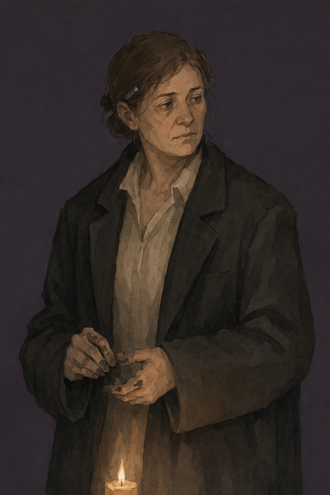

> 👤 **Ondra Vell** · *The Reeve (G11)*
> Late forties, ink on her fingers, wears her father Halvard's old coat, too big for her. Answers a question with a question.
> **Now:** **Not met yet.** Neutral. Has Durrow's account of the collapse and "the hole", and wants the party's.

- **Who:** The Reeve, because nobody else wants the blame. Writes everything down. **[CAMPAIGN]**
- **Wants (this session):** a list of what came out of her quarry, and a quarry that pays wages without Daggerford owning it.
- **Fears:** being *recorded* as the Reeve who lost Greybank.
- **Secret:** the moot chest is **9 gp short**. Surfaces if anyone audits it, Halvard asks, or she opens it publicly.
- **Lines:**
  - *"You're the ones who went in. Sit. Who carried what out? No, slower. I'm writing."*
  - *"The woman at the Cart is paying you. For what? …From under my quarry."*
  - *"I'd rather be removed than bullied. You can try the second one if you like."*
  - *"Is Dov an emergency? Harvest is six weeks away. Ask me again when you know what's coming."*
- **Voice tip:** finish the player's sentence for them, then apologise. Write in the air with one finger while they talk. Never promise anything: say *"I'll put it to the moot"* like it hurts.
- **Fight:** she isn't one.

### Halvard Vell

> 👤 **Halvard Vell** · *Former Reeve, 78*
> Sharp two days in three, lost on the third. Sits by the Moot Hall fire that everyone walks past.
> **Now:** **Not met yet.** Neutral. Desperate to be asked something worth answering.

- **Who:** Ondra's father. Knows more about Greybank than anyone alive. **[CAMPAIGN]**
- **Wants:** to be useful once more. **Fears:** the village finding out he can't tell what day it is.
- **Secret:** he knows Captain Berrick Hone ran once, long ago (WP03 S5). He'll never say it unless he's lost and thinks it's thirty years ago.
- **Lines (sharp day):**
  - **The warning:** *"The tower? Was here before the village. My grandfather's rule: build on the old stone, never cut it. Ninety years. Nobody's broken that rule."*
  - *"I'd not like to see who does."*
  - *"Elves? Fifty years since anyone saw one. That's not the same as fifty years since one saw us."*
- **Lines (lost day, d6 1–2):** *"Is the wolf winter over? Tell Berrick to stop running."* (That's the secret, by accident.)
- **Voice tip:** lean in, totally clear, then drift mid-sentence into another decade **in the same tone**. Grip someone's wrist when you mean it.

### Pell

> 👤 **Pell** · *Fostered girl, 12, Moot Hall*
> Fast, everywhere, carries every message. Says things in the wrong order and gets the important part right by accident.
> **Now:** **Not met yet.** Friendly. Has seen "the lady in the trees" twice.

- **Wants:** a real job. **Fears:** being sent back.
- **Death warning:** **if Pell dies, Ondra goes Hostile forever.** A party using a twelve-year-old as a scout gets noticed.
- **Lines:**
  - *"There's a goblin on the bridge and Denk's got the hook and she's got no knife and she's a she, I think, and she's asking for the Reeve, come ON."*
  - *"There's a lady in the trees by the graves. Not from here. She put her finger on her lips at me."*
  - *"I know a way round by the river nobody uses. I use it."*
- **Voice tip:** talk fast and out of breath. Change topic mid-word. Tug a sleeve.

### Kael Durrow

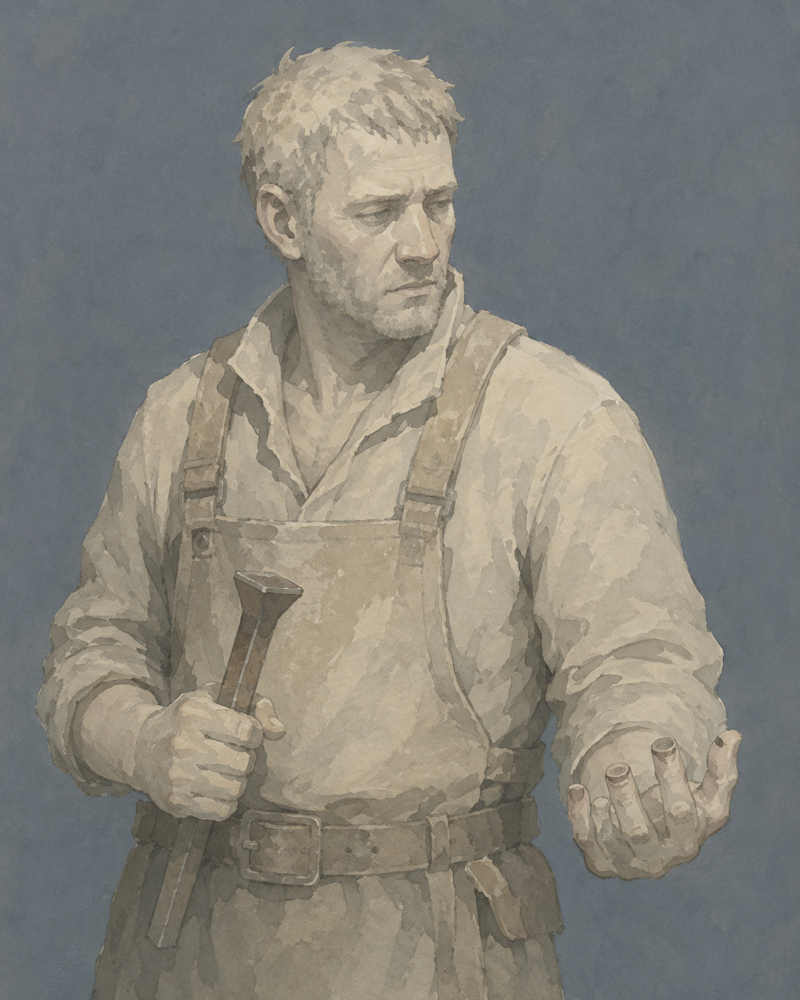

> 👤 **Kael Durrow** · *Quarry foreman (G14)*
> Grey with stone dust, two fingertips missing. Speaks in instructions; long silences he doesn't fill.
> **Now:** **Neutral.** Told the bard his secret on Day 1, gave permission, was **promised a share and hasn't been paid.** Has reported to the Reeve. Heard about the 300 gp.

- **Wants:** to keep cutting so fourteen men get paid through winter. **Fears:** the lowest bench.
- **Secret (half-out):** he went in **ten feet**, not into "a large room". The bard's notes show it. Confronted, he admits it.
- **Lines:**
  - *"You said a share. I heard three hundred. Thirty."* (Once. Never again.)
  - *"Fourteen men. No stone, no pay. No pay, they walk to Daggerford."*
  - *"Ten feet. All right? Ten feet, and the air moved, and I came out. I wanted it shut. Or opened. I don't know what I wanted."*
  - *(Paid)* *"There's a shaft. Comes out on the lowest bench, behind the slabs. Wet. Nobody else knows. Now you do."*
- **Voice tip:** speak in commands even when being nice: *"Sit. Drink. Listen."* Stare at a spot past their shoulder.
- **Stat block:** Quarry Hand (WP07 §5.3) if it ever comes to it; 14 men behind him are the real threat.

### Yorrin Fell

> 👤 **Yorrin Fell** · *Lay-keeper of the shrine. Casts nothing, ever.*
> Sixties, thin, grain-stained hands. Speaks slowly and leaves silences you rush to fill.
> **Now:** **Not met yet.** Neutral. Weeding graves below the tower on Day 3 Morning.

- **Wants:** a real priest sent from anywhere. **Fears:** burying a child with nothing useful to say.
- **Holds:** the shrine's **Potion of Healing** (not for sale; Reeve's consent or theft).
- **Lines:**
  - **The warning:** *"That's older than the village. Older than the wood we put on it. It holds the corner up and it has never asked anything of anybody, so we leave it be."*
  - *"The shrine has the same stone underneath. So does this wall."*
  - *"…"* (a long silence, until the PC says something they meant to keep)
  - *"Dov? Maybe he's an emergency. Ask Ondra. Then ask me again."*
- **Voice tip:** say half as many words as you want to. Then wait. **Count to five in your head before replying to anything.** Players will fill it.

### Ordga Brune

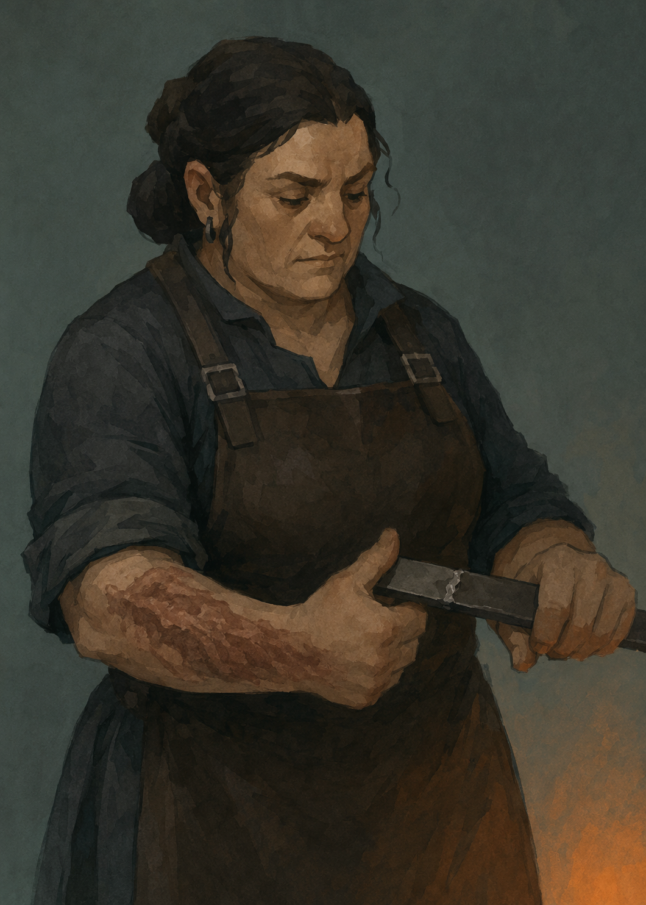

> 👤 **Ordga Brune** · *Dwarf smith (G5)*
> Burn scar up one arm, tests welds with her thumb. Never says "probably."
> **Now:** **Not met yet.** Wary. Furious with Vadd about the charcoal.

- **Wants:** enough bar iron that she never says "not until the cart comes" again. **Fears:** making something that fails and kills someone.
- **Secret:** left Daggerford after someone else's weld killed a man. Never named whose.
- **Lines:**
  - *"No chisel makes that cut. I've said it twice. Tower, shrine, the wall at the graves. Same stone. Somebody should LOOK at it."*
  - *"Rush job? No. Not for gold, not for you, not for the Reeve."*
  - *(Shown an S6 clamp)* *"…I can't make that. Nobody here can. Where did you— no. Don't tell me. Yes. Tell me."*
  - *(To Vadd)* *"Four days. FOUR."*
- **Voice tip:** grunts at the forge, then **suddenly a three-minute lecture on metal** if they ask the right question. Never "probably". Always "will" or "won't".
- **Stat block:** Ordga Brune (WP07 §5.3): dangerous with a hammer up close, defends the forge only.

### Vadd Brune

> 👤 **Vadd Brune** · *Dwarf hauler, Ordga's cousin*
> Young, strong, bored. Agrees with you, then does what he was going to do anyway.
> **Now:** **Wary toward Biggy** (the stolen beer); Neutral to the rest. Charcoal still not fetched.

- **Wants:** to be anywhere else. **Fears:** Ordga finally saying it out loud.
- **Lines:**
  - *"Sure. Yeah. Tomorrow."* (He means never.)
  - *(To Biggy)* *"You owe me a beer. And an apology. Mostly the beer."*
  - *(Recruited for something dodgy)* *"How much? …Don't tell Ordga."*
- **Voice tip:** slouch. Say "yeah" before everything. Eyes on the door.

### Enna Fisk

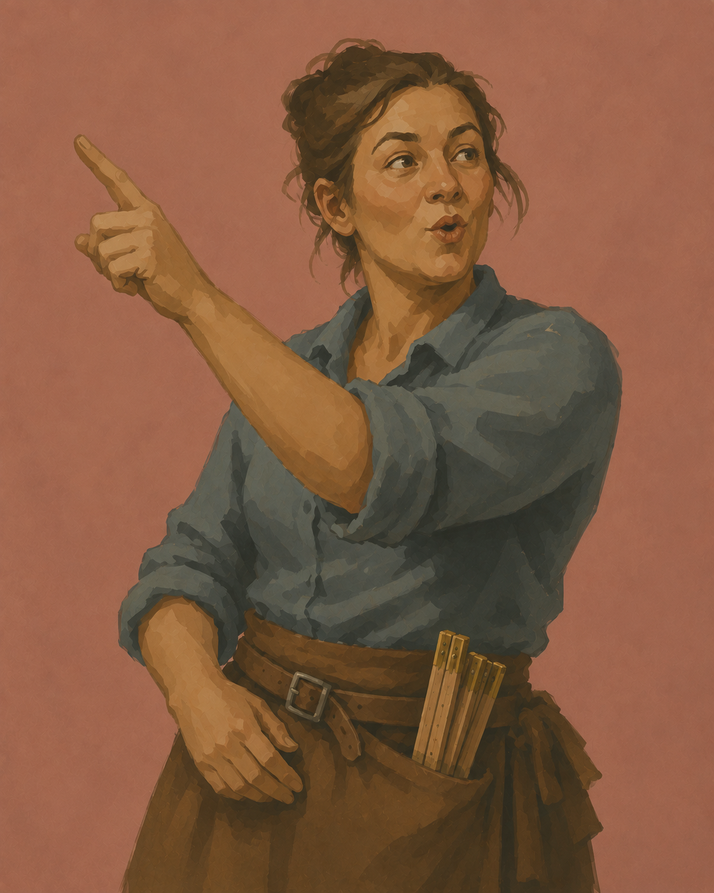

> 👤 **Enna Fisk** · *Wright (H4)*
> Thirties, sawdust in everything, a carpenter's rule in her belt. The only person in Greybank who whistles.
> **Now:** **Not met yet.** Friendly: adventurers mean projects.

- **Wants:** something worth building. **Fears:** a building she made falling on someone. **Load-bearing:** if Enna dies, Greybank has no builder, **ever** (design doc §33).
- **Lines:**
  - *"Bed frame? Two days and planks I haven't got. Ib's got timber."*
  - *"Shore the bench: three days, six men, eight loads. Expand it: you'll want me to shore that too, after."*
  - *(Whistling, to Bar.D.Sync)* *"This? My gran carved it. Not for sale. Play me something I don't know and we'll talk."*
- **Voice tip:** whistle between sentences. Answer every question with a number first.

### Maud Elleth

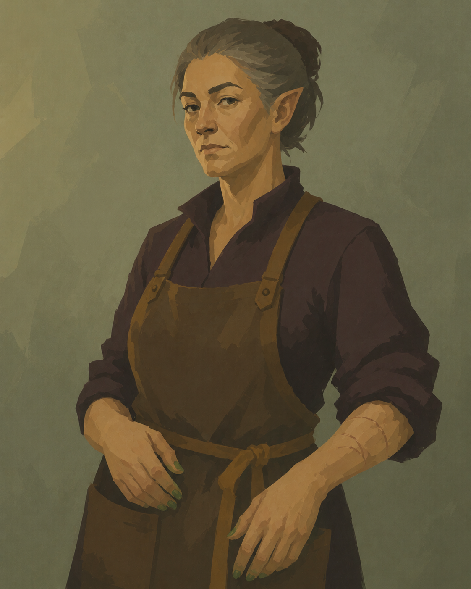

> 👤 **Maud Elleth** · *Herbwife (G22)*
> Half-elf who looks fifty and isn't. Green fingernails. Says "mm" instead of yes.
> **Now:** **Neutral, warmer.** Thanked the party for Dov. 2 healer's kits.

- **Wants:** 110 gp and a stone room for an apothecary. **Fears:** being needed by two people at once.
- **Secret:** she's **ninety-six**, and Secomber is a lie. Connects to nothing, by design.
- **Lines:**
  - *"Mm."*
  - *"That is a bite and that is a knife, and they are not the same night."* (If shown a carcass.)
  - *"Kit's six gold. Or free, for you. Don't need it again so soon."* (Rep +2.)
- **Voice tip:** flat. Clinical questions in a list. **No reaction to the answers.** One "mm" from her is a standing ovation.

### Dov Marrek

> 👤 **Dov Marrek** · *Quarryman, lost a leg at the Pale*
> **Now:** **Alive because of the bard's spell, minus a leg.** Off the militia roll. In Maud's care. *(Attitude not set in play.)*

- **Wants:** to know what he's for now. **Fears:** being the village's charity case.
- **Lines:** *"You're the ones. Thank you. I think. Ask me again when it stops hurting."* · *"Tell Durrow I'm not dead. He'll want the count right."*
- **Voice tip:** jokes that aren't funny, delivered too fast. Grips the blanket.

### Rosal Tunn

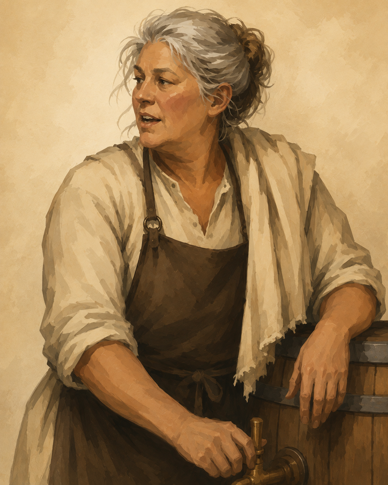

> 👤 **Rosal Tunn** · *Taproom keeper (G3)*
> Sixties, broad, a cloth on one shoulder that never comes off. Talks *at* you while she works and never stops.
> **Now:** **Friendly.** Paid the party's gig in free beds, dinner and 5 cp. Loves a full room, and they fill it.

- **Wants:** a full room every evening. **Fears:** the room emptying.
- **Lines:**
  - *"—and that's when the miller's girl said, well, you know what she said. Anyway there's a man from Daggerford at my window table and he's got a box bigger than my oven, and I don't like a box."*
  - *"You'll play tonight. Same deal. Beds and stew."*
  - *"Start a fight in my room and you'll sleep in the river."*
- **Voice tip:** never stop moving, never stop talking, and **bury the important news in the middle of a story about something else.**

### Bessa Ruddock

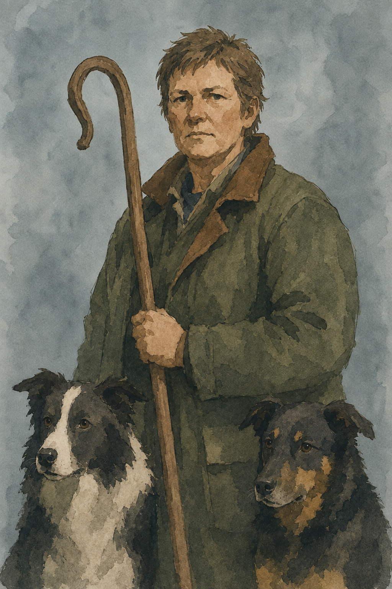

> 👤 **Bessa Ruddock** · *Head shepherd (G18)*
> Fifties, two dogs smarter than the militia. Talks to people like she talks to dogs: short, clear, not unkind.
> **Now:** **Not met yet.** Neutral. Has reported four times and been ignored four times.

- **Wants:** someone to take the fold seriously before it's a story. **Fears:** losing the flock in one night.
- **Lines:**
  - *"Hen. Rope. A fence panel. Three of them. Small. They go THROUGH the wall."*
  - *"Something else goes over it. Every third night. Due tomorrow."*
  - *"Come and look. Or don't. I won't ask again."*
- **Voice tip:** one-to-four-word sentences. Point instead of explaining. **Whistle at the dogs and they drop instantly.** (Players will notice the dogs obey her better than the militia obeys anyone.)

### Nissa Crake

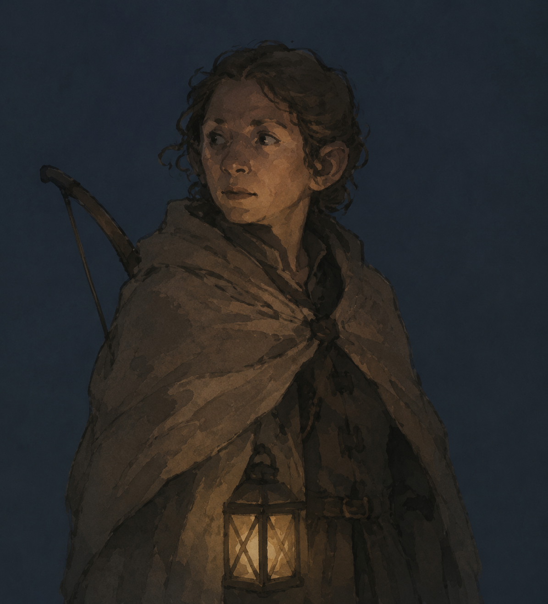

> 👤 **Nissa Crake** · *Halfling bell-warden. She/her.*
> Thirties, always cold, sleeps in her clothes. Asks "did you hear that?" about things nobody heard.
> **Now:** **Friendly for good.** The party believed her about the fold. Bar.D.Sync called her "brother"; she corrected him once and then let it stand.

- **Wants:** to be believed the first time. **Fears:** sleeping through it. One of Greybank's two real shots.
- **Lines:**
  - *"Did you hear that? Last night? You didn't. Nobody did. I did. Three. At the fold."*
  - *(To Bar.D.Sync)* *"Sister. But fine. Brother. You're the only ones who listen."*
  - *"I'll come to you first now. Not them. You."*
- **Voice tip:** whisper. Look over your shoulder. Hug yourself for warmth.
- **Stat block:** Nissa Crake (WP07 §5.3) if she joins a fight; she'd rather ring the bell.

### Old Tarn

> 👤 **Old Tarn** · *Old man, watches the Green all day*
> Sees everything. Reports it wrong. Hates Maud on principle and visits her anyway.
> **Now:** **Friendly, a fan.** Got 1 gp from the bard and now tells everyone it was "a fistful of gold".

- **Wants:** to be right about something, once. **Fears:** being ignored. **Unreliable witness** (WP01 §7.2): useful *because* he's wrong in a pattern: he doubles every number.
- **Lines:**
  - *"Six goblins last night. Big ones. Torches."* (Three. No torches.)
  - *"That cat-girl gave me a fistful of gold. A FISTFUL. Best musicians in the March."*
  - *"Village was never meant to be here. Ask anyone. Nobody'll tell you."*
- **Voice tip:** shout. Exaggerate everything. Point with a cane at the wrong thing.

### Ib Sallow

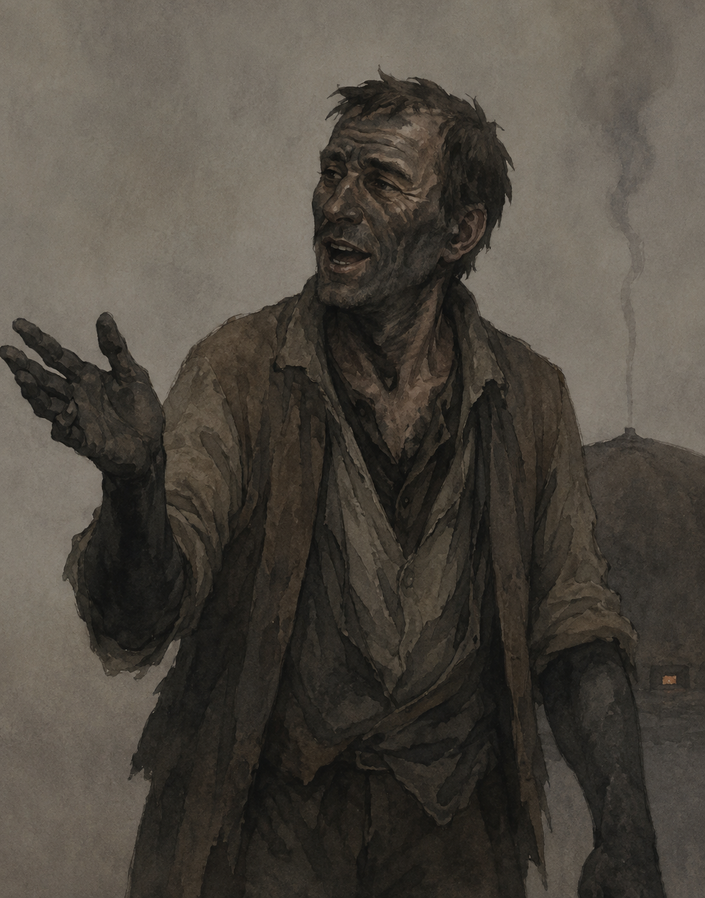

> 👤 **Ib Sallow** · *Charcoal burner, far bank (G20)*
> Forties, black to the elbows, smells of smoke from ten feet. Talks nonstop after days alone.
> **Now:** **Not met yet.** Neutral. Lonely. Has seen an elf, twice this tenday, and nobody believes him.

- **Wants:** company, and never to move into the village. **Fears:** the clamps going out.
- **Lines:**
  - *"People! Real ones! Tea? It tastes of smoke. Everything does."*
  - *"Something walks through here at night. Not a deer. Deer don't stop to look at you."*
  - *"Vadd? He's family to the smith, so he's allowed to be useless."*
  - *"That mark? Hunter's mark. Probably. Appeared yesterday. Probably a hunter."*
- **Voice tip:** do not let the players finish a sentence. Answer questions nobody asked. Wave the pole around.

### Alys Penn

> 👤 **Alys Penn** · *Militia, on tower duty*
> First to every muster; nobody has ever thanked her.
> **Now:** **Not met yet.** Neutral.

- **Lines:** *"Tower's manned Dawn to Evening. After that it's nobody's. Which is stupid."* · *"That smoke? Charcoal burners, probably."* · *(If thanked)* stunned silence, then: *"…Nobody says that."*
- **Voice tip:** bored, then suddenly delighted if anyone is nice. **Thank her: she's an easy Friendly and a night-watch volunteer.**

### Denk Ottersby

> 👤 **Denk Ottersby** · *Ferryman and toll-keeper (G2, on the south bank)*
> Counts your wheels before you reach the bridge. Keeps the crossing book, which has a three-month gap.
> **Now:** **Not met by name.** Neutral. Took their toll on Day 1.

- **Lines:** *"Carts pay, two copper a wheel. People walk free. That one,"* (the goblin) *"I don't know what she counts as."* · *"Book? What gap?"*
- **Voice tip:** count things out loud under your breath.

## 5.2 The elves (Laughing Hollow)

### Vaerelin Ossuine

> 👤 **Vaerelin Ossuine** · *Warden-speaker of the Laughing Hollow*
> A moon elf who has done this a long time. **Total stillness.** Answers the question asked and stops.
> **Now:** **Not met.** Neutral. Has watched the party go in, come out with full packs, and sell what they carried.

- **Who:** speaker for nine wardens. **[CAMPAIGN]** He's seen this happen before and it ended badly.
- **Wants:** the site closed and left closed. **Fears:** being right too late, again.
- **Secret:** he knows everything WP06 knows. **He will never explain below stage 6.** The elves are right about every fact and wrong about one possibility (that people could help hold the line).
- **Lines:**
  - **The warning (once, never repeated):** *"Do not open it further. Do not carry anything out. What you put into the stone, leave in the stone. If you do these things, we will take back what you have taken, from wherever it is."*
  - *"Because I have seen it done before."*
  - *"No. I am telling you what will happen."*
  - *"They were here first, and they left. Ask them why."*
- **Voice tip:** **Do not move.** Literally freeze at the table, hands still, for his whole scene. Long pauses that are not invitations. **Never say the same thing twice**: if asked to repeat, just look at them.
- **Stat block:** Vaerelin (WP07 §7.2). **Two rounds, then gone.**

### Nethra

> 👤 **Nethra** · *Warden-scout. Has watched Greybank for eleven years.*
> Younger than Vaerelin, dressed like someone who lives within sight of humans and never speaks to them. Glances at the tower when she talks.
> **Now:** **Not met, and not meetable yet.** Neutral. **Moves +1 the first time the party keeps a promise to anyone.**

- **This session:** **watch only.** She appears **only at Hollow Rep +2**, and then only to the PC who kept the promise. Pell has seen her. Ib has seen her. The players see **a figure at the treeline that's gone when they look again**.
- **How to earn her (this session):** pay Durrow · send Nakka home safe · sit with Ib for a watch · keep Vaerelin's terms through Day 4 · give the stone cup back to the site.
- **Wants:** to tell Greybank the truth and be allowed to. **Fears:** that Vaerelin is right and she'll get 143 people killed by trusting them.
- **Lines (if she does speak, Rep +2):**
  - *"The one with the ledger is a good Reeve. You should tell her what you told me."*
  - *"You kept your word to the foreman. I saw. I've been keeping count for eleven years."*
  - *"Vaerelin isn't wrong. He's just… only right."*
- **Voice tip:** asks about villagers by description: *"the child who runs"*, *"the man with the dogs' woman"*, then looks embarrassed to know.
- **Stat block:** Nethra (WP07 §7.2). **Won't fight the party.** One round to vanish.

## 5.3 The goblins (Red-Tusk)

### Nakka

> 👤 **Nakka** · *Red-Tusk envoy, sent by Orbal* **[CAMPAIGN]**
> Young, thin, missing two teeth, carries **one knotted cord** from Orbal's bundle as her proof. Careful, slow Common learned from Orbal.
> **Now:** New. **Wary.** Very frightened, and standing still anyway.

- **Who:** Orbal's apprentice in remembering. Chosen because she can talk and because Orbal trusts her not to run. **[CAMPAIGN]**
- **Wants:** to go home with food, or at least go home. **Fears:** being the envoy who started the war.
- **Secret:** she volunteered, over her own mother's objection. Ghesh told her she'd die. She thinks so too.
- **Lines:**
  - *"I am Nakka. Orbal sends me. This is her cord."*
  - *"We are sorry for the hen."*
  - *"Something came at night. It did not hurry."*
  - *"Orbal says there was a promise here once, with the stone-folk. Ghesh says there is no promise. Ghesh says take."*
  - *"What do you ask, for this?"*
- **Voice tip:** speak slowly, every word chosen. **Hold your hands open on the table the entire scene.** Flinch at sudden moves, and then make yourself stop flinching.
- **Stat block:** none. **7 hp, unarmed.** That's the point.

### Orbal the Rememberer

> 👤 **Orbal the Rememberer** · *Keeper of the cords, Red-Tusk*
> Old for a goblin, small, half an ear. Carries the band's entire memory in a bundle of knotted cords.
> **Now:** **Off-stage, at Kettlerock.** Wary. **Sent the envoy over Ghesh's objection.**

- **This session:** **not on stage** unless the party goes to Kettlerock (Scene 9B) or escorts Nakka home. Then she receives them, sitting, with the cords on her knees.
- **Wants:** a bargain that holds. **Fears:** the cords ending with her.
- **Holds:** **the name** that opens the Approach of Names (WP06 §5.3). She doesn't know what it opens; she knows the words.
- **Lines:** *"You came. Tie that knot."* (To Nakka; she ties a knot in a cord to record the visit.) · *"A promise is a thing. You can drop it, but it is still there on the ground."*
- **Voice tip:** treat every promise as a physical object. Mime tying a knot when anything is agreed.

### Ghesh Two-Knife

> 👤 **Ghesh Two-Knife** · *War-leader, Red-Tusk*
> Twenty-nine, lean from giving away his share. Scar across the jaw. Both knives new.
> **Now:** **Off-stage.** Hostile. **Counting.** Every scout that comes back tells him the party's number and reach.

- **This session:** **off-stage.** His words reach the party through Nakka. **His raiders** come on Day 3 Night (Scene 11). Meetable only at Kettlerock (Scene 9B).
- **Wants:** a place before winter, by any means. **Fears:** burying more of the thirty-nine.
- **Lines (at Kettlerock):** *"You are the ones at the fold. I counted you. I counted you."* · *"Food. Then we talk. Food first. Food first."*
- **Voice tip:** says the important part twice. Speaks Common badly *on purpose*.
- **Stat block:** Ghesh (WP07 §6.2).

### Tikk, Brusk and Ozz (the scouts)

> 👤 **Tikk, Brusk and Ozz** · *Red-Tusk scouts* **[CAMPAIGN names]**
> Small, fast, starving. Tikk knows six words of Common, and one is "hungry". Brusk is the archer. Ozz is the youngest and the fastest runner.
> **Now:** New. Hostile at Rep −1, and very much hoping not to be seen.

- **Lines (Tikk):** *"Hungry. Many hungry. Go."* · *"No kill. No kill. Hen."*
- **Stat block:** Red-Tusk Scout ×3 (WP07 §6.2). **Write down who survives** (WP07 §4.5).

## 5.4 Daggerford

### Osric Fenn

> 👤 **Osric Fenn** · *Clerk to Corben Threll, Daggerford trading house* **[CAMPAIGN]**
> Thirty, eager, ink-stained, a strongbox key on a chain round his neck. Restates your position more kindly than you put it, then names a number.
> **Now:** New. Neutral. Strictly business. **Has never been more than two days from Daggerford, and hates it.**

- **Who:** Threll's clerk (WP04 §13.5 says Threll travels with one; this is him, sent ahead alone). **[CAMPAIGN]**
- **Wants:** to go home with a signature. **Fears:** going home without one: Threll is not kind about that.
- **Secret:** Threll told him *"if there's something odd at the quarry, I don't want to hear about it until it's ours."* Fenn will hide anything strange from his own boss if it slows the deal.
- **Lines:**
  - *"You'll be the ones who went under the quarry. Mister Threll would very much like to be your friend."*
  - *"Let's be practical."* (Before every hard clause. Every one.)
  - *"So what you're saying is, you'd love to help the village and you'd love to be paid for it. Wonderful. Twenty gold."*
  - *"A ford you can turn on and off? …Say that again. Slowly."*
- **Voice tip:** smile with every tooth. Rub your hands. Say "Mister Threll" like a prayer.
- **Stat block:** none. **His two guards:** Caravan Guard ×2 (WP07 §8.1). They guard **cargo only**.

### Serina Malk

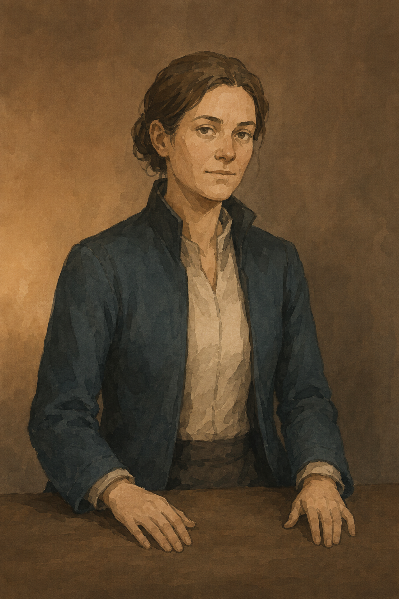

> 👤 **Serina Malk** · *Collector's agent*
> Thirties, travels alone, hands always still and visible. Names one price and lets the silence work.
> **Now:** Neutral, and she never moves. Bought ~30 tablets for ~300 gp. Knows the water-thing is blind. Bar.D.Sync is her main contact. Leaves Day 4 Dawn.

- **Wants:** Illefarn artefacts, authenticated and exclusive. **Fears:** the elves getting there first.
- **Secret:** her employer is a letter. She's never met them and never asked. **Not a mastermind** (WP04 §13.6).
- **Lines:**
  - *"Two hundred. For the basin."* (Silence.)
  - *"You sold them to me. Now they are worth more. That is how it works."*
  - *"Elves? Then we should hurry."*
  - *"It's a cup."* (About the stone cup. She's wrong, and she'll find out.)
- **Voice tip:** **keep your hands flat on the table, still, the whole time.** Never raise your voice. Answer offers with silence and wait.

### Corben Threll (off-stage)

> 👤 **Corben Threll** · *Factor, Daggerford trading house*
> Fifties, good boots badly kept, never walks if he can ride.
> **Now:** **Not met. In Daggerford.** Neutral. Sent Fenn. Comes himself only if told about the ford (WP10).

## 5.5 Dungeon residents

### The Listener

> 👤 **The Listener** · *Blind thing in the water, S8*
> Huge, eyeless, lashing arms. Reads every footstep on dry stone. **Can't feel you if you stand still in running water.**
> **Now:** **Met once, unharmed. Tricked.** Hasn't changed its habits.

- **What it is:** a Deep Ward the site's builders bred (named in the S6 records). **[CAMPAIGN]** Not evil. Hungry and territorial.
- **Lines:** none. **Sounds:** a wet slap on the stair; water draining off something big.
- **Play tip:** describe the **water** moving first, always. It comes up the stair toward the **sound of feet**, not light.
- **Stat block:** The Listener (WP07 §10.2). 97 hp, AC 15, two lashes +7 (2d8+4, grapple DC 15), Drag Under. **Killing it: Instability +1** and Z6 worsens.

### The Sentinel

> 👤 **The Sentinel** · *The Counter. The guard of the line.*
> Tall, stone and something else. Walks at exactly 30 ft. Never hurries, never stops, never talks.
> **Now:** **Not met.** Only its groove was seen. **The door between it and the quarry is open.**

- **What it is:** the line's security system, with an intact order (*turn back what crosses*) and a broken map (*everyone inside is an intruder*). **[CAMPAIGN, on ADAPTED Illefarn foundations]**
- **It cannot be killed at these levels.** Four solutions, none a fight: leave the line, seal it out, get authorised, correct its map.
- **Sounds:** the grind. *One… and another.* Never faster. Never slower.
- **Play tip:** **slow down your own speech when it's in the room.** Count the beats out loud, tapping the table. When it stops at 30 ft, **stop talking**, and let the silence ask the question.
- **Stat block:** The Sentinel (WP07 §11.2). **No hit points.** Under 25 damage does nothing.

## 5.6 The player characters

> ⚠️ **The sheets you shared are all level 3.** The party is **level 4** this session (ruling A8). Each player still needs to add their level-4 hit points, new spells or features, and any ability-score increase or feat. Numbers below are the level-3 sheets.

### Howling Matza

> 👤 **Howling Matza** · *the cat-folk bard*
> Tabaxi bard in half plate, sword in each hand, lute on her back. Street kid from Baldur's Gate who survived the fall of the Absolute. Writing a songbook.

| | |
|---|---|
| **Class** | Bard 3, **College of Valor** · Entertainer · Chaotic Good |
| **Defence** | **AC 17** (half plate: **disadvantage on Stealth**) · **HP 21** · Speed 30 ft, **climb 20 ft** |
| **Attacks** | Two shortswords +5 (1d6+3 / 1d6) · Cat's claws +5 (1d4+3) · Shortbow +5 (1d6+3) |
| **Spells** | Save DC 13, attack +5 · Cantrips: **Mending, Message, Vicious Mockery** · 1st: **Cure Wounds, Healing Word, Dissonant Whispers, Thunderwave** · 2nd: **Shatter, Knock** |
| **Senses, languages** | Darkvision 60 ft · passive Perception 13 · Common, Draconic, Sylvan · Disguise kit, lute |
| **Coin** | **88 gp** (her journal) |

**[CHARACTER SHEET PENDING: level 4: HP, one more spell, ability-score increase or feat]**

- **Hooks this session:**
  - **The Reeve** (her own plan). She holds **Durrow's private story** and **the ten-foot contradiction** in her notes (Scene 4).
  - **The tower.** She already saw the stone matches; Yorrin's warning lands on her first (Scene 3).
  - **Knock is back** after the long rest: the **Lock-keeper's Cell** (Scene 10.2) is the obvious use. Remember Knock is **loud** (audible 300 ft).
  - **Message** beats the Sluice Hall's noise (Scene 10.5). **Shatter** does nothing to the Sentinel (Scene 10.4).
  - **Half plate** means disadvantage when sneaking past the Listener (Scene 10.5).
  - **By Popular Demand:** she can always sing for a bed, which is exactly the deal with Rosal.
  - **The songbook.** Vaerelin doesn't care. **Nethra would**: a song that names Greybank's people kindly is what she's been scoring.

### Bar.D.Sync

> 👤 **Bar.D.Sync** · *Bartholomew D. Sync, halfling musician*
> Lightfoot halfling of the boyband "the Halftones", hunting rare whistles (and his next hit). Technically truthful liar who loves making people reach the wrong conclusion. **Nobody knows what the D stands for**: he gives a different answer every time.

| | |
|---|---|
| **Class** | Bard 3, **College of Lore** · Charlatan (false identity) · Chaotic Neutral |
| **Defence** | **AC 14** (leather) · **HP 24** · Speed 25 ft · Lucky, Brave, Naturally Stealthy |
| **Attacks** | Rapier +5 (1d8+3) · Light crossbow +5 (1d8+3) |
| **Spells** | Save DC 13, attack +5 · Cantrips: **Mage Hand, Vicious Mockery** · 1st: **Silent Image, Disguise Self, Dissonant Whispers, Healing Word, Faerie Fire** · 2nd: **Phantasmal Force** · Cutting Words |
| **Skills, kit** | **Expertise: Deception, Stealth** · Languages: Common, Halfling · **Forgery kit**, disguise kit, instrument |
| **Coin** | +75 gp from the tablets, +5 gp from Serina **[CHARACTER SHEET PENDING: starting purse]** |

**[CHARACTER SHEET PENDING: level 4: HP, one more spell, ability-score increase or feat]**

- **Hooks this session:**
  - **The charcoal man** (Scene 9A): Vadd gave him directions. **The mark on the alder** is waiting.
  - **The footprints** (Scene 9B).
  - **Whistles:** **Enna's bone whistle** (Scene 5). **[LOOT PLACEHOLDER: an S6 "whistle": a jointless stone tube in the stone-shop, a wardens' signal pipe. WP13. Proposed: makes a note goblins and the Listener both react to. Not the Aztec death whistle. Close.]**
  - **The forgery kit** is a live wire with Fenn's contracts and Ondra's papers (Scene 7).
  - **Mage Hand** can pull key B from 30 ft away and drop the S9 leaf: the safest way to seal the Sentinel out (Scene 10.4).
  - **Illusions do nothing to the Sentinel**, and Disguise Self doesn't fool it. They work fine on everyone else.
  - **Serina's contact.** She offers him the price list first. **Any sale: Hollow → 4.**
  - **Nissa:** he called her "brother". She'll correct him once.

### Allino

> 👤 **Allino** · *Allino Vexmoor, human ranger*
> 38, tall, ex-potato farmer living out his dead best friend Gale's dream of adventure. Won a wager with a devil once. **Extremely superstitious.** Judges actions, not words.

| | |
|---|---|
| **Class** | Ranger 3, **Fey Wanderer** (2024 rules) · Farmer · Neutral |
| **Defence** | **AC 14** (leather) · **HP 40** (Tough) · Speed 30 ft |
| **Attacks** | Longbow **+7** (1d8+3, Slow) · Shortsword +5 (1d6+3, Vex) · Dreadful Strikes +1d4 psychic · Savage Attacker |
| **Spells** | Save DC 14, attack +6 · **Hunter's Mark** (Favoured Enemy), **Charm Person, Cure Wounds, Ensnaring Strike, Fog Cloud, Longstrider** |
| **Senses, languages** | **Perception +8, Survival +8 · passive Perception 18** · Common, Draconic, Giant, **Goblin** · carpenter's and leatherworker's tools |
| **Coin** | 41 gp, 51 sp, 61 cp and **4 gems (10 gp each)** on his sheet, **+75 gp** from the tablets |

**[CHARACTER SHEET PENDING: level 4: HP, one more spell, ability-score increase or feat]**

- **Hooks this session:**
  - **He speaks Goblin.** That changes the fold (Scene 1) and the envoy (Scene 8): with him, it's a real conversation, and talking to Nakka in her own tongue counts toward the Compact.
  - **The goblin trail** (Scene 9B): he found the tracks himself on Day 1. **Automatic to the cache.**
  - **The ruins** (Scene 10): his plan. He ran the key test and saw the groove. He's the one most likely to time the Sentinel's turns.
  - **Superstitious:** warm, pulsing stones (Scene 3) and an elf appearing from nowhere (Scene 6) should rattle him. Play it.
  - **Fey Wanderer:** a touch of the Feywild about him. **[CAMPAIGN option]** Vaerelin may look at him a beat longer than the others, and say nothing.
  - **Carpenter's tools:** he can build Biggy's bed with him (Scene 5).
  - **Gale's dream:** adventure, not murder. At the envoy, ask the player: *what would Gale do?*

### Biggy Smalls

> 👤 **Biggy Smalls** · *goliath Rune Knight*
> Huge, grey-skinned, bald, about 7½ ft. Confident, and makes others feel it. On the run from a tyrant at home (or his landlord). Misses his childhood sweetheart. Wants to punch things.

| | |
|---|---|
| **Class** | Fighter 3, **Rune Knight** · Folk Hero · Chaotic Good |
| **Defence** | **AC 16** (chain mail) · **HP 31** · Speed 30 ft · Stone's Endurance (reaction, reduce damage by d12+3) · cold resistance |
| **Attacks** | Glaive +5 (1d10+3) · Greatsword +5 (2d6+3) · Two handaxes +5 (thrown 20/60) · Second Wind, Action Surge, **Interception** |
| **Runes** | **Fire Rune** (tool checks at double proficiency; shackles: +2d6 fire and restrained) · **Cloud Rune** (redirect a hit) · **Giant's Might** (become Large, advantage on Strength, +1d6) |
| **Skills, kit** | Athletics +5, Intimidation +4 · passive Perception 12 · Common, Giant · **smith's tools, carpenter's tools**, shovel, iron pot |
| **Coin** | +75 gp from the tablets **[CHARACTER SHEET PENDING: starting purse]** |

**[CHARACTER SHEET PENDING: level 4: HP, ability-score increase or feat]**

- **Hooks this session:**
  - **Wants to sleep in the tower and build bed frames.** He has the tools for it, and the Fire Rune makes him very good (Scenes 1, 3, 5).
  - **Vadd hates him.** One beer and a sorry fixes it (Scene 5).
  - **Wants to fight the Sentinel.** Scene 10.4 lists exactly what each of his tricks does to it (almost nothing; the Cloud Rune can save a friend once). **Give him the round of grace and the one sentence. Then let him choose.**
  - **The S5 cell door:** with Giant's Might he'll likely force it, and that breaks the bar for good (Scene 10.2). Warn first.
  - **His table sweep:** unidentified S6 objects. Ordga can identify them (Scene 5). **Anything sold: Hollow → 4.**
  - **The crew saw him lift the slab.** At the moot, **the quarry bloc listens to Biggy.**
  - **"Tyrants must not be allowed to oppress the people":** watch him around Threll's claim clauses.

---

# 6. Loot Summary

**"Proposed"** = not priced by WP13 yet. WP13 may change any of it.

## 6.1 What the party already has

| Item | Who | Value | Status |
|---|---|---|---|
| Coin | Howling Matza 88 gp · Allino 41 gp, 51 sp, 61 cp + 4 gems (10 gp each) + 75 gp · Biggy +75 gp · Bar.D.Sync +75 gp, +5 gp from Serina | — | **[CHARACTER SHEET PENDING: Biggy's and Bar.D.Sync's starting purses]** |
| **The stone cup** (from the S2 warden's kit) | The bard (journal: "keep the stone cup") | Serina: **0** ("It's a cup") · **proposed** WP13: it's Illefarn; the Hollow counts it as carried out | Kept |
| S6 tools and trinkets | Bar.D.Sync, Biggy | See Scene 5: gauge 15 gp, clamp 25 gp, warm peg 10 gp (**proposed**) + **[LOOT PLACEHOLDER: rest of Biggy's sweep]** | Unidentified until Ordga sees them |
| **No keys.** Key A in S3, key B in the S9 lock, S11 key untouched | — | Key = 60 gp to Serina (WP13 slice) | In the site |
| The Watch-Glass | **In its socket in S4** | 200 gp to Serina (WP13 slice). Selling it **blinds the party permanently** | In the site |

## 6.2 Everything in this session's scenes

| Where | Item | Value | Status |
|---|---|---|---|
| Scene 1, the fold | Scout gear if killed: shortsword, shortbow, 8 arrows, hide shield, dried mushrooms | standard PHB prices | Only if killed |
| Scene 5, Enna | **Bone whistle** (her gran's) | **proposed** keepsake | Earned by a song, at Enna Friendly |
| Scene 7, Serina | **The Chain tablets** (6, middle third of the sequence) | **proposed** 20 gp each buy-back | With Serina until Day 4 Dawn |
| Scene 7, Fenn | Fenn's "gifts": wool, lamp, good knife | **proposed** ~5 gp each | **[LOOT PLACEHOLDER]** |
| Scene 7, Fenn | 20 gp to "speak warmly" at the moot | 20 gp | A bribe |
| Scene 8, Nakka | **Orbal's single cord** (one strand of the name) | **[LOOT PLACEHOLDER: WP13/WP14]** priceless to the Red-Tusk | Only as a token of a deal |
| Scene 9A, Ib | 2 sacks of charcoal | forge/Cart need | Carry them back |
| Scene 9A, Ib | Trinkets | **[LOOT PLACEHOLDER]** | — |
| Scene 9B, cache | Bessa's rope and fence panel | return = Bessa +1 step | — |
| Scene 9B, cache | Goblin bone toggle | **[LOOT PLACEHOLDER]** | A possession to return (tie-break) |
| Scene 10.2, cell | **Lock-keeper's log tablet** | handout | Hollow: taking it out = carried out |
| Scene 10.2, cell | **Lamp-stone** (dead) | **[LOOT PLACEHOLDER: proposed glows near a lit anchor]** | Illefarn object |
| Scene 10.2, cell | **Warden's stone ring** | **[LOOT PLACEHOLDER: proposed no magic, 30 gp to Serina]** | Illefarn object |
| Scene 10.3, S6 | The remaining archive (racks) | 10 gp a tablet to Serina | **Every one sold: Hollow and Daggerford +1** |
| Scene 10.3, S6 stone-shop | **Stone signal pipe** (for Bar.D.Sync) | **[LOOT PLACEHOLDER: proposed]** | Illefarn object |
| Scene 10.5, S7 | Warden's gate-hook | **[LOOT PLACEHOLDER: proposed]** | Illefarn object |
| Scene 10.6, S11 | **Resonance key (the third)** | 60 gp (WP13 slice) | Stage III. Hollow → 4 if taken after the warning |

> 🎲 **DM.** **Every Illefarn object above is a little bomb.** Carried out after Vaerelin's warning: Hollow → 4. Sold: Hollow +1 and Daggerford +1. Given to Ordga: carried out, not sold. Left inside the site: nothing. Put back where it was found: compliance.

---

# 7. End-of-session Checklist

WP01 §18.3, 10–15 minutes. Tick it at the table.

**Step 1 — Ask every player:** *"What does your character intend to do next?"* Write it down. **That's WP10's opening.**

**Step 2 — The four village variables** (likely changes this session):

| Variable | Start | Likely end | Why |
|---|---:|---|---|
| Food | 4 | **3** | Day 3 Night: two sheep, nobody there (Scene 11). Stays 4 if guarded, flock moved, or bell rang |
| Trade | 3 | **2** | Quarry still stopped at end of Day 3 (WP08 §3.4). **+1 later** if Threll's supply passes (Day 6) |
| Defense | 2 | 2 | No change unless the tower is manned at night (no Defense change: it removes the cap) |
| Unity | 4 | 4 | −1 if an envoy is killed on the Green, a prisoner held 3 days, or the shrine/graves desecrated |

**Step 3 — Reputation:**

| Faction | Start | Moves this session if… |
|---|---:|---|
| Greybank | +2 | −1 refusing Durrow in public / caught lying / bribe exposed |
| Laughing Hollow | +1 | +1 returning an object · −1 attacking a warden, pulling key A |
| Red-Tusk | −1 | +1 talking at the fold / receiving Nakka / food in the cache · +2 escorting her home · −2 killing scouts · → −3 killing her |
| Daggerford | 0 | +1 bribe, buy-back · −1 refusing all offers, stealing from Serina |

**Step 4 — The five clocks:**

| Clock | Start | Likely end | Triggers |
|---|---:|---|---|
| Greybank Reaction | 2 | 2–3 | **3** if nobody tells Ondra what came out by Day 3 Evening, Bessa is hurt, or a PC dies in the site |
| Laughing Hollow | 3 | **2–4** | **2** on compliance · **4** on any sale, new sector, system, object carried out after the warning |
| Red-Tusk | 1 | **3** | → 2 Day 3 Morning (always) · → 3 when Nakka is answered / ignored 2 days |
| Daggerford | 3 | 3–4 | **4** on any sale, or an accepted Threll offer (Day 4 moot) |
| Instability | 1 | 1–2 | +1 only for a forced sluice gate, a badly-run Chain, killing the Listener |

**The Red-Tusk branch count** (WP04 §8.3). Score it at stage 3 and decide **Day 4, off-table**:

| WAR | pts | COMPACT | pts | FLIGHT | pts |
|---|---:|---|---:|---|---:|
| Envoy killed | +3 & lock | Envoy received, both walked away | +2/+3 | Instability ≥4 | +3 |
| Red-Tusk Rep ≤ −2 | +2 | Red-Tusk Rep ≥ 0 | +2 | 6+ fighters lost | +2 |
| Goblins killed, per incident (max 2) | +1 | Food/territory concretely offered | +2 | Defense ≥4 and ring closed | +2 |
| Reprisal raid | +1 | Shared enemy, both know it | +2 | Something from the site they recognise | +2 |
| Nobody offered food/territory | +1 | A goblin life saved | +1 | A viable elsewhere | +1 |
| Reaction ≥4 | +1 | Orbal spoke with Greybank | +1 | No compact offered | +1 |
| Envoy ignored / driven off | +1/+2 | **Unity ≥3 (it's 4)** | **+1** | | |

> 🎲 **DM.** The **starting** count if the party does nothing at all: War **+1** (nobody offered food) · Compact **+1** (Unity 4) **+1** (Ondra turned Nakka away unharmed) · Flight **+1** (no compact). **Compact 2, War 1: a fragile Compact by default**, because Ondra is decent. Ties: WP04 §8.4.

**Step 5 — Threats:** Z4 stays **Incident** (Sign while the Anchor holds, for the beast half). Z5 stays none unless Hollow 4 (then Ib is hurt in session 3).

**Step 6 — NPC changes** (dead / missing / injured / hostile / unavailable). Likely: **Bessa injured?** · **Serina gone (Day 4 Dawn)** · **Fenn in the village until Day 5** · **Nakka: home, captive, or dead** · scouts: who escaped (write names) · attitude changes: Ondra, Durrow, Ordga, Vadd, Bessa, Ib, Yorrin, Enna, Alys.

**Steps 7–9 — The site, stock, snapshot.** Sectors: S5 (cell opened? bar broken?), S7 Discovered?, S9 still open? Systems: 3 Identified? Breaches (S8 drained?). Healer's kits (2, or 1 if Bessa was treated). **Write the dashboard snapshot** in `post-session-state.json` style. **Key A and key B: where are they?** (The single most important line on the sheet.)

**Level:** the party stays **4** this session. WP10 owns 4 → 5 (design doc §19).

---

# 8. Materials Still to Make

## 8.1 Portraits (not in `assets/img/`)

Style: match the existing portraits (`npc-ondra-vell.png` etc.): painted, muted earth palette, head-and-shoulders, plain background, 3:4. **Each built on the one memorable fact.**

| File | Shows | Prompt |
|---|---|---|
| `npc-vaerelin-ossuine.png` | The stillness | *Painted fantasy portrait, 3:4, head and shoulders. A moon elf man, ageless, pale blue-grey skin, long dark hair tied back, weather-worn grey-green hooded cloak, an unstrung longbow over one shoulder. Perfectly still, calm, unreadable eyes looking straight at the viewer. Muted forest palette, overcast light, plain dark background. Grounded, not glamorous.* |
| `npc-nethra.png` | Glancing at the tower | *Painted fantasy portrait, 3:4. A young-looking wood-elf woman scout in plain brown and green leathers, short practical hair, looking slightly off to one side as if at something in the distance, a hint of embarrassment. Muted woodland palette, soft light, plain background.* |
| `npc-nakka.png` | Open hands, one cord | *Painted fantasy portrait, 3:4. A young, thin, half-starved female goblin, two missing teeth, grey-green skin, ragged hide clothes, holding up empty open hands, a single knotted cord tied round one wrist. Frightened but standing firm. Daylight, muted palette, plain background. Sympathetic, not monstrous.* |
| `npc-orbal-the-rememberer.png` | The cords | *Painted fantasy portrait, 3:4. An old, small female goblin with half of one ear missing, wrinkled, wise eyes, a big bundle of knotted cords across her lap and shoulders. Firelight, muted palette. Dignified.* |
| `npc-ghesh-two-knife.png` | New knives, old scar | *Painted fantasy portrait, 3:4. A lean, hungry male goblin warrior of about thirty, a scar across his jaw, two new bright knives at his belt, worn old hide armour. Hard, tired eyes. Muted palette, overcast, plain background. Not a villain: a desperate leader.* |
| `npc-osric-fenn.png` | Ink and the strongbox key | *Painted fantasy portrait, 3:4. A neat young human clerk of about thirty in a good city coat with ink-stained cuffs, a large iron key on a chain round his neck, an eager toothy smile, holding papers. Tavern lamplight, muted palette.* |
| `npc-halvard-vell.png` | The chair by the fire | *Painted portrait, 3:4. A very old human man, 78, thin white hair, sharp but wandering eyes, wrapped in a blanket in a chair by a hearth, gripping the arm of the chair. Warm firelight, muted palette.* |
| `npc-vadd-brune.png` | Bored | *Painted portrait, 3:4. A young, strong dwarf man with a short brown beard, slouching, visibly bored, leaning on a doorframe, eyes on the exit. Smithy background, muted palette.* |
| `npc-old-tarn.png` | Pointing with a cane | *Painted portrait, 3:4. A very old human man on a bench, wild grey eyebrows, pointing excitedly with a walking stick at something off-frame, mouth open mid-shout. Village green, muted palette.* |
| `npc-dov-marrek.png` | One leg, a grin | *Painted portrait, 3:4. A young human quarryman, dusty, lying in a herbwife's cot with a heavily bandaged stump where his lower leg was, forcing a crooked grin. Dim cottage light, muted palette.* |
| `npc-alys-penn.png` | The spear, bored | *Painted portrait, 3:4. A young human village woman in a quilted jerkin holding a spear, leaning in a stone tower doorway, bored, freckled. Muted palette, morning light.* |
| `npc-denk-ottersby.png` | Counting wheels | *Painted portrait, 3:4. A wiry middle-aged human toll-keeper in a hut doorway, holding a boathook, squinting as if counting something. River mist, muted palette.* |
| `npc-the-listener.png` | Blind, in black water | *Dark fantasy painting, 3:4. A huge eyeless aberration rising from black moving water at the bottom of an ancient stone stair, long lashing ropy arms, smooth pale skin, no eyes at all, water streaming off it. Dim lantern light from above. Horror, but grounded.* |
| `npc-the-sentinel.png` | Standing at 30 ft | *Dark fantasy painting, 3:4. A tall faceless construct of seamless pale grey stone, no joints, long arms, standing perfectly still at the far end of a dead-straight ancient stone gallery, slightly tilted as if it barely fits. Dust in a lantern beam. Calm, inevitable, terrifying.* |

## 8.2 Maps

| File | Shows | Prompt / source |
|---|---|---|
| `map-tower-g13.png` | The tower: ground plan, the palm-dip recess, the villager top, ladder, the burial wall below | *Top-down hand-drawn fantasy battle map, the inside and outside of a round stone watchtower on a grassy knoll, 22 ft of seamless ancient stone and a crude wooden top floor, a small palm-sized recess on the inner wall, a graveyard below with a low seamless stone wall. 5-ft grid, parchment style, no text.* |
| `map-illefarn-stage-2.png` | S5 (with the Lock-keeper's Cell), S6, S7, S8 as played (S7 off S8) | Regenerate from `Maps/tools/build_maps.py` with the cell added to S5; **DM copy only** (WP06 §16: no player interior maps) |
| `map-illefarn-stage-3.png` | S9 turning floor, S10 (groove at the midpoint), S11 mouth; the Sentinel's circuit on the DM copy | Same tool. Mark the **120 ft presence range** from the S9 floor reaching the S6 records room |

## 8.3 Handouts

| Handout | What it shows | Prompt |
|---|---|---|
| **The mark on the alder** (`handout-hollow-mark.png`) | A circle with a line through it, six short cuts below, three crossed out, cut into bark | *Close-up photo-real painting of alder bark with a fresh carved symbol: a circle with a diagonal line through it, and beneath it six short vertical notches, three of them crossed out. Pale fresh wood in the cuts. Natural light.* |
| **Vaerelin's warning** (`handout-vaerelin-warning.png`) | *Not paper: he never writes.* A card with his exact words for the DM to hand over **after** he speaks, so players can't misremember | Plain card, elegant hand: the four sentences of the warning. No signature |
| **Threll's contract** (`handout-threll-contract.png`) | Three offers on one sheet, the claim clause in small print at the bottom | *A Daggerford merchant contract on good paper, neat clerk's hand, a red wax seal with a set of scales, three numbered clauses, and a dense paragraph of very small print at the bottom. Slightly ink-blotted.* Text: see Scene 7 |
| **Serina's price list** (`handout-malk-price-list.png`) | Scene 7's table, minus the cup line and the waystone line | *A small neat card in a cultured hand, prices in a column, no letterhead, no name.* |
| **Tablet fragment: the Sentinel register** (`handout-tablet-register.png`) | Cut-name glyphs; a translation strip for after a watch's reading: *"The keeper of the line walks the line. It turns back what is not written."* | *A broken pale stone tablet with fine precise carved glyphs in rows, a diagram of a long straight line with a figure on it. No joints in the stone.* |
| **The lock-keeper's log** (`handout-lockkeeper-log.png`) | Small tablet, last lines: *"Ninth day. It walks the Stage I side now. I have barred the leaf. The others are below. I stay."* | Same style as the register, smaller, cracked, a thumb-worn spot |

## 8.4 Loot cards

One card per proposed item (5:7): **gauge, clamp, warm peg, lamp-stone, stone ring, signal pipe, gate-hook, bone whistle, Orbal's cord, stone cup.** Each card: name, one-line description, "Illefarn object: the elves count it" where true. **Prompt pattern:** *Fantasy item card illustration, centred object on parchment, soft shadow: [item description].*

## 8.5 Session 2 rumour cards

Same format as WP08 §10. **[CAMPAIGN]** Each restates canon from this book.

| Card | Says (to players) | Truth | If ignored |
|---|---|---|---|
| **S2-R1** · "Three of them, at the fold." | Nissa heard it; nobody got up | Scouts, Day 2 Night | Bessa stops reporting |
| **S2-R2** · "There's a goblin on the bridge." | Pell, breathless | Nakka, Day 3 Afternoon | Ondra decides alone |
| **S2-R3** · "A man from Daggerford has a box bigger than Rosal's oven." | Rosal | Fenn and three offers | The supply offer passes at moot |
| **S2-R4** · "There's a lady in the trees by the graves." | Pell | Nethra | Nothing. She keeps watching |
| **S2-R5** · "The Reeve's calling a moot." | Old Tarn ("about the end of the world") | Day 4 Evening: quarry, Threll, goblins | The village decides without the party |
| **S2-R6** · "Ib's seen elves." | Vadd, laughing | True | Nobody believes Ib, again |
| **S2-R7** · "Durrow's telling the crew he's owed." | Rosal | He is: 30 gp | Durrow Wary, quarry bloc cools |
| **S2-R8** · "Something's grinding under the quarry." | Sabel Quist, who won't work the lowest bench | The Sentinel's turns, heard faintly through the rock at the aperture **only at Deep Night** | Nothing, yet |

---

# As played

**Session 2, recorded live on 1 Nov 2026 and ingested the same day.** This part replaces the plan wherever the two differ. The planned scenes above stay as written; a ⚠️ note at the top of each scene points here. In-game times marked *(inferred)* are worked out from the order of events; the DM never gave them. Full text of the rulings: [[Canon Amendments — Session 2 Play]].

> ⚠️ **The party took a different path from the plan.** They fought the fold raid, chased the survivor to Kettlerock, made peace there, went on to the Old Delving, cleared the Kettlerock Gate and explored the north end of the Marrowward. They were away from Greybank for **Day 3**. Greybank's Day 3 scenes (Bessa, Threll's clerk, Nakka, Vaerelin) were not played.

## Chronology

| Record | Real time (1 Nov 2026) | In-game | What happened | Effects |
|---|---|---|---|---|
| R2-002 | 20:23 | Day 2 · Evening | Session 2 opens. The party enters the Sundered Cart (G3) | none |
| R2-013 | 20:27 | Day 2 · Night | **Fold raid.** The party kills two scouts, incapacitates the third and carries him up to the Cart | Red-Tusk Rep −2 (→ −3) · War +1 (one incident) |
| R2-015 | 20:27 | Day 2 · Night *(inferred)* | Cart NPCs see him carried in. Someone will tell the Reeve; the party does not know yet | Reaction trigger (see dashboard) |
| R2-014, R2-003 | 20:23–20:27 | Day 3 · Morning *(inferred)* | The scout flees, wounded. The party chases him about 3 hours (distance overruled) and reaches Kettlerock | Ghesh learns the party's number and reach |
| R2-020 | 20:29 | Day 3 · Morning | The party leaves after the fold scuffle and travels all day, first to Kettlerock, then the Old Delving | Misses Deadlines 2, 3, 5, 6 |
| R2-004, R2-017 | 20:23, 20:27 | Day 3 *(inferred)* | Ghesh comes out, talks, tells the story of the Sentinel. He gives nothing about what is down the ramp | Telegraph level 1 delivered |
| R2-005, R2-019 | 20:23, 20:27 | Day 3 *(inferred)* | Chaos. **Aldracu** fails to intimidate the camp. **Bar.D.Sync's** stone golem illusion scares off the camp's attack. The party runs into the bushes | none scored (no kills) |
| R2-006, R2-007, R2-016, R2-001 | 20:23–20:27, 17:46 | Day 3 *(inferred)* | The party stages a kill of the illusion to win trust. Peace is made; **30 rations** are given. **Orbal accepts the food and the promise to defeat the Sentinel** | Compact +2 (food) · Orbal spoke +1 |
| R2-008, R2-018 | 20:23, 20:27 | Day 3 · evening *(inferred)* | The party goes to the Old Delving and clears the rubble | **S12 Breached for good** · Hollow +1 |
| R2-022 | 20:31 | Day 3 · Night *(inferred)* | Rests outside S12, then spends time inside, and comes out after another half day | long rest |
| R2-009, R2-010 | 20:23 | Day 4 *(inferred)* | Sneaks past the Sentinel in S10 again. Knock opens S13. S14 holds the register. **The Sentinel walks only S9–S12** | S13 Accessible · S14 Discovered |
| R2-011, R2-023, R2-012 | 20:23, 20:31 | Day 4 *(inferred)* | The party goes on to S16, comes out onto Hagsfoot Moor and **kills the Moorgaunt**. They want to carry the body to town | Z4 and Z11 hazards → Stage 1. The hole is still open |

## Dashboard after Session 2

Same layout as §1.5. **Held** means the record does not settle it and the DM must choose (see "Open questions" below).

| Track | Start (§1.5) | End | Why |
|---|---:|---:|---|
| Food | 4 | **4** | The Day 3 Night raid (Scene 11) would be Food −1, but the party made peace with the band that day and nothing says the raid happened. **Held** |
| Trade | 3 | **2** | The quarry is still shut at the end of Day 3 (WP08 §3.4) and no record says it reopened. The rule fires; **confirm** |
| Defense | 2 | **2** | No change. Turnout 10 |
| Unity | 4 | **4** | The scout was never held in the store room, so no prisoner-held-3-days rule |
| Greybank Rep | +2 | **+2** | No change yet. The Moorgaunt's body is not in town |
| Laughing Hollow Rep | +1 | **+1** | No change |
| **Red-Tusk Rep** | −1 | **−3** | Two scouts killed (WP09 §7: −2). The peace at Kettlerock is **not scored**: the files give no number. See "Open questions" |
| Daggerford Rep | 0 | **0** | No change |
| Greybank Reaction | 2 | **3** | WP09 §7: it goes to 3 if nobody tells Ondra what came out of the hole by Day 3 Evening. The party never met her (R2-015) |
| Laughing Hollow Intervention | 3 | **4** | S12 pile cleared: "Hollow +1 minimum" (WP05 Z17). Vaerelin's warning was not given. The elves are at stage 4, *Interference* |
| Red-Tusk Strategic | 1 | **2** | Day 3 Morning, always. It reaches 3 when Nakka is answered or ignored two days. **Held** |
| Daggerford Commercial | 3 | **3** | No sale. The clerk's visit was not played. **Held** |
| Illefarn Instability | 1 | **1** | The S12 breach does not move it. Knock into S13 and the register are not recorded as using a system |

**Infrastructure:** Quarry **Damaged** (shut). Watchtower **Intact, unmanned at night**. Everything else Intact.
**Critical stock:** unchanged. Healer's kits **2**. The 30 rations were the party's own.
**Hazards:** **Z4 Incident → Stage 1. Z11 Stage 2 → Stage 1** (the Moorgaunt is dead; WP07 E16). The hole is still open.

**The site**

| Sector | Was | Now |
|---|---|---|
| S9 | Accessible, open (key B in the lock) | unchanged |
| S10 | Discovered | **Accessible** (crossed by timing the circuit) |
| S12 | Discovered | **Breached (permanent)** |
| S13 | Unknown | **Accessible** (Knock) |
| S14 | Unknown | **Discovered** |
| S15 | Unknown | Unknown (no record). **Held** |
| S16 | Unknown | **Discovered** *(inferred: the party left by it)* |

**Keys:** key A in the S3 recess (W3 lit), key B in the S9 lock. The S11 key is not recorded either way. **Systems:** System 1 Active, System 2 Identified. Whether the party used or identified System 6 (the register) is **not recorded**.

### The Red-Tusk branch count (WP04 §8.3), not yet decided

The branch resolves off-table once the clock reaches stage 3. Score so far:

| WAR | pts | COMPACT | pts | FLIGHT | pts |
|---|---:|---|---:|---|---:|
| Red-Tusk Rep ≤ −2 | +2 *(if Rep stays ≤ −2)* | Food or territory concretely offered | **+2** | none yet | 0 |
| Goblins killed, per incident | **+1** | Orbal spoke with Greybank | **+1** | | |
| Nobody offered food | 0 | Unity ≥ 3 | **+1** | | |
| Envoy ignored or driven off | 0 so far | Shared enemy, both know it (the Sentinel) | +2 *(DM to confirm)* | | |
| | | A goblin life saved (the scout was spared) | +1 *(DM to confirm)* | | |
| | | Rep ≥ 0 | +2 *(only if the peace lifts Rep to 0)* | | |
| | | Envoy received / turned away | open (Nakka) | | |
| **Total** | **1–3** | **Total** | **4 on what is certain; up to 9** | | **0** |

> 🎲 **DM.** On the record as it stands, **Compact leads on the certain points alone (4 against 3).** The Rep call matters most: if the peace lifts Rep to 0 or better, War loses its +2 and Compact gains +2. Ties go to the Ghesh/Orbal argument (WP04 §8.4); Orbal wins it if any human kept a word given to them.

## Open questions for the DM

1. **Red-Tusk Rep after the Kettlerock peace.** The closest rows in WP09 §7 are +1 (food in the cache) and +2 (escorting Nakka home). Options: **+2 (→ −1)**, +1 (→ −2), or hold at −3 until Nakka is answered. Recommended: +2, because the food was given openly to the band at its camp.
2. **Nakka.** Her Day 3 Afternoon visit to the bridge was not played. Does Orbal still send her after the peace? If she does, the default (Ondra receives her and turns her away unharmed) gives Compact +1.
3. **Which scout lived?** Tikk, Brusk or Ozz (WP07 §4.5: "write down who escapes").
4. **Day 3 Night raid and Food.** Did the Red-Tusk raid the farms or the fold after the peace?
5. **The S14 register.** Did the party claim or correct it, or only look? Did they try S15? Did they take the S11 key?
6. **Shared enemy and a goblin life saved.** Count the Sentinel as a shared enemy both sides know? Count the spared scout as a life saved?
7. **Trade and Reaction.** Confirm Trade 3 → 2 and Reaction 2 → 3, or rule otherwise.

## Promises, deals, crimes and evidence still open

| What | Detail |
|---|---|
| **To Orbal** | The party promised to **defeat the Sentinel** *(R2-001)*. It cannot be killed. System 6 *corrected* is the solution that keeps the word |
| **To the Red-Tusk** | Peace, and 30 rations given. The band's price in the Compact branch is food and a place (WP04 C4) |
| **The staged kill** | The band believes a stone golem was killed. It was an illusion. If Ghesh learns that, trust breaks |
| **Durrow** | Still owed 30 gp |
| **Crime and evidence** | Killing goblins outside the ring is **not a crime** (WP07 §17.12). The Reeve will hear that goblins were carried into the Cart. No evidence against the party |
| **Daggerford** | Serina still holds the tablets and leaves Day 4 Dawn by default. Threll's clerk, three contracts and the Day 4 moot are unplayed |

## What each PC now knows

- **Everyone:** the Marrowward has a north gate and the party opened it. Ghesh's story of the Sentinel (what exactly he said is not recorded). The Red-Tusk are starving and now at peace. There is a rubble slope onto Hagsfoot Moor with a cache, and the Moorgaunt is dead. They promised Orbal to defeat the Sentinel.
- **They do not know:** that the Reeve has heard about the goblin at the Cart; that the S12 breach may have been noticed by the Hollow; that the hole in the fence is still open; what the register in S14 does.
- **Resources:** level 4. 30 rations spent. A Knock spell slot spent. HP and purses unchanged from §5.6 (no record).
- **Aldracu** (guest from Session 2): how he joined is not recorded. He failed to intimidate the camp at Kettlerock (R2-005).

---

# Appendix

## A. Design decisions: reviewed and confirmed by the DM (29 Oct 2026, "for now")

| # | Decision | Reason |
|---:|---|---|
| **D1** | **The S6 archive is about a fifth gone, not "depleted".** Racks mostly full. Missing: the middle third of the Deterrent Chain sequence (with Serina). Authorisation forms and Sentinel register remain | Evidence: "racks like books in a library"; bard carried 10, party sold ~30 (B1); live note "may be incomplete depending on which tablets were sold". Keeps WP06 §5.3 route 2 alive; makes the sale cost something specific |
| **D2** | **The Sentinel's circuit is unchanged by the open leaf**; it turns on S9 once per watch at the half-watch mark; its 120 ft presence-sense reaches the S6 records room; with the leaf open it can pursue to the S1 mouth; it never enters S7/S8 | WP06 §11.2 "the Counter", "an open leaf holds nothing", WP07 §11.2 presence-sense and "does not pursue past the perimeter", Canon Amendments §1 (tunnels only below Instability 3) |
| **D3** | **The second S5 door is the Lock-keeper's Cell, part of S5**, holding a lock-bar that wedges the S5 leaf shut regardless of key A. Using the bar is not touching a system | No new sector (sixteen fixed). Gives a harsh-but-fair second seal that doesn't cost W3; forcing the door destroys it (harsh option) |
| **D4** | **Level 4 telegraph = the grind**, audible 10 minutes before each turn, then the round of grace at 30 ft | WP06 §11.2 / WP07 §11.4 levels; Level 3 (groove) already delivered on Day 2 |
| **D5** | **Vaerelin appears the first time a PC heads to the Pale on Day 3**, else on the bridge at dusk, else in the Cart; exact words fixed; "leave key in the stone" | WP04 §5.3 "a time and place of his choosing", §5.5 stage-3 words; A9 |
| **D6** | **Envoy = Nakka**, Day 3 Afternoon, the bridge; carries one of Orbal's cords | WP04 §8.2, WP07 E09 (bridge). Name and cord **[CAMPAIGN]** |
| **D7** | **Threll's agent = Osric Fenn, his clerk**, arrives Day 3 Morning; three offers with claim clauses; a 20 gp "speak warmly" bribe | WP04 §7.3, §13.5 (Threll travels with a clerk); A6 |
| **D8** | **At Hollow 4 the wardens take objects, never key A** | Removing key A darkens W3, which is the opposite of containment; WP04 §5.3 stage 4 "remove artifacts" still bites (objects, Serina's crate) |
| **D9** | **The tower has an anchor recess (palm-dip); no key fits it; it's warm because W1 is alive** | WP02 G13 "WP06 owns what"; Canon Amendments §2 (only S3 is an anchor room in canon: the dip is *not* a key socket) |
| **D10** | **Durrow's share = a tenth, 30 gp**, asked once in private | DM-confirmed default |
| **D11** | **Day 3 Night stage-2 raid: 5 raiders take 2 sheep → Food −1 if unguarded**; Bessa d6 injury roll if alone | WP04 §6.3 stage 2 "livestock at the fold"; WP01 §3.1 major livestock attack; WP01 §17 roll only for meaningful uncertainty |
| **D12** | **Moot on Day 4 Evening** for quarry + Threll + goblins | WP08 §6.2 session-2 row "the session's politics" |
| **D13** | **Nissa is a she**; she corrects Bar.D.Sync once | DM ruling, this conversation |
| **D14** | **Scout names Tikk, Brusk, Ozz**; S2 rumour cards S2-R1 to S2-R8 | WP07 §4.5 "write the survivor's name down" |
| **D15** | **Waystones can be read by touch:** a dead post is cold (W4), a failing post pulses (W1, W2), a key-powered post is steadily warm (W3, since Day 2). **The Watch-Glass does not change**, but anyone who sits and watches it for a few minutes sees the W1 and W2 rings **flicker faintly**: detail that was always there | Lets players see "failing" without a lore dump; fits WP06 §12 (waystones warm as the line wakes). **Confirmed by the DM, 30 Oct 2026** |
| **D16** | **Destroying a waystone sends the Hollow to 4 at once, and it can never drop below 3** | WP04 §5.3 doesn't list it as a trigger; WP01 §6.2 lets destructive acts block reversal. Replaces an earlier "→ 5" that had no canon basis. **Confirmed by the DM, 30 Oct 2026** |
| **D17** | **Killing Vaerelin also sets Hollow Rep to −3** (on top of WP04's clock → 5) | WP04 §13.1 only moves the clock; the DM chose the harsher reading. **Confirmed 30 Oct 2026** |

## B. Changes to upstream canon

| Change | Supersedes | Reason |
|---|---|---|
| **S6 archive: "depleted" → "about a fifth removed; the Chain sequence's middle third is with Serina"** | Canon Amendments §3 last bullet; continuation brief §1 | Session 1 evidence (D1). Ratified into the Canon Amendments, 29 Oct 2026 |
| **S5 gains a sub-room (the Lock-keeper's Cell) with a lock-bar** | Canon Amendments §3 "undefined, WP09 to define" | Defined as asked; no new sector |
| **Proposed amendments the continuation brief §6 asked WP09 to state:** Knock through S4/S5 (already ratified); S7 after S8 (already ratified); S2 kit empty (already ratified); Durrow's "large room" (kept as a lie he admits, D-scene 4); Malk owning part of the S6 archive (D1) | — | Stated explicitly, none silently rewritten |

**Values set that an earlier package deferred to WP09:** the envoy's identity and timing (WP04 §8.2); Threll's agent (A6); the Sentinel/open-leaf consequence (state v6 `pending_WP09`); the S5 door; the skipped stage-2 mark as trace evidence (continuation §3).

## C. Worked examples

**Example A: the cautious party.** They sleep (raid missed), see Bessa at Dawn (Bessa Friendly), hear Yorrin at the tower, give Ondra the honest list (Ondra Friendly), pay Durrow (Durrow Friendly, **Nethra +1**), meet Vaerelin at the Pale and **pull key B and leave it on the S6 bench** (Hollow → 2), receive Nakka and send her home with a pack of food (Compact +3, food offered +2, Red-Tusk Rep 0). Day 3 Night the tower is manned: one sheep lost, no Food change. **End:** Food 4 · Trade 2 · Reaction 2 · Hollow **2** · Red-Tusk **3, Compact leading** · Daggerford 3 · Instability 1 · Greybank +2 · Hollow +1 · Red-Tusk 0 · Daggerford 0. **The Sentinel is sealed behind S9; W3 lit. Four spans.**

**Example B: the greedy party.** They sell Biggy's clamp and gauge to Serina on Day 2 Night (Hollow → 4, Daggerford → 4). Vaerelin's speech on Day 3 is an explanation. They go down, read the records for a watch in the records room with the leaf open: **the grind; they ignore it; the Sentinel stops at 30 ft;** Biggy hits it (posture 3). Biggy goes down in round 2; the others drag him up the ramp; it stops at the mouth. Day 4 Dawn: **the stone cup is gone from the bard's pack.** Nakka was ignored (Day 5: War +1). **End:** Food 3 · Trade 2 · Reaction 3 (a PC carried up bleeding) · Hollow **4** · Red-Tusk 3 (War leading by Ghesh tie-break) · Daggerford **4** · Instability 1 · Hollow Rep +1. **Nothing in the site changed. Everything around it did.**

**Example C: the party that splits.** Allino and Biggy go to the ruins Day 3 Morning (Vaerelin meets them at the Pale). The bards do the Reeve, then Bar.D.Sync goes to Ib (mark found) and the cat-folk bard to the bridge when Pell runs in (Nakka received, taken to the Reeve: Compact +2 +1). Underground, Allino times a turn from the stone-shop, Biggy opens the Lock-keeper's Cell by force (**bar broken**: the second seal option is gone forever). They leave key B in. **End:** Hollow → 4 (opened "further" after the warning) unless they argue the cell counts as S5. **Rule: it counts. A new door is "further."** Red-Tusk 3 Compact · Daggerford 3 · Food 3 (nobody at the fold Day 3 Night).

## D. Edge cases

- **Party split:** run by watch. Vaerelin goes to the ruins group. Nakka goes to whoever Pell reaches. Nobody can be in S7 and hear anyone.
- **Party wipe:** in the site, only the Sentinel can do it. Greybank Reaction +1; Hollow pulls key B and seals S9 (Vaerelin's ward-craft on the aperture, 24 h); replacements from WP03 / cott H22 (WP07 E14).
- **Party ignores this whole book:** see Scene 11 "If they skip all of it." WP10 runs from that dashboard.
- **They pull key A:** W3 dark, 3 of 6, Hollow → 4, Rep −1. **Put back: relit, but the elves already saw.**
- **They destroy a waystone:** WP06 §13. One more after that ends the good ending. **Hollow → 4, and never below 3 again** (D16).
- **They bring Fenn into the ruins:** no villager enters, but Fenn isn't a villager. **He refuses** ("Mister Threll would rather it stayed a rumour"). If dragged: Daggerford → 4 and Threll comes himself.
- **They try to sell to Fenn instead of Serina:** he buys nothing Illefarn. He wants contracts, not stones.
- **A player asks "is the Sentinel killable?":** *"You get the feeling hitting it would be like hitting the quarry."* Then the round of grace does the rest.
- **Nissa / brother:** she corrects once, then lets it stand. It's affectionate.

## E. Final canonical WP09 rules

1. **Session 2 opens Day 2 Evening at the Cart; the fold probe fires Day 2 Night wherever the party is.**
2. **Day 3:** Bessa Dawn · Fenn Morning · Red-Tusk → 2 Morning · Nakka Afternoon · Vaerelin on first approach to the Pale (else dusk on the bridge, else the Cart) · stage-2 raid Night · Serina leaves Day 4 Dawn · moot Day 4 Evening · branch decided Day 4.
3. **Vaerelin's warning:** don't open further, don't carry out, leave in the stone what you put there. **Breaking it, or any sale → Hollow 4. Visible compliance → Hollow 2.**
4. **Hollow stage 4 takes objects, never key A.**
5. **The Sentinel turns on S9 once per watch at the half-watch mark;** with the S9 leaf open, the S6 records room and S9 are in its sector; it can pursue to the S1 mouth; it never enters S7/S8; the grind is audible 10 minutes ahead.
6. **The S6 archive is ~⅕ gone;** the Chain sequence's middle third is with Serina.
7. **The Lock-keeper's Cell** (S5) has a bar that seals the S5 leaf regardless of key A; forcing the door breaks the bar forever.
8. **Durrow is owed 30 gp.** Paying is a kept promise (Nethra +1).
9. **Nakka is the envoy;** WP04 §8.2's table governs; killing her locks War.
10. **Every sale advances Daggerford and the Hollow by 1.**

## F. Completion criterion

*Could a DM run Session 2 from this book alone, for this party, whatever they do?* Later packages must be able to answer from this document:

- Where are keys A and B at the end of Session 2, and what does each position mean?
- What did Vaerelin say, and was it obeyed?
- What happened to Nakka, and what is the branch count?
- Which Threll offer passed at the moot, if any?
- Did anyone meet the Sentinel, and is S9 open or shut?
- Is the S5 lock-bar intact?
- Who owns the Chain tablets?

## G. Handoffs

**To WP10 (Session 3):** inherit as fixed: the branch decision from Part 7's count; the moot result; Serina's tablets reaching Daggerford around Day 5 (translations a few days after); Hollow at 2, 3 or 4 with the theft schedule; the S5/S9 seal state; the party at level 4 → 5. **Yours:** the branch's first consequence, Threll in person if the ford was mentioned, the Sentinel's first full appearance as a set-piece, spate via Corvin Ash.
**To WP13:** price every **[LOOT PLACEHOLDER]** and every "proposed" figure; the stone cup's real nature; Orbal's cord.
**To WP14:** the six handouts in 8.3 and the S2 rumour cards.
**To WP15:** the fourteen portraits and three maps in 8.1–8.2.
**To WP16:** the branch-count table belongs on the dashboard refill sheet; add a "keys A / B / S11" line to the Illefarn block.
**To the guide (G6–G8):** G6 needs reference entries for **Osric Fenn, Nakka**, the **Lock-keeper's Cell**, the **stone cup**; G7 needs Session 2's end-state hooks; G8 must check the new `07-session-two.html` anchors and the new portrait filenames.

## H. Self-check

- [x] Header block; Consumes/Feeds accurate.
- [x] Every consequence is a WP01 state change.
- [x] No new meter, clock, scale or time unit.
- [x] Nothing silently moved: the two changes are listed in B.
- [x] Tags on world claims.
- [x] Three worked examples traced to state.
- [x] Edge cases: split, wipe, ignore.
- [x] Final rules readable alone.
- [x] No fake choices: every deadline fires regardless; nothing relocates to the party.
- [x] No single-check gates: every barrier has two or more routes.
- [x] DM confirmed D1–D14 (29 Oct 2026).
- [x] DM confirmed D15–D17 (30 Oct 2026).
- [ ] **Pending:** character sheets.
